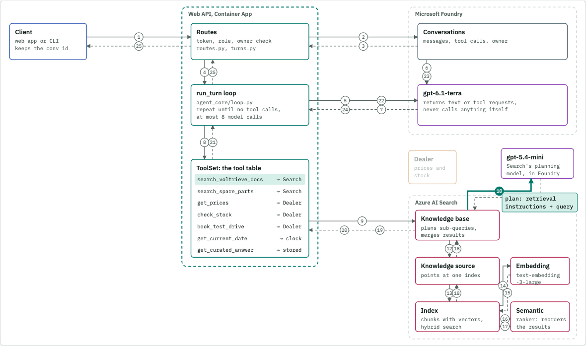
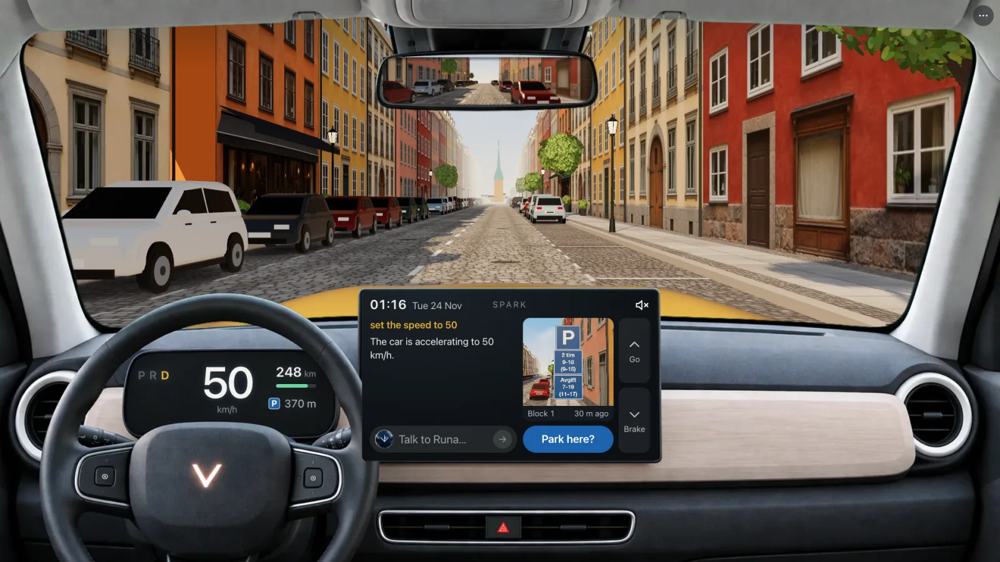
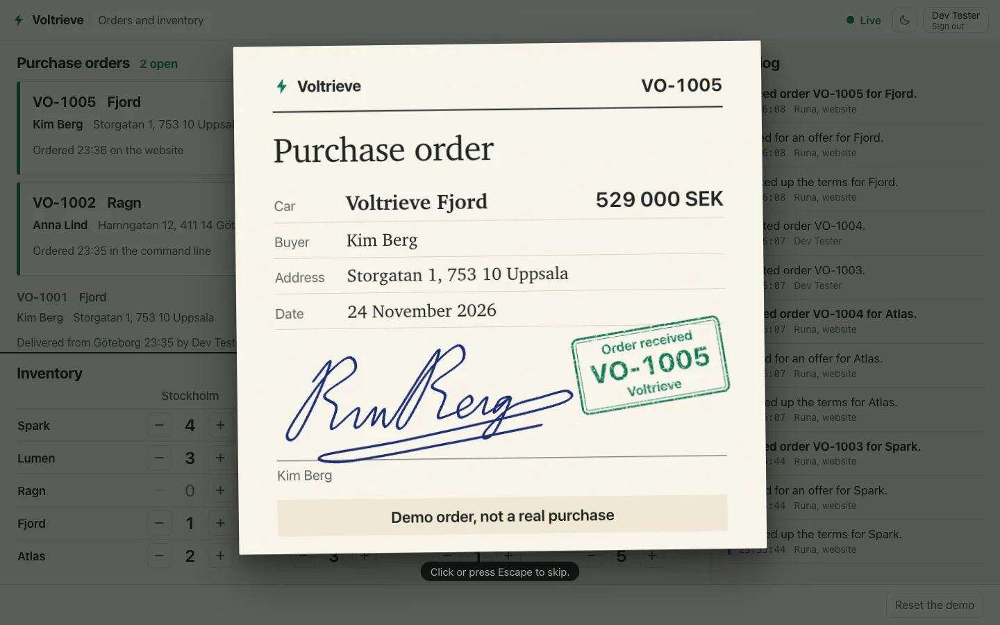
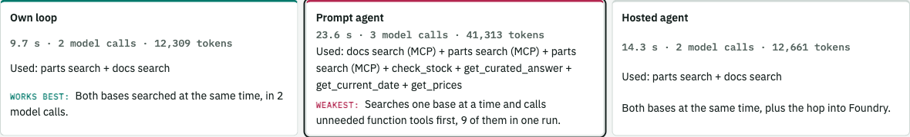
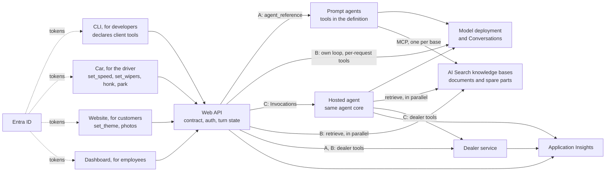

# Voltrieve: agentic RAG on Azure, three ways, with the receipts

[](https://github.com/mklab-se/voltrieve/actions/workflows/tests.yml)
[](https://mklab.se/voltrieve/)


[](LICENSE)

[](https://mklab.se/voltrieve/)

*Meet Voltrieve, a made-up Swedish carmaker with five electric cars, 24 brochures, guides and price lists, and 7 spare parts catalogs. Ask Runa, its AI assistant, which car charges fastest, or which parts a rear brake job needs, and watch three agent architectures find the answer.*

**The same assistant built as an own loop, a Foundry prompt agent and a Foundry hosted agent, deployed side by side and measured with real runs.** See exactly who calls what, where each design wins, and where it fails.

*This repository was called `agentic-rag` until 17 November 2026. Old links redirect here.*

[](https://mklab.se/voltrieve/assets/prompt-journey.html)

Most agent samples stop at "it answers". This one answers the questions you meet in the next meeting:

| The question | The short answer | Read more |
| --- | --- | --- |
| **Why host an agent in Foundry at all?** | For a managed identity, versions and a publishing path. Not for the loop, which is 348 lines of Python. | [Comparison](docs/why-foundry.md) |
| **My client has its own tools. Now what?** | A prompt agent refuses per-request tools with a 400. An own loop or a hosted agent runs them, even one the server has never seen. | [Client tools](docs/why-foundry.md#1-what-happened-with-client-tools) |
| **Can a client send a photo, and where does it go?** | Straight into the model call, as an unstored turn. The conversation keeps the text only. No chat text goes to telemetry since Foundry's tracing was [disconnected](docs/decisions.md#closed-foundrys-tracing-is-disconnected). A new kind of attachment is one handler. | [Photos and attachments](docs/attachments.md) |
| **How does the agent decide to use RAG?** | No classifier exists. The model decides in its first call, from words you control. | [The journey of a prompt](docs/prompt-journey.md) |
| **Can it use several knowledge bases without calling them in vain?** | Yes: all three reached the right bases in every run. Two of them run the searches at the same time. | [Two knowledge bases](docs/why-foundry.md#6-two-knowledge-bases-who-chooses-and-who-runs-them-together) |
| **Which model should I use?** | Newer isn't always better. `gpt-6.1-terra` runs all three backends, with 1 of 48 turns over 10 s to first token on the own loop. `gpt-6-luna` costs about a third of `gpt-5.4-mini`. Search plans its queries with `gpt-5.4-mini`, and `gpt-6-luna` is opt-in (`PLANNING_MODEL_NAME`): the same answers and cheaper planning, but about half a second slower per search. | [Choosing a model](docs/model-comparison.md) |
| **I need curated answers without slowing everything down.** | Pick the answer in the model call you already make, then skip the second one. Curated questions took under 2 s on two of the three, and other questions showed no measurable delay. | [Curated answers](docs/prompt-journey.md#curated-answers) |

## Who it is for: one client for each audience

| Client | Audience | Shows |
| --- | --- | --- |
| [The car](docs/clients.md#the-car) | The driver | The assistant inside the car, with functions you see and hear, and a photo of a road sign |
| [The website](docs/clients.md#the-website) | A signed-in customer | Asking Runa about your own car, with a photo if you have one |
| [The operations dashboard](docs/clients.md#the-operations-dashboard) | Voltrieve employees | What happens in the service: users, times, cost, errors, and what people ask about |
| [The CLI](docs/clients.md#the-cli) | Developers | A test tool for the API, on every backend, with the whole trace |
| [The dealer page](docs/clients.md#the-dealer-page) | A Voltrieve representative | Stock, purchase orders and a live log, with a signing when a customer orders through Runa. In the car the same order is refused |

All five clients are built. [The clients](docs/clients.md) says what each one does, and what has not been run live is marked there.



*The car at 50 km/h. Runa's text comes from a mock server, not from the deployed agents. The car, the street and the sign are made up.*



*The dealer page while an order is signed. Mock data and a made up address, from a mock server.*

## See it: the journey of a prompt

**[Open the interactive journey](https://mklab.se/voltrieve/assets/prompt-journey.html)**, or browse [the documentation site](https://mklab.se/voltrieve/). Pick an architecture and a prompt, then step through every call: who makes it, what it carries and what comes back.

- **Three architectures on one map.** The boxes stay in place and you can watch what moves.
- **Seven real prompts,** from a greeting to a two-base spare parts job and a client-side tool.
- **Detailed RAG.** Follow one question from the agent through the knowledge base, knowledge source, index, embedding model and semantic ranker.

Prefer text? [docs/prompt-journey.md](docs/prompt-journey.md) has the same story as Mermaid diagrams.

## Three architectures compared



| What you care about | Own loop | Prompt agent | Hosted agent |
| --- | --- | --- | --- |
| Everyday question, total time | **1.5 s** | **1.8 s** | 6.5 s, about 5 s slower on every turn |
| Question for two knowledge bases | **7.8 s**, searches run together | 10.9 s, one at a time | 12.8 s, searches run together |
| A client tool the server has never seen | **Works** | Refused | **Works** |
| Curated answer, word for word | **1.5 s** | **1.7 s** | 6.3 s |
| Control over each search | **Full** | Little, it runs inside Foundry's agent run | **Full** |
| Code you own for searching | A client per base | **None, declare an MCP tool** | A client per base |
| Agent identity and versions in Foundry | No | **Yes** | **Yes** |
| Change instructions without shipping code | No | **Yes** | No |

**Which one should you pick?** The own loop when clients bring tools or speed matters. The prompt agent when the tool list is fixed and you want the least code. The hosted agent when you also need an agent identity or a publishing path. Medians come from live runs, and the [evidence](docs/evidence/) is in the repository.

The diagram below is the whole system. The only thing that changes between backends is who makes the calls.



Choose per request with `X-Agent-Backend: prompt|loop|hosted`. Clients can't otherwise tell which one answered, so you can compare them on real traffic.

## What you can reuse

- **A shared agent loop** ([`agent_core/`](agent_core/)): parallel tool calls, roles on tools, schema checks, pause and resume for client tools.
- **Client tools end to end**: a turn that pauses, runs on the user's machine and picks up again, with repair when a client disappears.
- **Photos and attachments** ([`api/app/attachments/`](api/app/attachments/)): a handler for each kind, unstored turns that keep the photo out of the conversation and our telemetry (the text is another matter, see [the privacy limits](docs/attachments.md#what-storefalse-does-not-promise)), and an upload that answers `rejected` instead of failing.
- **Curated answers** ([`curated.py`](agent_core/src/voltrieve_agent/curated.py)): approved text, word for word, with no search on every turn.
- **Status events**: tell users what's happening while they wait, on the stream they already have.
- **Agentic retrieval as code** ([`search/definitions/`](search/definitions/)): knowledge bases, sources, indexes and skillsets, on the latest API version.
- **Keyless Azure**: Entra and managed identities everywhere, deployed with one `azd up`.
- **Routing tests** ([`tests/routing/`](tests/routing/)): prove that the model picks the right source, and catch calls in vain.

## Quick start

The story is Voltrieve, a fictional electric car maker, so all data is generated and safe to share. You need `az`, `azd`, `uv`, Node.js and, on Apple Silicon without Rosetta, Docker. See [docs/deploy.md](docs/deploy.md) for rights, regions and hooks.

```sh
az login && azd auth login
azd env new voltrieve-dev
azd env set AZURE_LOCATION swedencentral
azd up                     # watch for the tester password, printed once
scripts/deploy-web.sh      # only where the SWA CLI cannot run, also `dashboard` and `car`
scripts/deploy-agents.sh
```

Then ask something, on any backend:

```sh
# The CLI reads API_URL, TENANT_ID, CLI_CLIENT_ID and API_CLIENT_ID from the azd environment.
uv run --project clients/cli voltrieve ask "Which Voltrieve charges fastest?" --backend loop --az-token
uv run --project clients/cli voltrieve chat --backend hosted --az-token
```

With [`just`](https://github.com/casey/just) installed, `just chat` does the same on the own loop, and `just chat hosted` picks a backend. `just open` opens the deployed web client, and `just web` runs it locally. `just open-car` and `just car` do the same for the car, `just open-dashboard` and `just dashboard` for the operations dashboard, and `just open-dealer` and `just dealer` for the dealer page. Before a demo, `just warm-up` wakes everything that scales to zero, and `just keep-warm` keeps it awake. Add a gauge in the CLI with `just chat loop --gauge` or `/gauge` in the chat.

The chat shows message bubbles with rendered Markdown and one live status line. Add `--trace` to watch every step, or type `/trace` to see the last turn.

Check it with `uv run scripts/runbook.py` and `uv run tests/grounding/check.py`. Measure routing with `uv run tests/routing/check.py --repeats 1 --no-save`. The walkthrough is in [docs/runbook.md](docs/runbook.md).

Tear down with `azd down --purge`. App registrations and the tester are not removed by azd: [docs/deploy.md](docs/deploy.md#teardown) shows how to delete them.

## Repository layout

| Path | Contents |
| --- | --- |
| `agent_core/` | The shared loop, model client, tools, dealer and knowledge base clients |
| `api/` | The Web API and its three backends |
| `agents/prompt/` | Prompt agent definitions and the rejection demo (backend A) |
| `agents/hosted/` | Hosted agent container and deployment (backend C) |
| `api/app/attachments/` | One handler for each kind of attachment, and the store |
| `clients/car/` | The car, for the driver |
| `clients/web/` | The website, for customers |
| `clients/dashboard/` | The operations dashboard, for employees |
| `clients/cli/` | The CLI, a developer tool |
| `services/dealer/` | The dealer web service, with its order store and the page for representatives (`site/`) |
| `services/insights/` | The job that counts what people ask about |
| `search/` | Definitions and tooling for the Search objects |
| `data/` | The source data file, document generator and generated documents |
| `infra/` | Bicep modules and the Entra setup script |
| `hooks/` | azd hooks |
| `scripts/` | Agent and web deployment, runbook, denied demo, line count |
| `tests/` | Contract tests, the grounding check and the routing suite |
| `docs/` | Principles, comparison, journey of a prompt, runbook, deployment, decisions, evidence, design, screenshots |

## Costs

Idle, about 80 USD a month plus a small amount for Log Analytics (the usage insights add a few MB a year, and their job costs nothing while it does not run; the dealer's table is well under 1 SEK a month, and the dealer stays awake while a dealer page is open, about 0.5 SEK an hour): Search Basic is about 75 USD and Container Registry Basic about 5 USD. Container Apps scale to zero, the three Static Web Apps (website, car and dashboard) are on the Free tier, models bill per token, and the hosted agent bills per active session. A Serverless search service can stand next to Basic. It is off by default. In the dev environment it is on, and Basic was deleted on 2026-11-24, so that environment should idle at about 5 USD a month (not seen on a bill yet). Serverless used about 0.11 USD by the diagnostic metric for a night of test runs, not by an invoice ([Deployment](docs/deploy.md#idle-cost)).

## Status

Deployed and run live on 2026-11-04 and 2026-11-05. Photos, the car, the new website and the newer Search versions were deployed and measured on 2026-11-24.

Run live on 2026-11-24:

- The car, the website and the dashboard in a browser against the deployed API, with a token from the az CLI in place of the sign-in page (`docs/evidence/clients-live.txt`).
- A photo on all three backends: 252 parking questions with no wrong verdict, and 36 of 36 part numbers right for a broken lamp ([Photos and attachments](docs/attachments.md#measured)).
- The car's five tools on all three backends, 18 of 18 (`docs/evidence/car-tools.txt`).
- The three sites are deployed and show their sign-in page (looked at by hand, no evidence file).
- Search on the newest data plane version, on Basic and on Serverless, with two planners: 135 of 135 routing turns right on Serverless (`docs/evidence/search-versions.txt`).

The usage insights were built and run on 2026-11-24, by hand and on made up conversations only. The schedule is off and the notice date is empty, so the job has read no real chat ([the decisions](docs/decisions.md#usage-insights)):

- Labels: 91 of 100 made up conversations had all four labels right, on a gate of 90. Where the person tries to steer the labels it was 3 of 6. The right answers and the prompt have the same author, and a second agent checked the answers (`docs/evidence/insights-labels.txt`).
- Personal details: 108 were planted in 50 conversations. None was found in an intent, or in the 51 group names saved in all runs. The model did not write them, so the filter had nothing to stop.
- The job's own calls: a marker in a conversation that the job read was in no row of any table 16 minutes after the run, and no stored completion was listed (`docs/evidence/insights-acceptance.txt`, section 8).
- Groups: the last run labeled 508 of 514 conversations and saved 36 group rows, 25 of them named. 20 of 20 phrasings of one need became one group, and two planted names, one with a person and one with a street, were replaced (`docs/evidence/insights-acceptance.txt`). Since then the masking takes that street itself, so the check plants a second person and another street. Those two are not verified live. It took 4 minutes and cost 0.08 USD at list price, without the detection of personal data.
- Failing closed: two runs that failed saved nothing. The workbook's query for missing nights ran live for made up data and listed 18 of the last 30 days (section 10).
- The notice is in the deployed files of the website and the car (section 9).
- Access: the job's identity lists and reads conversations on all three backends, and gets 403 when it creates, adds or deletes (`docs/evidence/insights-role.txt`). In Log Analytics it reads its own table, and got 0 rows from the others that were tried.
- Foundry's tracing is disconnected: a marked turn on each backend left no rows in any table 16 and 47 minutes later. Before the change the same check found rows for the prompt and hosted agents (`docs/evidence/tracing-disconnected.txt`). The hosted agent's first text had a p95 of 13.6 s then, over the 10 s limit as before.

Verified live:

- All three backends through the deployed API: every runbook step passes on the final build, including the automated trace check in step 12.
- Grounding: 30 of 30 answers passed.
- The cross-document question "cheapest AWD in Sweden" repeated 6 times per backend: 18 of 18 right. At the default reasoning effort it was 11 to 15 of 18, so the sample uses medium effort.
- A tool the server has never seen, declared only in the request: relayed on loop and hosted, refused on prompt (`docs/evidence/new-client-tool.txt`). The demo declares a car function, `set_seat_heating`.
- Recovery on all three backends: a paused turn nobody answers, and a conversation resumed after the API scaled to zero (`docs/evidence/repair.txt`).
- One trace per turn across API, Foundry, hosted agent and dealer (`docs/evidence/application-insights.txt`), before Foundry's tracing was disconnected. Afterwards one trace joins the API, the hosted agent and the dealer.
- The prompt agent's 400.
- Where a photo turn leaves its text and its photo, on 2026-11-24: the photo nowhere we looked, the text of prompt and hosted turns in Foundry's tracing (`docs/evidence/photos-privacy.txt`). [Foundry's tracing was then disconnected](docs/decisions.md#closed-foundrys-tracing-is-disconnected), and the marked question and client's line of a turn on each backend left no rows in telemetry (`docs/evidence/tracing-disconnected.txt`).
- The authorization denied path, on the loop backend, against real Foundry with a fake token validator.

The dealer system and the orders were run on the deployed service on 2026-11-24 (`docs/evidence/dealer-orders.txt`):

- `scripts/orders_check.py`: 27 of 27 cases on the three backends. Orders go through, nothing is ordered from one message, after a "no" or with the old address, and the car is refused with nothing reaching the dealer service.
- Deliveries (one winner of two at once, 409 the second time and at zero), deletes that leave the stock alone, and a restart that keeps stock and orders.
- The page in a browser, with a token in place of the sign-in page: an order through Runa was signed on the screen.
- An open page kept the service awake for 12 minutes (`docs/evidence/dealer-awake.txt`).
- A marker in an address was found in no table of the workspace.
- The full routing suite on the new instructions, on 2026-11-25 (`docs/evidence/routing.txt`): right sources in 139 of 141 turns, 43 of 43 part numbers on each backend, and the order tool in 6 of 6 order questions and no other. Both misses are parts questions that also searched the documents. Median first text 3.9 s on the prompt agent, 4.7 s on the own loop and 9.1 s on the hosted agent, where 11 of 45 turns were over 10 s.

Not verified, for the dealer system and the orders:

- The sign-in to the dealer page, the `name` claim in a token of the website or the CLI (it is in one of the az CLI), and the demo by hand in two windows.
- The signing in Safari or Firefox (it was looked at in Chromium only) and after a real switch of tabs, and the masking of street addresses on real ones.
- A token of Runa's own identity on the staff routes, other than in tests.

Offline tests pass: `agent_core` 314, `api` 634, `agents/hosted` 56, `search` 67, `services/dealer` 437, `services/dealer/site` 153, `services/insights` 725, `clients/cli` 62, `clients/web` 181, `clients/dashboard` 74, `clients/car` 426, `tests/photos` 229, `tests/contract` 176 and `infra/scripts/entra` 49, plus the 123 of `data/generator` in CI (they need a browser), the Bicep and script checks. Every suite runs in [CI](.github/workflows/tests.yml).

Not verified:

- Sign-in to the car, the website and the dashboard.
- The car in Safari or Firefox, on a slow or Windows computer, and with a screen reader. Whether a person hears the horn and the motor.
- A rollback of the Serverless search service or of the Search versions, and what Serverless costs on an invoice.
- The workbook's check of Foundry's tracing rows.
- The Agent 365 exporter that the hosted agent's platform turns on, and what Foundry keeps for itself.
- The usage insights on real conversations, their schedule, and the switch from `off` to `on`. The job's identity deleting a conversation that exists (it was refused for an id that is not there).
- The job at its caps of 1,000 real and 500 made up conversations. At the measured speed both take about 12 minutes of its 25.
- The queries that take the newest week first (the page and the group names), and the workbook's table of missing nights since the newest night waits for 04:00 UTC: tested, not run live.
- A 403 from `GET /admin/insights` for a user without `Dashboard.View`, and four made up people plus one real: only in tests.
- The page "What people ask" against the deployed API in a browser, the new sentence in the notice seen in a signed in session, a night of the schedule that failed, and a conversation marked `car` or `web`.
- The group names over several nights of real use, the labels on real conversations, and the price of the detection of personal data.
- Reading a small sign in a large photo: [a known limit](docs/attachments.md#the-known-limit).
- A real browser sign-in with `voltrieve login` (its MSAL calls are tested against a fake).
- A real sign-in as the tester.
- Publishing to Teams and Microsoft 365.
- Latency and cold-start figures.

## More

- [Principles: what Voltrieve is for](docs/principles.md)
- [The journey of a prompt](docs/prompt-journey.md)
- [The clients](docs/clients.md)
- [Photos and attachments](docs/attachments.md)
- [Why Foundry: the comparison](docs/why-foundry.md)
- [Demo runbook](docs/runbook.md)
- [Deployment](docs/deploy.md)
- [Decisions and live findings](docs/decisions.md)
- [Evidence](docs/evidence/)
- [Design](docs/superpowers/specs/2026-11-03-voltrieve-agentic-rag-design.md)

## License

[MIT](LICENSE). The cars, documents and images are made up for this demo.
