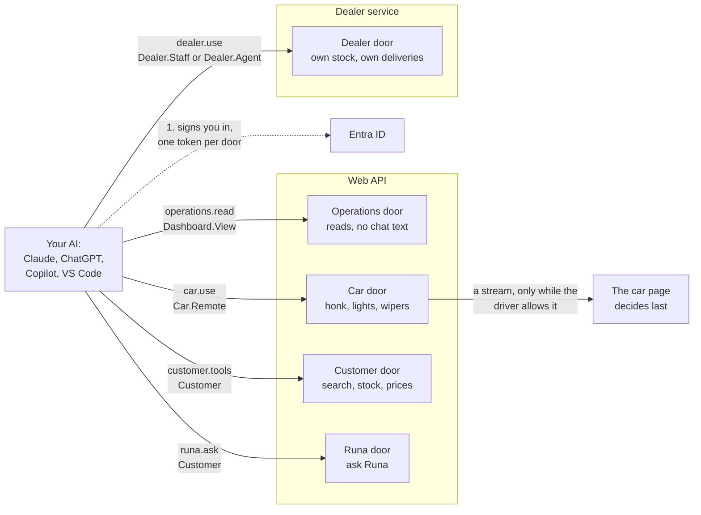

# Bring your own AI

Runa is Voltrieve's own assistant. Many people already have another one: Claude, ChatGPT, Microsoft 365 Copilot or GitHub Copilot. Voltrieve opens doors to them: for operations, the car, dealers and customers, through [MCP](https://modelcontextprotocol.io/) (version 2026-07-28, and older clients work too).

**The same person gets different rights through different doors, whichever AI they bring.**



A token for one door opens nothing else, not even the API it stands in. The design is in [four MCP doors](https://github.com/mklab-se/voltrieve/blob/main/docs/superpowers/specs/2026-11-25-mcp-doors-design.md), and the choices in [Decisions](decisions.md#bring-your-own-ai-four-mcp-doors).

## Build AI in, or open up?

| | Build it in (Runa) | Open up (a door) |
| --- | --- | --- |
| Who pays for the model | Voltrieve | The one who brings the AI, except `ask_runa` |
| Who owns the conversation | Voltrieve | The other AI's company. Voltrieve sees the calls. A question to `ask_runa` is stored like every chat with Runa |
| What the answer looks like | Decided here: instructions, sources, approved texts | Decided there. An approved text may be reworded |
| What can be measured | Whole turns | Calls per door, tool and app |
| Where the user is | On the website, in the car | Where they already work |
| What must be safe | The agent and its tools | Each tool by itself, against any caller |

Build it in when the conversation is the product. Open up when the data or the action is the product, and people already have somewhere to ask. Voltrieve does both, and the customer door exists to compare them.

## The doors

### Operations

For staff with `Dashboard.View`. "How are we doing?", "Which turns were slow today, and why?"

| Tool | Gives |
| --- | --- |
| `service_health` | Turns, errors, time to first text, cold starts and cost per backend |
| `recent_turns` | The latest turns since the service started |
| `problem_turns` | Slow or failed turns |
| `explain_turn` | Every step of one turn, with its time |
| `what_people_ask` | The totals that the dashboard shows |

No chat text and no user leave through it, not even a pseudonym. For raw logs, use [Azure MCP Server](https://learn.microsoft.com/azure/developer/azure-mcp-server/get-started) beside it, with your own Azure rights.

The same model got two questions with each ([evidence](https://github.com/mklab-se/voltrieve/blob/main/docs/evidence/operations-door.txt)). With the door it answered both in 7 and 9 seconds, with about 5,000 and 9,000 tokens, and the numbers agree with a direct query. With Azure MCP Server it answered one, as well and with more detail, and reached the limit of 100,000 tokens on the other. So the door is for the questions that come back, and Azure MCP Server for the ones nobody thought of. It is one run, with a workspace that the model had to find its way in.

### The car

For the owner of a car, with `Car.Remote`. Switch **Remote control** on in the car's menu first. Then "honk", "flash the lights" or "turn the wipers on" from your own AI.

It cannot drive, park or use the camera: those functions are not behind this door at all. The server checks who you are and that the car is parked, and then the car checks again and has the last word. The driver sees what was done and by which app. It is the mirror of [the car rule](decisions.md#the-car-rule-is-in-code-by-the-tokens-azp): nobody orders a car from inside one, and nobody drives one from outside.

### The dealer

For a dealer's staff (`Dealer.Staff`), or a dealer's own agent that runs without a person (`Dealer.Agent`). Both see and change the stock of their own city and see open orders. Only a person can deliver, and the server asks the person for a yes in the middle of the call. Nobody can delete. Which city is yours comes from a list in the service, never from what the AI says. Names and addresses are not shown here: they are on [the dealer page](clients.md#the-dealer-page).

### The customer

For a customer (`Customer`), in two ways that can be compared, each a door of its own. `/mcp/customer` gives search, stock, prices, test drives and the approved answers, and the AI thinks by itself. `/mcp/runa` gives one tool, `ask_runa`, and Runa answers. A car cannot be ordered through a door.

On eight questions the same model did as well with only these tools as Runa did: the right part numbers, none invented, and both approved texts word for word ([evidence](https://github.com/mklab-se/voltrieve/blob/main/docs/evidence/customer-door.txt)). That is one run, with the model that Runa uses. It says that the tools carry what is needed, not that any AI will do as well.

## Connect from your AI

**What every guide needs:** the address of the door (`just mcp` prints them), the client id of the harness's registration (`voltrieve-harness-...`), and a role on the door, which the setup gives to the deployer. No guide uses a secret.

**The addresses.** `https://api.voltrieve.mklab.se/mcp/operations`, `/mcp/car`, `/mcp/customer` and `/mcp/runa`, and `https://dealer.voltrieve.mklab.se/mcp/dealer`. A harness needs an address on a domain that is verified in the tenant, so that the address can be the id of the door.

**Which sign-in server.** Entra ID's ordinary server (`.../v2.0`) does not say that it supports PKCE, and the MCP standard tells a client to refuse such a server. The newer one, `.../oauth21/2026-08`, says so, and also accepts client ID metadata documents. It is a preview. The doors point to it with `MCP_ISSUER`.

**Tried or not.** The steps are from each product's documentation, read on 2026-11-25. Products change, so follow the links.

| Harness | State | What we expect |
| --- | --- | --- |
| A scripted MCP client | [Run live](https://github.com/mklab-se/voltrieve/blob/main/docs/evidence/doors.txt) on 2026-11-25, 98 checks | With a token from the Azure CLI, so not a sign-in |
| Claude (web, desktop) | Not tried | Own client id, no secret: likely, the documentation does not say it for this case |
| Claude Code | Not tried | Own client id, no secret |
| ChatGPT | Works | On 2026-11-26 from the Mac app, the customer door, with our own registration and no secret: search, parts and prices answered. Its own metadata document, which ChatGPT picks by itself, is refused by Entra ID (`AADSTS10051012`), so choose the registration as below |
| GitHub Copilot in VS Code | Not tried | Own client id. Redirect addresses not found on the pages read |
| Copilot Studio | Works | On 2026-11-26, the dealer door: an agent answered with the stock of its city, signed in as the person, with no secret: a federated credential from the connector's managed identity |
| Agent Builder in Microsoft 365 Copilot | Cannot | It does not add an MCP server with OAuth. It says to copy the agent to Copilot Studio |
| Microsoft 365 Copilot, declarative agent | Not tried | A public client on the SPA platform |
| GitHub Copilot cloud agent | Cannot | Its servers cannot use OAuth ([documentation](https://docs.github.com/copilot/concepts/context/mcp)) |

A door sleeps when nobody uses it. The first call takes about half a minute, and an AI may give up: run `just warm-up` first.

### Claude

In **Customize**, **Connectors**, **Add custom connector**: the address, then **Use your own OAuth client** with the client id and no secret. ([Documentation](https://support.claude.com/en/articles/11175166-getting-started-with-custom-connectors-using-remote-mcp))

### Claude Code

```bash
claude mcp add --transport http --client-id <client id> --callback-port 8765 voltrieve-operations https://<host>/mcp/operations
```

Then `/mcp`, choose the server and sign in. ([Documentation](https://code.claude.com/docs/en/mcp))

### ChatGPT

**Plugins**, **Add custom MCP server**, with the address and its path, and **OAuth**. Then open **Advanced OAuth settings**:

| Field | Value |
| --- | --- |
| Registration method | **User-Defined OAuth Client**. Not the metadata document that ChatGPT chooses by itself, which Entra ID refuses |
| OAuth client ID | The client id of `voltrieve-harness-chatgpt` |
| OAuth client secret | Empty |
| Token endpoint auth method | `none` |
| Default scopes | The door's scope, which ChatGPT finds by itself |
| Base scopes | `offline_access` |

**Create as a plugin**, then **Connect**, and sign in. The callback address, `https://chatgpt.com/connector_platform_oauth_redirect`, is already on the registration. The documentation says that custom servers need Business, Enterprise or Edu, and that Pro may read only. ([Documentation](https://developers.openai.com/apps-sdk/deploy/connect-chatgpt), [sign-in](https://developers.openai.com/apps-sdk/build/auth))

### GitHub Copilot in VS Code

In `.mcp.json` at the root of the workspace:

```json
{
  "mcpServers": {
    "voltrieve-operations": {
      "type": "http",
      "url": "https://<host>/mcp/operations",
      "oauthClientId": "<client id>"
    }
  }
}
```

([Documentation](https://code.visualstudio.com/docs/copilot/reference/mcp-configuration))

### Copilot Studio

Without a secret. Copilot Studio needs a confidential web client, and Microsoft's way to avoid its secret is a federated credential from the managed identity of the connector that Copilot Studio makes. The registration is `voltrieve-harness-copilot-studio`, without a secret. Use a Developer or Sandbox environment if the default one blocks custom connectors.

1. In the agent: **Tools**, **Add tool**, **Model Context Protocol**, the door's address, **OAuth 2.0**, **Manual**:

| Field | Value |
| --- | --- |
| Client ID | The client id of `voltrieve-harness-copilot-studio` |
| Client secret | Any placeholder: the managed identity replaces it |
| Authorization URL | `https://login.microsoftonline.com/<tenant>/oauth2/v2.0/authorize` |
| Token URL and Refresh URL | `https://login.microsoftonline.com/<tenant>/oauth2/v2.0/token` |
| Scopes | The door's scope and `offline_access`, such as `https://dealer.voltrieve.example/mcp/dealer/dealer.use offline_access` |

2. **Create**, and add the **Redirect URL** that it shows to the registration as a web redirect.
3. In Power Apps, **Custom connectors**, the new connector, **Security**: identity provider **Azure Active Directory**, **Enable Service Principal support**, **Use managed identity**, the tenant, and the door's address as **Resource URL**. **Update connector**.
4. Add the connector's federated credential (issuer, subject, audience `api://AzureADTokenExchange`) to the registration. The values are on the connector's Security page, and in the connector's `connectionParameterSets` from the Power Apps API.
5. Make the connection in Power Apps, on the connector's **Test** step, with your own click: a sign-in popup only opens from a person's click. In the Copilot Studio wizard it failed with `ParameterNotDefined: Parameter 'token' is not allowed`, since the wizard still held the connector as it was before step 3.
6. In Copilot Studio, **Add tool** again, the connector, the connection that now exists, **Add**.

Copilot Studio does not ask a person in the middle of a call, so `deliver_order` refuses there, and delivering is done on the dealer page.

### Microsoft 365 Copilot

A declarative agent with an MCP plugin. Register the client in the Teams developer portal (**Tools**, **OAuth client registration**) with the client id, PKCE on, no secret, the door's scope and `offline_access`, and use it in the plugin manifest. Entra ID cannot register clients by itself, so dynamic registration does not work. ([Plugin](https://learn.microsoft.com/microsoft-365/copilot/extensibility/build-mcp-plugins), [sign-in](https://learn.microsoft.com/microsoft-365/copilot/extensibility/plugin-authentication-oauth), [requirements](https://learn.microsoft.com/microsoft-365/copilot/extensibility/prerequisites))

## What an AI you bring can do wrong

- **It can be tricked by what it reads.** So the car door has only harmless functions, the dealer door cannot delete, and delivering needs a yes from a person.
- **Marks on a tool are no protection.** "Read only" and "destructive" help a harness decide when to ask. The rules are in the code of the door.
- **It keeps what it got.** Answers land in a chat that Voltrieve does not own, so signed links, names, addresses and chat text are not given.

## Add a door or a tool

The shared part is [`doors/`](https://github.com/mklab-se/voltrieve/tree/main/doors): a guard in front of the MCP SDK, the token check, limits and the log. A tool is an async function with its role and scope:

<!-- source: doors/src/voltrieve_doors/door.py -->
```python
class DoorTool:
    """`fn` is an async function whose parameters become the schema. The rules are checked on every call."""
```

The guard exists because the SDK, used as it comes, writes a caller's own words into spans and logs: the name of an unknown tool, the request id, the text of an error. Its tracing and logging are off, and a test puts a marker in every field that a caller controls.

## Not verified

- A sign-in from any harness, and whether each accepts two doors on one host. It waits for the DNS records of an address of our own.
- An unattended dealer agent with a real managed identity. Only in tests.
- Asking a person in the middle of a call, from a real harness. A scripted client has done it live, with no, cancel and yes.
- Client ID metadata documents, a preview in Entra ID.
