# The clients

Voltrieve has one server and five clients. Each client shows one audience, so someone who watches a demo can tell what it is meant to show. The design is in [the car, the website and attachments](https://github.com/mklab-se/voltrieve/blob/main/docs/superpowers/specs/2026-11-23-car-website-attachments-design.md).

| Client | Audience | Shows | Where |
| --- | --- | --- | --- |
| The car | The driver | The assistant inside the car, with functions you see and hear: speed, wipers, horn, parking, and a photo of a road sign | `clients/car/` |
| The website | A customer who is signed in | Asking Runa about your own car, with a photo if you have one | `clients/web/` |
| The operations dashboard | Voltrieve employees | What happens in the service: users, response times, cost, errors, and what people ask about | `clients/dashboard/` |
| The CLI | Developers | A test tool for the API. It does not stand in for a car | `clients/cli/` |
| The dealer page | A Voltrieve representative | Stock per city, purchase orders and a live log of every call to the dealer service, beside the car or the website | `services/dealer/site/` |

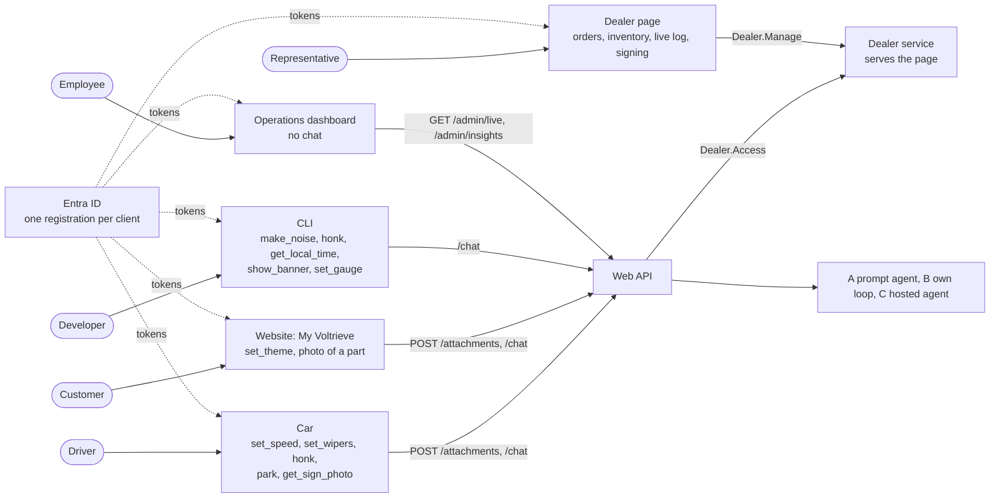

## Status

All five clients are built in this repository: the car, the website, the operations dashboard, the CLI and the dealer page. This page was checked against the code of the car on 2026-11-24. The pictures on it were taken with mock servers, so the answers and the numbers in them are mock data.

Run live on 2026-11-24: the car, the website and the dashboard in a browser against the deployed API, with a token from the az CLI in place of the sign-in page ([`clients-live.txt`](https://github.com/mklab-se/voltrieve/blob/main/docs/evidence/clients-live.txt)). From scripts: photo turns with the car's and the website's context on all three backends ([Photos and attachments](attachments.md#measured)), and the car's five tools on all three backends, 18 of 18. The three sites are deployed and show their sign-in page (looked at by hand).

Not verified:

- the dealer page, the signing and the orders against the deployed service (not run live yet),
- sign-in to the car, the new website and the dashboard,
- the dashboard's page "What people ask" against the deployed API in a browser,
- that the notice's sentence about the nightly job is live in the deployed car and website,
- the car in Safari or Firefox, on a slow or Windows computer, or with a screen reader,
- whether a person hears the horn and the motor.

## What the clients share

- **Sign-in.** Each browser client is a public client with its own app registration (`voltrieve-web`, `voltrieve-car`, `voltrieve-dashboard`, `voltrieve-dealer-site`) and the same delegated scope, `access_as_user`. The CLI has `voltrieve-cli`. Users need the `Chat.User` role. The dashboard needs `Dashboard.View`. See [Deployment](deploy.md).
- **One stream.** All chat clients read the same server-sent events and answer the same `client_tool_calls` through `/chat/tool-results`. The car and the website are copies of one another in their sign-in, stream parser, turn state and answer rendering, with a comment in each that says where its twin lives.
- **Tools run on the client.** A client declares the tools it offers in every request. The API never runs them. What a tool does is decided in the client.
- **Which backend answers.** The header `X-Agent-Backend` picks one of the three. For the prompt agent, the API picks the agent whose tools include every declared one: web, then CLI, then car. No match gives `unsupported_client_tool`.
- **The notice.** The car (in its menu) and the website (under the chat) say the same about the live screen and the stored chat, and then: "A nightly job counts what people ask about. It saves only topics shared by several people, never your chat." The website has one more sentence, since a customer can order a car there: "If you order a car, your name and address are saved with the order in the dealer system." The car has not, because a car cannot order. The job is not on a schedule and has read no real chat. It may read real chats only from the first full UTC day after the notice went live, and that date is not set ([the decision](decisions.md#real-chats-are-read-from-the-first-full-day-after-the-notice)). The car hides its menu below 1280 pixels, as it hides the car.

## The car

The car is the Spark, the city car in saffron yellow. The driver sees a picture of its dashboard from the driver's seat, with a street in 3D behind the windscreen and in the rear view mirror. A typed message stands in for the driver talking. Voice is not built.

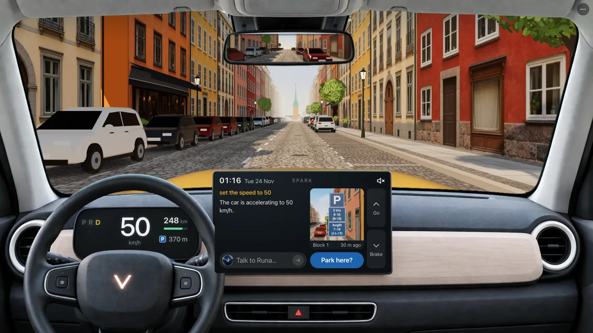

*Driving at 50 km/h. The center screen shows the last sign that was passed. Mock data.*

| Tool | What happens |
| --- | --- |
| `set_speed(kmh)`, 0 to 150 | The car accelerates or brakes to it. From a bay it pulls out first, and finishes that also when it is told to stop |
| `set_wipers(mode)`: off, slow, fast | The wipers move. Slow and fast also start rain |
| `honk(times)`, 1 to 5 | A horn is heard. A browser blocks sound until the first click in the car, and then the tool says so |
| `park()` | The car pulls into the next bay it has room to stop for. The result says when the bay belongs to another block than the sign asked about |
| `get_sign_photo()` | Uploads the last photo of a sign and returns its attachment id with the result |

The driver can do some of it alone: the up and down keys, or the Go and Brake buttons, drive the car, and the speaker button turns the sound of the motor on. Typing anywhere starts a message. The driver display shows gear, speed, range, battery, wipers and the distance to the next sign. Its range and battery are made up.

The street is endless and made of blocks of 400 m. One parking rule holds for a block, and its sign stands at the start, followed by five bays. There are eight signs, and they come in the same order again and again. When the car passes a sign, a second camera takes a close-up of 1024 x 1024 pixels, where the sign fills most of the photo, so the smallest row of text is large enough to read. Above 70 km/h the photo is blurred, and the server rejects it as `too_blurry`. The photos were checked offline with the server's own photo handler: all eight signs were accepted at 50 km/h, and all eight rejected at 90.

"Park here?" sends the last photo with the question "Can I park here?". If the photo cannot be used, the question goes alone. Runa is then expected to ask for the photo with `get_sign_photo`, get the reason and tell the driver. The car keeps its last 10 photos and uploads again when the API has lost one.

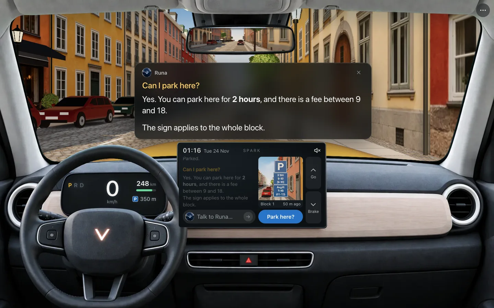

*Parked and asking. The answer is scripted in the mock server and is not a reading of the sign: the real agents read the photo.*

The answer to a question floats above the dashboard in large type, then sinks back into the center screen after 12 quiet seconds, or when the driver closes it or presses Escape. It stays while Runa works, and while the pointer or keyboard focus is in it. When the car has come to another sign, it says that the answer is for the previous block. The car needs a window of at least 1280 pixels wide, and a smaller one gets a message that says so. It was looked at from 1280 x 720 to 2560 x 1440. The clock on the screen can be set to any day and time, and it is sent as the local time in the context, with the car, the odometer and the speed.

| | |
| --- | --- |
| 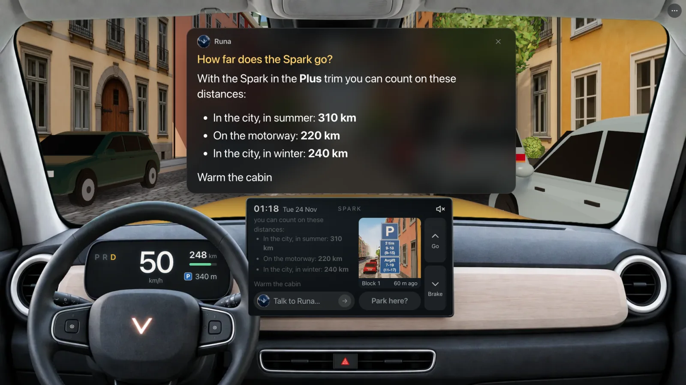 | 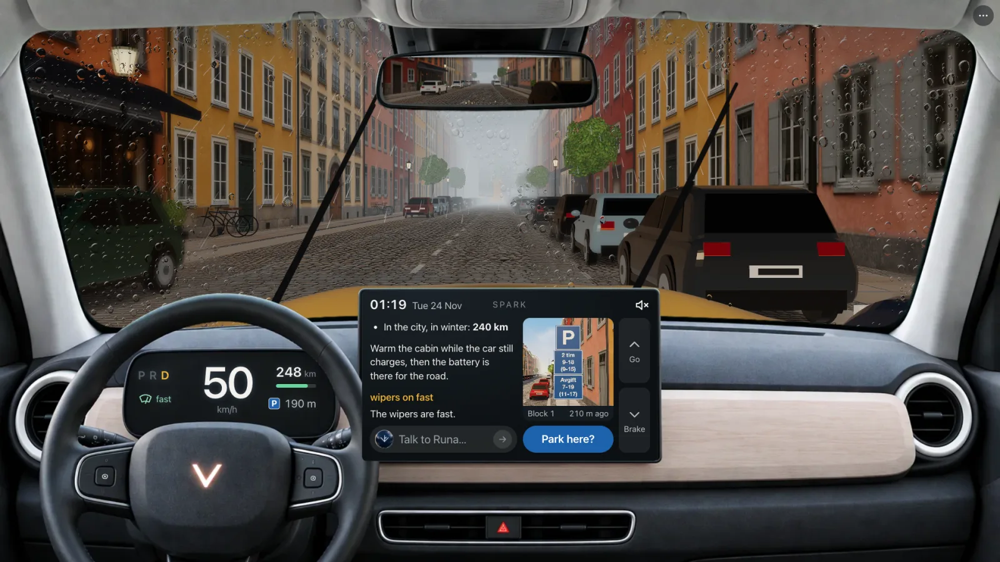 |
| *A long answer while it streams. Mock data.* | *Wipers on fast, and rain. Mock data.* |

The cockpit and five house fronts are generated pictures ([how they were made](https://github.com/mklab-se/voltrieve/blob/main/clients/car/assets/README.md)), and the product owner has not picked them yet. The rest of the street is drawn by code. Without Azure, `npm run mock` and `npm run dev:mock` in `clients/car` run the car against a mock server on port 8789.

**`set_speed` does what it is told.** It is a simulation. A real car must decide for itself what it accepts, whatever the model asks for. See [Decisions](decisions.md#set_speed-does-what-it-is-told).

**Under the hood.** A switch in the menu in the corner, off by default, opens the event timeline and the backend picker beside the car. When it is off, nothing on the screen mentions backends or events. The car starts on the own loop.

## The website

"My Voltrieve" is a customer's page: name, their car with picture, registration, trim, color, odometer and next service, and the chat as "Ask Runa about your car". The car data is made up and lives in the client. It is sent with each message as `context`, so Runa knows which car is meant. Suggested questions are about that car. The customer's Spark is in the Plus trim. A button attaches a photo, with a preview, a remove button and drag and drop.

The gauge, `set_gauge`, the name "Flight Recorder" and the dashboard are not in the website. The website declares only `set_theme`. "Under the hood" works as in the car: timeline, backend picker and correlation id, off by default.

A photo goes with one message. When the message is sent, the photo moves from the field into the message, and the next message has none. If the message fails, the photo and the text come back to the field. Photos are not stored in the conversation, so a follow-up cannot see an earlier photo: the field says to attach it again ([#18](https://github.com/mklab-se/voltrieve/issues/18)).

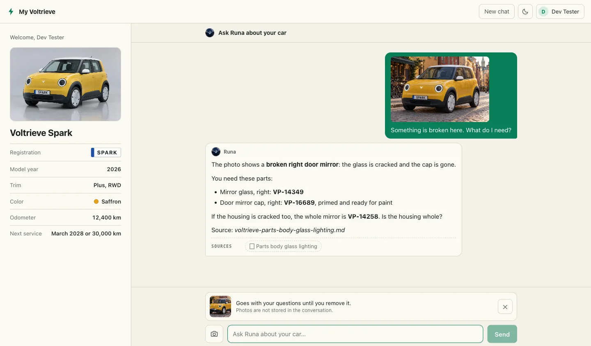

*A photo on the website. The photo is a catalog picture and the answer is scripted in the mock server, so the two do not match. Mock data, and a test user.*

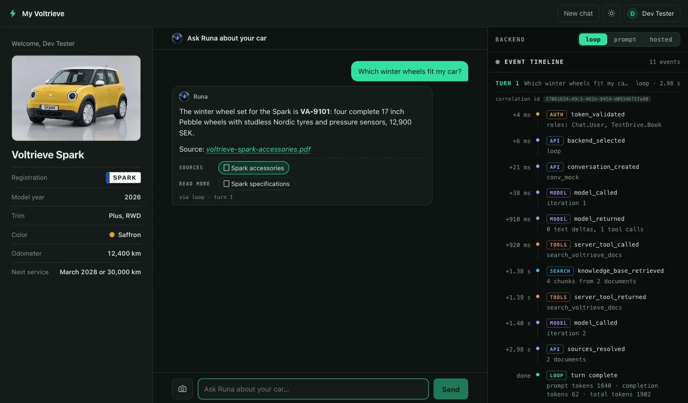

*Under the hood. Mock data. The note under the chat is cut off in both pictures, since its text was corrected afterwards.*

## The operations dashboard

Its own app with its own sign-in. It has two pages, **Live** and **What people ask**, for users with the `Dashboard.View` role. The first shows the live feed and links to Live Metrics and the workbook. See [the runbook](runbook.md#the-operations-dashboard).

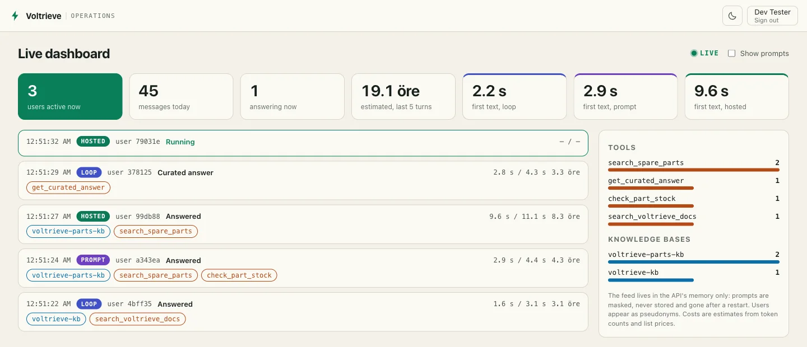

*The live dashboard with mock data: the times and costs are not measurements. The note says "never stored", which was corrected afterwards: the live feed stores nothing, but the chat itself is stored in Foundry's conversation.*

### What people ask

The second page (`#ask`) shows the totals that the [nightly job](runbook.md#usage-insights) saved, from `GET /admin/insights`. It answers what people ask about, what works and what does not, without letting anyone read a chat:

- topics, and inside each its groups, results and what people want, with the share that was answered,
- topics per car model, people per client, and people per week for twelve weeks.

Only topics that at least five people share are there, and counts are rounded to five, so the page says "about 35 people". What is missing has fewer than five people or is held back. **Real** and **Made up** are two views, and they are never added. The page says which one it shows, when the last run was, which week it covers, and the share sampled when that was not everything. When Real has rows to show, it also says when the last run is more than two days old, since nights may be missing. An account that the API refuses (403) is told that it has no access. Real is empty today.

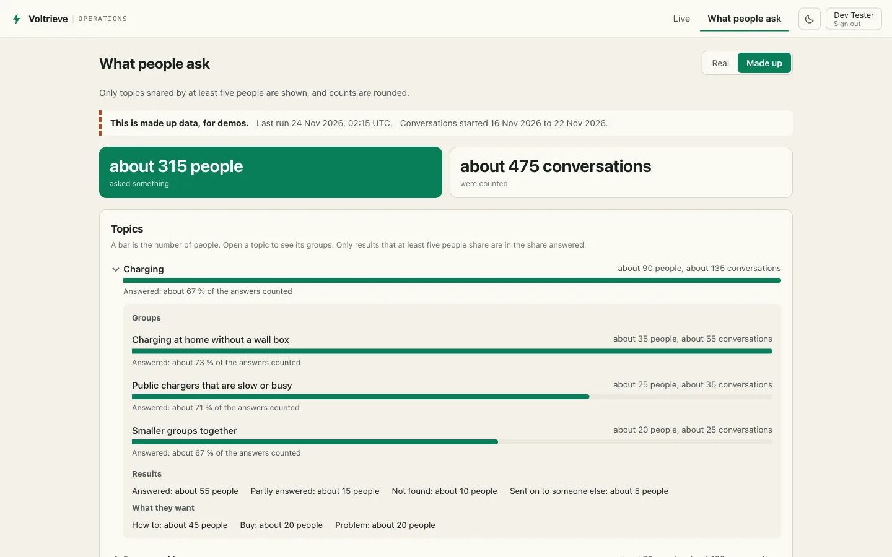

*What people ask, with mock data from `npm run mock` in `clients/dashboard`: the topics and numbers are invented by the mock server, and are no measurement.*

## The CLI

A command line for developers. It declares `make_noise`, `honk`, `get_local_time`, `show_banner` and, when asked, `set_gauge`, runs on every backend and shows the whole trace with `--trace`. Most of the recorded evidence comes from scripts that speak the same contract. It no longer stands in for a car: the car is the car client.

## The dealer page

The page of a Voltrieve representative, for users with the `Dealer.Manage` role. It is not a chat. It is served by the dealer service itself, so it has the address of the service: run `just dealer` to print it, or `azd env get-value DEALER_URL`. It has its own app registration, `voltrieve-dealer-site`, and the scope `manage_as_user` of the dealer. An account without a role cannot sign in at all.

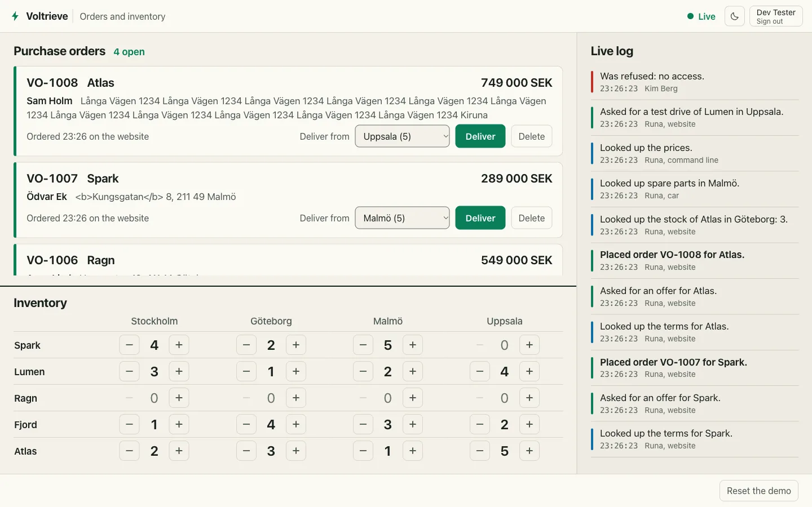

*The dealer page with mock data from a mock server, in a test session. The names, orders and numbers are made up. One address holds markup on purpose, to show that the page prints it as text.*

- **Purchase orders** with number, car, price, the customer's name, the address and the client. **Deliver** lists the cities that have the model, with the count, and starts on the one with the most. With none, it says "None in stock" and comes on by itself when a car is added. A delivery takes one car from the chosen city. **Delete** removes an order and leaves the stock alone. Both ask first.
- **Inventory** per model and city. One click on plus or minus changes the number, never below 0, and the number flashes when Runa or a delivery changes it.
- **The live log** shows every call to the dealer service: stock, parts stock, prices, terms, offers, orders, test drives, refused calls and what staff change. It holds the latest 200 entries, in memory. It names the model, city and order number, and who and from which client. It never holds an address.
- **The signing.** When an order arrives while the page is open, the page dims and a purchase order slides in with a made up signature, a stamp with the number and the words "Demo order, not a real purchase". Then it flies into the list. A click or Escape skips it, and orders that arrive together queue. It never plays for the orders that were there when the page loaded. It waits while the tab is hidden, so it plays when you look again.

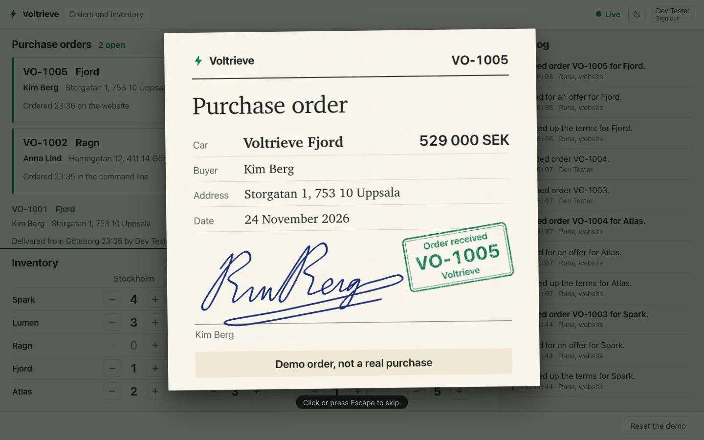

*The signing, with mock data and a made up address. The signature is a scribble that code draws from the name.*

- **Reset the demo** puts the stock back as in the data file and removes orders, offers and the log. Order numbers go on from where they were: they are never used again.
- **Chrome or Edge.** The signing and the layout were looked at in Chromium only. Safari and Firefox are not verified.
- It works from a window 720 pixels wide, so it fits beside the car or the website. It shows a lost connection in the header and connects again by itself. Two representatives can have it open, and both see the same.

**What Runa may do depends on where it is used.** A customer can order a car on the website or in the CLI, never from inside the car. In the car, Runa says: "It is not possible to order a car from within the car. You are welcome to talk with Runa about buying a car on the Voltrieve website." The check is in code and reads the client from the token ([the decision](decisions.md#the-car-rule-is-in-code-by-the-tokens-azp)). Nothing is ordered without a message from the customer after Runa has read the offer back ([the decision](decisions.md#an-order-needs-a-later-message)). Use a made up address: the name on an order is the real name of the account.

Not run live yet: the page, the signing and the orders against the deployed service.
