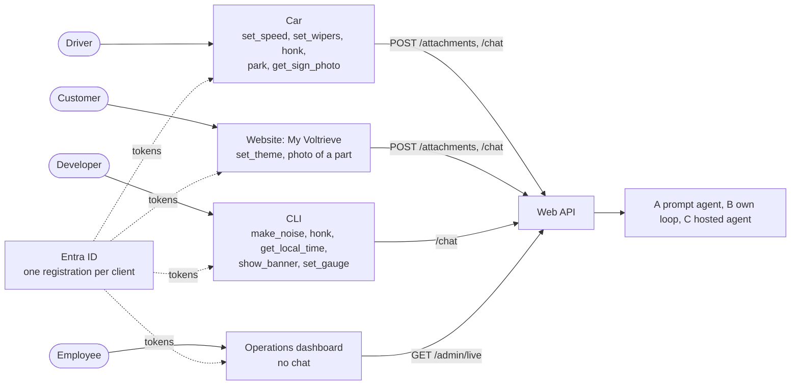

# The clients

Voltrieve has one server and four clients. Each client shows one audience, so someone who watches a demo can tell what it is meant to show. The design is in [the car, the website and attachments](https://github.com/mklab-se/voltrieve/blob/main/docs/superpowers/specs/2026-11-23-car-website-attachments-design.md).

| Client | Audience | Shows | Where |
| --- | --- | --- | --- |
| The car | The driver | The assistant inside the car, with functions you see and hear: speed, wipers, horn, parking, and a photo of a road sign | `clients/car/` |
| The website | A customer who is signed in | Asking Runa about your own car, with a photo if you have one | `clients/web/` |
| The operations dashboard | Voltrieve employees | What happens in the service: users, response times, cost, errors | `clients/dashboard/` |
| The CLI | Developers | A test tool for the API. It does not stand in for a car | `clients/cli/` |

<!-- MEASURE: screenshots of the car and the website, and a short recording of the car, go here -->

## Status

All four clients are built in this repository: the car, the website, the operations dashboard and the CLI. This page was checked against the design. What has run live is listed below as it is measured.

<!-- MEASURE: what has run live for each client (sign-in, a photo turn, the car's five tools on three backends), and what is not verified -->

## What the clients share

- **Sign-in.** Each browser client is a public client with its own app registration (`voltrieve-web`, `voltrieve-car`, `voltrieve-dashboard`) and the same delegated scope, `access_as_user`. The CLI has `voltrieve-cli`. Users need the `Chat.User` role. The dashboard needs `Dashboard.View`. See [Deployment](deploy.md).
- **One stream.** All chat clients read the same server-sent events and answer the same `client_tool_calls` through `/chat/tool-results`. The car and the website are copies of one another in their sign-in, stream parser, turn state and answer rendering, with a comment in each that says where its twin lives.
- **Tools run on the client.** A client declares the tools it offers in every request. The API never runs them. What a tool does is decided in the client.
- **Which backend answers.** The header `X-Agent-Backend` picks one of the three. For the prompt agent, the API picks the agent whose tools include every declared one: web, then CLI, then car. No match gives `unsupported_client_tool`.

## The car

The car is the Spark, the city car in saffron yellow. The driver sees a picture of its dashboard from the driver's seat, with a street in 3D behind the windscreen. A typed message stands in for the driver talking. Voice is not built.

| Tool | What happens |
| --- | --- |
| `set_speed(kmh)`, 0 to 150 | The car accelerates or brakes to it. From a bay it pulls out first |
| `set_wipers(mode)`: off, slow, fast | The wipers move. Slow and fast also start light rain |
| `honk(times)`, 1 to 5 | A horn is heard |
| `park()` | The car pulls into the next bay and stops. Runa says so if the bay belongs to another parking block than the last answer |
| `get_sign_photo()` | Uploads the last photo of a sign and returns its attachment id with the result |

The street is made of blocks. One parking rule holds for a block, and its sign stands at the start. When the car passes a sign, a second camera takes a close-up, so the smallest row of text is large enough to read. Above 70 km/h the photo is blurred, the server rejects it as `too_blurry`, and Runa asks the driver to slow down. The button "Park here?" sends the last photo with the question.

The answer to a question floats above the dashboard in large type, then sinks back into the center screen after 12 quiet seconds or when the driver presses Escape. It stays while the pointer or keyboard focus is in it. The layout keeps its proportions from 1280 to 2560 pixels wide, and a smaller screen gets a message that asks for a larger one. The clock on the screen can be set to any day and time, and it is sent as the local time in the context.

**`set_speed` does what it is told.** It is a simulation. A real car must decide for itself what it accepts, whatever the model asks for. See [Decisions](decisions.md#set_speed-does-what-it-is-told).

**Under the hood.** A switch, off by default, opens the event timeline and the backend picker beside the car. When it is off, nothing on the screen mentions backends or events.

## The website

"My Voltrieve" is a customer's page: name, their car with picture, registration, trim, color, odometer and next service, and the chat as "Ask Runa about your car". The car data is made up and lives in the client. It is sent with each message as `context`, so Runa knows which car is meant. Suggested questions are about that car. The customer's Spark is in the Plus trim. A button attaches a photo, with a preview, a remove button and drag and drop.

The gauge, `set_gauge`, the name "Flight Recorder" and the dashboard are not in the website. The website declares only `set_theme`. "Under the hood" works as in the car: timeline, backend picker and correlation id, off by default.

## The operations dashboard

Its own app with its own sign-in. It shows the live feed and links to Live Metrics and the workbook, for users with the `Dashboard.View` role. See [the runbook](runbook.md#the-operations-dashboard).

## The CLI

A command line for developers. It declares `make_noise`, `honk`, `get_local_time`, `show_banner` and, when asked, `set_gauge`, runs on every backend and shows the whole trace with `--trace`. Most of the recorded evidence comes from scripts that speak the same contract. It no longer stands in for a car: the car is the car client.
