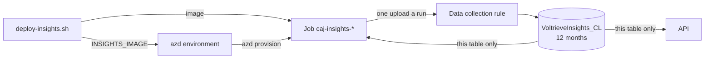
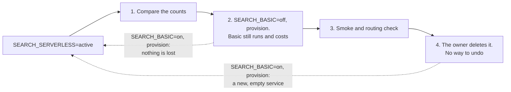

# Deployment

How to deploy Voltrieve to Azure, in the order that worked on 2026-11-04. Nothing here uses API keys: every call uses Entra tokens.

## Prerequisites

Tools:

- Azure CLI (`az`) and Azure Developer CLI (`azd`)
- `uv` (Python 3.12 is resolved per project)
- Node.js and npm, for the website build
- Docker, where the Static Web Apps CLI cannot run (see below)

Model quota in `AZURE_LOCATION`, GlobalStandard, in thousands of tokens a minute: 150 each for `gpt-6.1-terra`, `gpt-5.4-mini` and `gpt-6-luna`, and 10 for `text-embedding-3-large`. `gpt-6-luna` is always deployed, also when it does not plan anything, so a subscription without that quota cannot provision. It costs nothing until it is used.

Rights, for one user account. A service principal does not work, because the deployer role assignments use `principalType: 'User'`:

- enough on the subscription to create resources and role assignments;
- in Entra: create app registrations, service principals, a user, and app role assignments.

Sign in to both tools as the same user. The post-provision hook checks this and stops if they differ:

```sh
az login
azd auth login
```

## Regions and why

| Resource | Region | Why |
| --- | --- | --- |
| Foundry, storage, Container Apps, registry, monitoring | Sweden Central (`AZURE_LOCATION`) | The primary region |
| Azure AI Search | France Central (`AZURE_SEARCH_LOCATION`, the default) | Sweden Central and West Europe were flagged as not accepting new Search services. France Central is the nearest EU region that does. |
| Three Static Web Apps: web, car and dashboard | East US 2 (`webLocation` in Bicep) | West Europe rejected new Static Web Apps. This region holds the metadata; the content is global. |

Search reaches Foundry and storage over public endpoints with Entra tokens.

All three backends run `gpt-6.1-terra` version `2026-10-26`, set with `chatModelName`. `gpt-5.4-mini` plans the Search queries. `gpt-6-luna` is opt-in, set with `PLANNING_MODEL_NAME` (`planningModelName` in Bicep). Do not move a model without checking availability: all three are deployed as GlobalStandard with capacity 150. Capacity 10 caused rate limit failures in multi-question runs. On pay-per-token, capacity is a cap, not a cost.

## Environment

```sh
azd env new voltrieve-dev
azd env set AZURE_LOCATION swedencentral
```

The name is limited to 22 characters and appears in resource names. Optional values:

| Name | Default | Purpose |
| --- | --- | --- |
| `AZURE_SEARCH_LOCATION` | `francecentral` | Search region |
| `PLANNING_MODEL_NAME` | `gpt-5.4-mini` | The model that plans Search queries. The only other value is `gpt-6-luna`, which is opt-in and follows [its own order](#order-for-an-update-with-the-new-search-values) |
| `SEARCH_SERVERLESS` | `off` | A Serverless search service next to the Basic one. `off`: not deployed. `standby`: deployed, nothing uses it. `active`: the API and agents use it. `SEARCH_BASIC` alone decides on Basic. Going back to `off` does not delete a deployed service |
| `SEARCH_BASIC` | `on` | The Basic search service. `off`: not deployed, and nothing refers to it. Only with `SEARCH_SERVERLESS` at `active`, or the provision stops. It does not delete a deployed service: [Removing the Basic service](#removing-the-basic-service) |
| `INSIGHTS_SCHEDULE` | `off` | The usage insights job. `off`: it starts by hand only. `on`: every night at 02:30 UTC, once the job has its image |
| `INSIGHTS_NOTICE_DATE` | empty | The first full UTC day the notice was live in the car and on the website, as `YYYY-MM-DD`: the day after it went live. Real chats started before it are never read. Empty: no real chat is read |
| `VOLTRIEVE_VERIFIED_DOMAIN` | the tenant's default domain | Domain for the tester account |

The Basic service is in `AZURE_SEARCH_LOCATION`. A Serverless service is in `serverlessSearchLocation`, which defaults to Sweden Central.

The hooks and scripts fill in the rest, such as `TENANT_ID`, `API_CLIENT_ID`, `INSIGHTS_IMAGE`, `INSIGHTS_JOB_NAME`, `INSIGHTS_IDENTITY_ID`, `INSIGHTS_IDENTITY_CLIENT_ID`, `LOG_ANALYTICS_WORKSPACE_ID`, `WEB_URL`, `CAR_URL`, `DASHBOARD_URL`, `CAR_CLIENT_ID`, `DASHBOARD_CLIENT_ID`, `DEALER_URL`, `DEALER_CLIENT_ID`, `DEALER_SITE_CLIENT_ID`, `DEALER_SP_OBJECT_ID`, `API_SP_OBJECT_ID`, `ORDER_PLACE_ROLE_ID`, `DEALER_MANAGE_ROLE_ID`, `DEALER_SCOPE_ID`, `TEST_USER_UPN` and `HOSTED_AGENT_PRINCIPAL_ID`. All of them are identifiers. The Application Insights connection string is an ingestion identifier, not a secret.

## Order

### 1. `azd up`

```sh
azd up
```

Stay at the terminal: the preprovision hook prints the tester's password once, the first time the account is created, and it is not stored anywhere. Do not paste it into docs or tickets.

`azure.yaml` replaces the default order with provision, `package --all`, `deploy --all`. The default packages first, which is too early: the web build needs values that provision creates.

What each hook does:

| Hook | When | What |
| --- | --- | --- |
| `hooks/preprovision.sh` | Before each provision | Creates or updates the app registrations (`voltrieve-api`, `voltrieve-cli`, `voltrieve-web`, `voltrieve-car`, `voltrieve-dashboard`, `voltrieve-dealer`, `voltrieve-dealer-site`), the tester, roles and consent, and stores the ids in the azd environment. Idempotent. Runs interactively so the password is visible. |
| `hooks/postprovision.sh` | After each provision | Checks that `az` and `azd` are the same user. Uploads the documents to their two containers, applies the search objects of both knowledge bases, runs both indexers, gives the API identity `Dealer.Access`, and adds the redirect URI of each of the three sites (`set-spa-redirect --app web|car|dashboard`) and of the dealer page (`set-spa-redirect --app dealer`, with the address of the dealer service, which is the page's address). Each step retries up to 10 times, 60 seconds apart, for role propagation. |
| `hooks/web-prepackage.sh` | Before the web package | Writes `clients/web/.env.production` with public values only. |
| `hooks/car-prepackage.sh` | Before the car package | Writes `clients/car/.env.production` with public values only. |
| `hooks/dashboard-prepackage.sh` | Before the dashboard package | Writes `clients/dashboard/.env.production` with public values only. |
| `hooks/postup.sh` | After `azd up` | Runs the search smoke test. It runs last so that a retrieval miss cannot block a deployment. |

Provision keeps deployed images: azd sets `SERVICE_API_RESOURCE_EXISTS` and `SERVICE_DEALER_RESOURCE_EXISTS`, so Bicep reuses the current image instead of the placeholder.

### 2. Apple Silicon without Rosetta: `scripts/deploy-web.sh`

`azd` deploys each Static Web App with the Static Web Apps CLI, whose upload client is an x86 binary. On Apple Silicon without Rosetta that step fails, and on macOS 27 without Rosetta so do `azd deploy web`, `azd deploy car` and `azd deploy dashboard`. `dealer` and `api` deploy first, so only the Static Web Apps are missing. Installing Rosetta is a system change, so this repository uses a container instead. This worked on macOS 27 on 2026-11-24:

```sh
azd package web && scripts/deploy-web.sh web
azd package car && scripts/deploy-web.sh car
azd package dashboard && scripts/deploy-web.sh dashboard
```

`azd package` runs the hook of the site and builds it. Without an argument, `scripts/deploy-web.sh` uploads `web`.

It runs the Linux `StaticSitesClient` in Docker against `clients/<service>/dist`, and keeps the deployment token in memory. It finds the site by its `azd-service-name` tag, never by its position in a list, and stops if none or more than one matches. If `azd up` stopped at this step, run the smoke test by hand, since the `postup` hook may not have run:

```sh
SEARCH_ENDPOINT="$(azd env get-value SEARCH_ENDPOINT)" PLANNING_MODEL="$(azd env get-value PLANNING_MODEL)" \
  uv run --project search voltrieve-search smoke
```

Without `PLANNING_MODEL` the check does not look at which model planned.

### 3. `scripts/deploy-agents.sh`

Run this after `azd up`, from the repository root, as the deployer:

```sh
scripts/deploy-agents.sh
```

1. `agents/prompt/create_agents.py` creates a new version of each of three prompt agents: `voltrieve-prompt-cli`, `voltrieve-prompt-web` and `voltrieve-prompt-car`. The third has the car's tools (`set_speed`, `set_wipers`, `honk`, `park`, `get_sign_photo`). The API picks the first agent whose tools include every tool the client declared.
2. `agents/hosted/deploy.py` builds the `linux/amd64` image with `az acr build`, creates a hosted agent version, waits until it is active, and stores `HOSTED_AGENT_PRINCIPAL_ID`.
3. `azd provision --no-prompt` runs again, because the agent identity did not exist before step 2. Bicep then gives it its Foundry and Search roles. All provision hooks run again too.
4. `voltrieve-entra assign-app-role` gives the agent identity `Dealer.Access`, with the same retry.

Until step 4 has propagated, hosted dealer tools fail. Sessions are bound to the agent version they started on, so conversations in flight stay on the old version until the API restarts or a call fails and the session is dropped.

### 4. `scripts/deploy-insights.sh`

Run this after `azd up`, from the repository root, as the deployer:

```sh
scripts/deploy-insights.sh
```

It builds the image of the usage insights job with `az acr build`, gives it to the job and stores its name as `INSIGHTS_IMAGE` in the azd environment. A later `azd provision` reads `INSIGHTS_IMAGE`, so it keeps the image. Before the first deploy the job has a public sample image, which only prints a line and is never on a schedule. The script starts no run and changes no schedule.



The job's identity reads conversations and calls models in the Foundry account (a custom role), saves to its own data collection rule, and reads the `VoltrieveInsights_CL` table back. The API's identity may read that table. Both read it through Log Analytics Data Reader with a condition on the table name. A new condition can take 15 minutes to work.

Start a run by hand, and see how it ended:

```sh
az containerapp job start -n "$(azd env get-value INSIGHTS_JOB_NAME)" -g "$(azd env get-value AZURE_RESOURCE_GROUP)"
az containerapp job execution list -n "$(azd env get-value INSIGHTS_JOB_NAME)" -g "$(azd env get-value AZURE_RESOURCE_GROUP)" -o table
```

A run prints one line a step, with counts, and a count of 1 to 4 as `under 5`. One that fails prints `failed: <step>: <error type>` and ends with exit code 1. It saves nothing, with one exception: a failure at `save` may have been saved, whole, when only the answer was lost.

An older week, for made up conversations only, is a run with `--window-end` and the last day of the week. It reads no real chat and writes no real row. Save the job's template outside the repository, add `args: ["--window-end", "2026-11-22"]` to the container in it, and start the job with that file:

```sh
week="$(mktemp -d)/insights-week.yaml"
az containerapp job show -n "$(azd env get-value INSIGHTS_JOB_NAME)" -g "$(azd env get-value AZURE_RESOURCE_GROUP)" \
  --query properties.template -o yaml > "$week"
```

Edit the file, then:

```sh
az containerapp job start -n "$(azd env get-value INSIGHTS_JOB_NAME)" -g "$(azd env get-value AZURE_RESOURCE_GROUP)" \
  --yaml "$week"
```

The page and the workbook show the newest week, whichever week was run last. Still run older weeks first: a week takes over group names from the weeks before it.

**Off until it is approved.** `INSIGHTS_SCHEDULE` stays `off` and `INSIGHTS_NOTICE_DATE` stays empty until the product owner says yes to both. To read real chats, the notice has to be live first. With the notice date set and the schedule off, starting the job by hand reads real chats and saves totals.

**First check the marks.** Make one signed in turn in the car and one on the website, and look at the metadata of the newest conversation after each: the client has to be `car` and then `web`. Otherwise every conversation is `other`, none is counted, and the page is empty in the same way as after a quiet week. This prints the newest one's client and backend, and no text (the command was not run when it was written):

```sh
TOKEN="$(az account get-access-token --resource https://ai.azure.com --query accessToken -o tsv)"
curl -s "$(azd env get-value FOUNDRY_PROJECT_ENDPOINT)/openai/v1/conversations?limit=1&order=desc" -H "Authorization: Bearer $TOKEN" \
  | python3 -c 'import json, sys; m = json.load(sys.stdin)["data"][0]["metadata"]; print(m.get("client"), m.get("backend"))'
```

After the yes and the check, set both values (the date is the first full UTC day after the notice went live) and provision:

```sh
azd env set INSIGHTS_NOTICE_DATE 2026-12-01
azd env set INSIGHTS_SCHEDULE on
azd provision
```

Run on 2026-11-24 ([`insights-acceptance.txt`](https://github.com/mklab-se/voltrieve/blob/main/docs/evidence/insights-acceptance.txt)): the job deploys and runs by hand, and the condition held the job's identity to the table. The API read it too, but what else the API's identity can read was not tried.

Not verified: the schedule, and that a job can go from `off` to `on` in place. If Azure refuses to change the trigger, delete the job and provision again: it holds no data.

### 5. Check it

```sh
uv run scripts/runbook.py
uv run tests/grounding/check.py
```

See [runbook.md](runbook.md).

## Order for an update with attachments

When attachments and the new Search values ship in the same update, this order applies. The planner stays on `gpt-5.4-mini` and `SEARCH_SERVERLESS` on `off` for all of it. Steps 2 and 3 of [the new search values](#order-for-an-update-with-the-new-search-values) come afterwards, in their own provisions.

When an environment already runs an older version, deploy the hosted agent before the API. With a new API and an old agent, a photo turn answers without the photo and the protection of the logs is missing.

1. Preview, then `azd provision`: the three registrations and sites, the CORS origins, and `PROMPT_AGENT_CAR`. Not `azd up`, which would deploy the API before the agents.
2. `scripts/deploy-agents.sh` at once after the provision, with nothing in between, since a provision moves the MCP connections and the prompt agents keep the old address until it has run. It deploys the three prompt agents, then the hosted agent, then `azd provision` again (the agent identity did not exist before, so Bicep gives it its roles then) and the `Dealer.Access` role. Its final check is `scripts/smoke.py --basic`, because the API is still older.
3. `azd deploy api`. The new revision drops the sessions that are bound to the old hosted version.
4. `uv run scripts/smoke.py`, the full check. It adds one turn with the car's tools on the prompt agent and one upload on each backend.
5. `web` and `dashboard` together, then `car`. On macOS 27 without Rosetta, package and upload each one [with the container](#2-apple-silicon-without-rosetta-scriptsdeploy-websh).

**Rollback** goes in reverse, the API first, then the agents, so a new API never meets an older agent.

**A rollback of the infrastructure starts Foundry's tracing again.** A provision from a version of this repository from before 2026-11-24 recreates the connection `appinsights` in the Foundry project, and chat text reaches telemetry again. A later provision does not remove it, so [delete it by hand](decisions.md#closed-foundrys-tracing-is-disconnected) again and run `scripts/tracing_check.py` ([how](runbook.md#the-operations-dashboard)).

**An empty environment** starts with `azd up`, then `scripts/deploy-agents.sh`, then an API restart. Photos count as unavailable until then.

## Order for an update with the usage insights

1. `azd provision`: the table, the data collection rule, the job with its identity and roles, and the API's access to the table. Then `scripts/deploy-agents.sh` at once, as after every provision. An older deployment still has the connection `appinsights` in the Foundry project. Bicep does not delete it, so [delete it by hand](decisions.md#closed-foundrys-tracing-is-disconnected) after the agents. Do the same after any provision from before 2026-11-24, which recreates it and starts the tracing again, and run `scripts/tracing_check.py` ([how](runbook.md#the-operations-dashboard)).
2. `scripts/deploy-insights.sh`: the job's image. It starts no run.
3. `azd deploy api`: conversations are marked with the client, and `GET /admin/insights` answers.
4. The dashboard, [with the container](#2-apple-silicon-without-rosetta-scriptsdeploy-websh) where the SWA CLI cannot run.
5. The car and the website, for the notice. They have to be live before real chats may be read.

Every step leaves the job off. Checking and seeding are in [the runbook](runbook.md#usage-insights).

## Dealer orders: values, roles and redirect

Nothing new has to be set by hand. The preprovision hook creates the registration of the page, `voltrieve-dealer-site`, the scope `manage_as_user` and the roles, and stores their ids in the azd environment: `DEALER_SITE_CLIENT_ID`, `DEALER_SCOPE_ID`, `DEALER_MANAGE_ROLE_ID` and `ORDER_PLACE_ROLE_ID`. The dealer service gets `SITE_CLIENT_ID` from Bicep, and the page reads its tenant and client ids from `/config.json`.

| Role | On | Held by | Needed for |
| --- | --- | --- | --- |
| `Order.Place` | `voltrieve-api`, for users | The deployer. Not the test user | Both order tools. Without it Runa refuses before an address is asked for |
| `Dealer.Manage` | `voltrieve-dealer`, for users | The deployer. Not the test user | Signing in to the dealer page, and the staff routes |
| `Dealer.Access` | `voltrieve-dealer`, for applications | The API identity and the hosted agent identity (as before) | Runa's calls to the dealer |

The registration of the dealer requires an assignment, so an account without `Dealer.Manage` cannot sign in to the page at all.

**To give a role to somebody else,** assign it as for the other app roles: in the Entra admin center under the enterprise application of `voltrieve-api` or `voltrieve-dealer`, or with the script of the repository, as the deployer:

```sh
uv run --project infra/scripts/entra voltrieve-entra assign-app-role \
  --principal-object-id <the user's object id> \
  --resource-sp-object-id "$(azd env get-value API_SP_OBJECT_ID)" \
  --app-role-id "$(azd env get-value ORDER_PLACE_ROLE_ID)"
```

For the dealer page use `DEALER_SP_OBJECT_ID` and `DEALER_MANAGE_ROLE_ID`. A new token is needed before the role shows.

**The redirect.** The dealer page is a single page app served from the address of the dealer service, which only exists after the first provision. So that address is added as a redirect URI by the postprovision hook, and the preprovision hook passes it again on later provisions (`--dealer-redirect-uri`). Do not add it by hand. If sign-in says that the redirect does not match, run `azd provision` again.

## Order for an update with the dealer orders

The other order fails closed: a new API or agent that calls order routes the dealer does not have yet is refused, and Runa cannot order. So the callee goes first:

1. `azd provision`: the table, the dealer's role on it, the registrations, roles and the redirect. Preview it first.
2. `azd deploy dealer`: the service, with the page. Check that `just dealer` prints an address and that the page shows its sign-in.
3. `scripts/deploy-agents.sh`: the three prompt agents (new instructions and the two order tools) and the hosted agent. As after every provision, run it at once, and [delete the Foundry connection](decisions.md#closed-foundrys-tracing-is-disconnected) if an older provision recreated it.
4. `azd deploy api`.
5. The website, [with the container](#2-apple-silicon-without-rosetta-scriptsdeploy-websh) where the SWA CLI cannot run, for the sentence in the notice.
6. `uv run scripts/orders_check.py --dry`, then the checks in [the runbook](runbook.md#the-dealer-orders-demo).

**Rollback** goes the other way, the API first, then the agents, then the dealer. Orders and stock stay in the table.

Not run live yet: this order has not been run on the deployed environment.

## Redeploying

| Change | Command |
| --- | --- |
| API or dealer code, `agent_core` | `azd deploy api`, `azd deploy dealer` |
| Website, car, dashboard | `azd deploy web`, `azd deploy car`, `azd deploy dashboard`, or `azd package <service> && scripts/deploy-web.sh <service>` where the SWA client cannot run (macOS 27 without Rosetta) |
| Usage insights job, `agent_core` as used by it | `scripts/deploy-insights.sh` |
| Agents, including `agent_core` as used by the hosted agent | `scripts/deploy-agents.sh` |
| Infrastructure | `azd provision` |
| Documents | `azd provision` (the post-provision hook uploads and indexes) |

## Idle cost

Approximate:

| Resource | Idle cost |
| --- | --- |
| Azure AI Search Basic | About 75 USD a month (22 SEK a day on the November 2026 bill). 0 only once the service is [deleted](#removing-the-basic-service) |
| Azure AI Search Serverless, `off` (the default) | 0 |
| Azure AI Search Serverless, `standby` or `active` | Storage under 0.01 USD a month, and 0.255 USD per CU hour while it works, on top of Basic while that one exists. It sleeps after 10 idle minutes |
| Container Registry Basic | About 5 USD a month |
| Log Analytics | Small, by ingestion. The insights table adds a few MB a year |
| Usage insights job | None: per run, one a night at most when it is on |
| Container Apps | None when scaled to zero. The dealer stays awake while a dealer page is open: about 0.05 USD (0.5 SEK) an hour at list price, before the free grant |
| Table Storage, the dealer's table | Well under 1 SEK a month. No new resource, site or plan |
| Three Static Web Apps, Free tier | None |
| Models | None: per token |
| Hosted agent | None: per active session |

Search is the cost that matters. Tear down when you are done.

The car and the dashboard add no idle cost: two more Static Web Apps on the Free tier, one more prompt agent, and two more registrations. What they add is use:

- A photo adds about 950 input tokens to each turn while it lives.
- The pictures for the car cost 0.32 USD once: the cockpit in its variants and five house fronts ([how they were made](https://github.com/mklab-se/voltrieve/blob/main/clients/car/assets/README.md)).
- The first 20 photo turns cost about 0.11 USD, and the whole photo run of 351 turns about 1.10 USD, at list prices ([Photos and attachments](attachments.md#measured)).

## Before a demo

The API and the dealer scale to zero after 5 idle minutes. A cold start took 34 seconds for the API and 30 for the dealer in a measured run, which is far over the 10 second limit for the first token. `just warm-up` wakes everything and asks a real question on each backend. `just keep-warm` does the same, then pings `/healthz` every 2 minutes until Ctrl-C, which costs no tokens. An open dealer page is meant to keep the dealer awake too, because it reads its state once a minute. Not run live yet. If the page is cold anyway, see [the runbook](runbook.md#when-the-dealer-page-is-cold).

## Budget alert

The resource group has a budget named `voltrieve-monthly` of 2000 SEK a month, which is about USD 200, because the subscription bills in SEK. It sends an email when actual cost goes over the budget. It was created by hand, so it is not part of `azd up`. An alert does not stop any spending, and cost data can lag by up to a day.

## Teardown

```sh
azd down --purge
```

`--purge` also removes the soft-deleted resources that would otherwise keep their names reserved.

**Entra objects survive teardown.** `azd` does not remove the app registrations or the tester, because hooks created them, not Bicep. To delete them:

```sh
UPN="$(azd env get-value TEST_USER_UPN)"
az ad user delete --id "$UPN"

for name in voltrieve-api voltrieve-cli voltrieve-web voltrieve-car voltrieve-dashboard voltrieve-dealer; do
  az ad app delete --id "$(az ad app list --display-name "$name" --query '[0].id' -o tsv)"
done
```

Deleted applications stay in the Entra recycle bin for a while. These commands were not run in this project, so check the names first if the tenant has anything else called `voltrieve-*`. Whether the hosted agent's Entra identity goes away with the project was also not checked.

If you deploy again into the same azd environment after teardown, clear the stale agent identity first, or provision will try to assign roles to a principal that no longer exists:

```sh
azd env set HOSTED_AGENT_PRINCIPAL_ID ""
```

The tester password is printed again only if the account was deleted and is recreated.

## Removing the Basic service

Once Serverless is `active`, nothing uses the Basic service, but it costs the same, about 22 SEK a day. Until it is deleted, the Basic service is the fast fallback. The dev environment went through all four steps on 2026-11-24 (`docs/evidence/search-basic-removed.txt`). The way back has not been tried.

Setting a value never deletes it: azd deploys incrementally, so a service that leaves the template stays in Azure and stays on the bill. The delete is a command of its own, run by the product owner.



The two names look alike. `srch-voltrieve-<token>` is Basic and goes. `srch-voltrieve-sl-<token>` is Serverless and stays. This block finds the Basic one by its tier, in any shell, also after step 2. Run it again in each new shell. The `az` lines work in the default subscription of the CLI, so it sets that too:

```sh
eval "$(azd env get-values)"
az account set --subscription "$AZURE_SUBSCRIPTION_ID"
az search service list -g "$AZURE_RESOURCE_GROUP" --query "[].{name:name, tier:sku.name}" -o table
BASIC_NAME="$(az search service list -g "$AZURE_RESOURCE_GROUP" --query "[?sku.name=='basic'].name" -o tsv)"
BASIC_ENDPOINT="https://$BASIC_NAME.search.windows.net"
BASIC_ID="$(az search service show -n "$BASIC_NAME" -g "$AZURE_RESOURCE_GROUP" --query id -o tsv)"
BASIC_PRINCIPAL="$(az search service show -n "$BASIC_NAME" -g "$AZURE_RESOURCE_GROUP" --query identity.principalId -o tsv)"
echo "Basic: $BASIC_NAME, identity $BASIC_PRINCIPAL"
```

Write the identity down. After step 4 it cannot be looked up.

**1. Compare what the two services hold:**

```sh
search_get() { az rest --resource https://search.azure.com --url "$1?api-version=2026-11-01-preview" --query "$2" -o tsv; }
for endpoint in "$BASIC_ENDPOINT" "$SEARCH_SERVERLESS_ENDPOINT"; do
  echo "$endpoint"
  search_get "$endpoint/knowledgebases" 'value[].name'
  for index in $(search_get "$endpoint/indexes" 'value[].name'); do
    echo "$index $(search_get "$endpoint/indexes/$index/stats" documentCount)"
  done
done
```

Both must have the same two indexes (`voltrieve-docs-index`, `voltrieve-parts-index`) and the same two knowledge bases. The counts are chunks. They should be equal. Basic may hold older documents, because a provision only fills the active service. If Serverless has fewer, run `SEARCH_ENDPOINT="$SEARCH_SERVERLESS_ENDPOINT" uv run --project search voltrieve-search index` and compare again. Stop if Basic holds an index or a knowledge base that Serverless does not.

**2. Leave Basic out.** The preview must not create or delete a search service:

```sh
azd env set SEARCH_BASIC off
azd provision --preview
azd provision
scripts/deploy-agents.sh
```

The provision keeps the Serverless endpoint everywhere. It stops managing the Basic service and its eight role assignments, which all stay where they are. `SEARCH_BASIC_ENDPOINT` becomes empty, so `voltrieve-search upload --prune` only knows Serverless from here. **Do not prune between step 2 and step 4:** Basic would keep the chunks of the deleted documents.

**3. Check that everything answers without it.** First the live addresses. All three must contain `srch-voltrieve-sl-`:

```sh
az containerapp show -n "ca-api-$AZURE_ENV_NAME" -g "$AZURE_RESOURCE_GROUP" \
  --query "properties.template.containers[0].env[?name=='SEARCH_ENDPOINT'].value" -o tsv
for name in "$KB_CONNECTION_NAME" "$PARTS_KB_CONNECTION_NAME"; do
  az rest --query properties.target -o tsv --url "https://management.azure.com/subscriptions/$AZURE_SUBSCRIPTION_ID/resourceGroups/$AZURE_RESOURCE_GROUP/providers/Microsoft.CognitiveServices/accounts/$FOUNDRY_ACCOUNT_NAME/projects/$FOUNDRY_PROJECT_NAME/connections/${name}?api-version=2026-11-15-preview"
done
```

Then prove that the metric sees this kind of traffic. An empty answer alone proves nothing: the metric can be late, or not count knowledge base calls. So ask Basic on purpose, and see it arrive:

```sh
now() { date -u +%Y-%m-%dT%H:%M:%SZ; }
basic_queries() {
  az monitor metrics list --resource "$BASIC_ID" --metric SearchQueriesPerSecond --aggregation Average \
    --interval PT1M --start-time "$1" --end-time "$(now)" \
    --query 'value[].timeseries[].data[] | [?average > `0`].[timeStamp, average]' -o json
}
CONTROL="$(now)"; echo "control: $CONTROL"
SEARCH_ENDPOINT="$BASIC_ENDPOINT" uv run --project search voltrieve-search smoke
```

Wait about 10 minutes, then:

```sh
basic_queries "$CONTROL"
```

It must list the minutes of that run. If it prints `[]`, wait longer. If it stays `[]`, the metric cannot show whether anyone uses Basic: stop here, and delete nothing. When the control is there, run the real checks, after it and not before:

```sh
CHECKS="$(now)"; echo "checks: $CHECKS"
PLANNING_MODEL="$(azd env get-value PLANNING_MODEL)" SEARCH_ENDPOINT="$(azd env get-value SEARCH_ENDPOINT)" \
  uv run --project search voltrieve-search smoke
uv run scripts/smoke.py
uv run tests/routing/check.py
```

The routing check asks all three backends, and the prompt agent reaches Search through the MCP connections. Wait again, as long as the control took to show, then:

```sh
basic_queries "$CHECKS"
```

It must print `[]`. Every check must have passed.

**4. The owner deletes it.** Not a script, not a hook and not an agent without the owner's yes. The delete only runs when the tier is `basic`, the service in use is a Serverless one, and the two names differ:

```sh
KEEP="$(azd env get-value SEARCH_SERVICE_NAME)"
TIER="$(az search service show -n "$BASIC_NAME" -g "$AZURE_RESOURCE_GROUP" --query sku.name -o tsv)"
echo "delete: $BASIC_NAME ($TIER), keep: $KEEP"
if [ "$TIER" = basic ] && [ "${KEEP#srch-voltrieve-sl-}" != "$KEEP" ] && [ "$BASIC_NAME" != "$KEEP" ]; then
  az search service delete -n "$BASIC_NAME" -g "$AZURE_RESOURCE_GROUP"
else
  echo "not deleted: the name or the tier is wrong"
fi
```

It asks for a yes. **It cannot be undone:** the indexes, the knowledge bases and the indexer history of that service are gone. No data is lost that Serverless does not hold: the documents are in storage, the definitions are in the repository, and step 1 compared the counts. Older versions of the prompt agents point at Basic and stop working. The versions that step 2 created do not.

Its identity leaves three role assignments behind, one on storage and two on Foundry. They let nobody in. List them:

```sh
ORPHANS="$(az role assignment list --all --query "[?principalId=='$BASIC_PRINCIPAL'].id" -o tsv)"
echo "identity: $BASIC_PRINCIPAL"; echo "$ORPHANS"
```

Go on only if the identity is the one you wrote down, and the list holds nothing but assignments on storage, Foundry and the deleted service. Each is deleted by its id, one at a time, because `az role assignment delete` without an id could take others:

```sh
echo "$ORPHANS" | while IFS= read -r id; do
  if [ -n "$id" ]; then az role assignment delete --ids "$id"; fi
done
```

**The way back.** Before step 4 nothing is lost: set `SEARCH_BASIC` to `on`, provision, and fill it as below. After step 4 the same commands create a new, empty service:

```sh
azd env set SEARCH_BASIC on
azd provision
```

Then fill it. The variable is for this shell only, since the API still uses Serverless. A 403 means that the new roles need some minutes:

```sh
set -a; eval "$(azd env get-values)"; set +a
export SEARCH_ENDPOINT="$SEARCH_BASIC_ENDPOINT"
uv run --project search voltrieve-search apply
uv run --project search voltrieve-search index
uv run --project search voltrieve-search smoke
unset SEARCH_ENDPOINT
```

If the old service is still there and documents were pruned while `SEARCH_BASIC` was `off`, rebuild its two indexes before that block. The indexers keep no list of what they filled, so each one is reset too, or it skips every document it has seen:

```sh
for name in docs parts; do
  az rest --resource https://search.azure.com --method delete --url "$BASIC_ENDPOINT/indexes/voltrieve-$name-index?api-version=2026-11-01-preview"
  az rest --resource https://search.azure.com --method post --url "$BASIC_ENDPOINT/indexers/voltrieve-$name-indexer/reset?api-version=2026-11-01-preview"
done
```

If Search refuses to delete an index that a knowledge source uses, do step 4 instead: a new service has no old chunks.

Last, in a new shell, `SEARCH_SERVERLESS` goes to `standby`, with a provision and `scripts/deploy-agents.sh`. The [rollback of Serverless](#order-for-an-update-with-the-new-search-values) is refused until `SEARCH_BASIC` is `on`. The way back costs about 22 SEK a day from the minute the service exists, one round of embeddings (159 chunks, under 0.01 USD), and the time of two provisions. It also needs the region to take a new service: `AZURE_SEARCH_LOCATION` was accepted on 2026-11-04, and that is no promise.

Not verified: none of these commands has been run, nor whether the old name can be used again right after the delete, which the way back needs. Checked without Azure: the compiled template, worked out for every combination of the two values.

## Order for an update with the new search values

The default stays as it was: `PLANNING_MODEL_NAME` is `gpt-5.4-mini` and `SEARCH_SERVERLESS` is `off`, so a plain `azd provision` changes neither. A GPT-6 planning model needs every caller of Search to use `2026-11-01-preview` or later, so the code goes first. The reasons are in [Decisions](decisions.md#search-moved-to-the-foundry-iq-versions).

Each step is an `azd provision`, with `scripts/deploy-agents.sh` at once after it. A provision moves the MCP connections, and the prompt agents keep the old address until `deploy-agents.sh` has run.

1. **The versions, with the old planner.** Leave both values alone. `azd provision`, then `scripts/deploy-agents.sh`, then `azd deploy api`. The provision writes the search definitions with the new version. Check with `uv run scripts/smoke.py`, the prompt agent first.
2. **The planner, if wanted.** `azd env set PLANNING_MODEL_NAME gpt-6-luna`, then `azd provision`, then `scripts/deploy-agents.sh`. The next retrieve plans with it, with no new API image. Never do this in the same provision as step 1: an old client would meet a base that plans with GPT-6.
3. **Serverless, if wanted, and last.** `active` is refused before `standby` has been provisioned. Set `standby`, provision and fill the service:

```sh
azd env set SEARCH_SERVERLESS standby
azd provision
scripts/deploy-agents.sh
```

Fill it with the definitions, then with the documents, which are already in storage. The variable is for this shell only, since the API still uses Basic:

```sh
set -a; eval "$(azd env get-values)"; set +a
export SEARCH_ENDPOINT="$SEARCH_SERVERLESS_ENDPOINT"
uv run --project search voltrieve-search apply
uv run --project search voltrieve-search index
uv run --project search voltrieve-search smoke
unset SEARCH_ENDPOINT
```

Then switch. Use a new shell, so that the changed `SEARCH_ENDPOINT` is gone:

```sh
azd env set SEARCH_SERVERLESS active
azd provision
scripts/deploy-agents.sh
```

**Rollback** goes the other way: Serverless, planner, version. The commands are in [the design, section 8](https://github.com/mklab-se/voltrieve/blob/main/docs/superpowers/specs/2026-11-24-search-foundry-iq-design.md#8-rollback).

When attachments ship in the same update, use [that order](#order-for-an-update-with-attachments) for step 1, since it deploys the agents before the API too.

Measured on 2026-11-24, with the commands above ([`search-versions.txt`](https://github.com/mklab-se/voltrieve/blob/main/docs/evidence/search-versions.txt)): `gpt-6-luna` plans about half a second slower per search. Serverless is about 0.3 s faster per search than Basic when warm, and took 2.9 s for the first call after 14 idle minutes. The rollback commands were not run.
