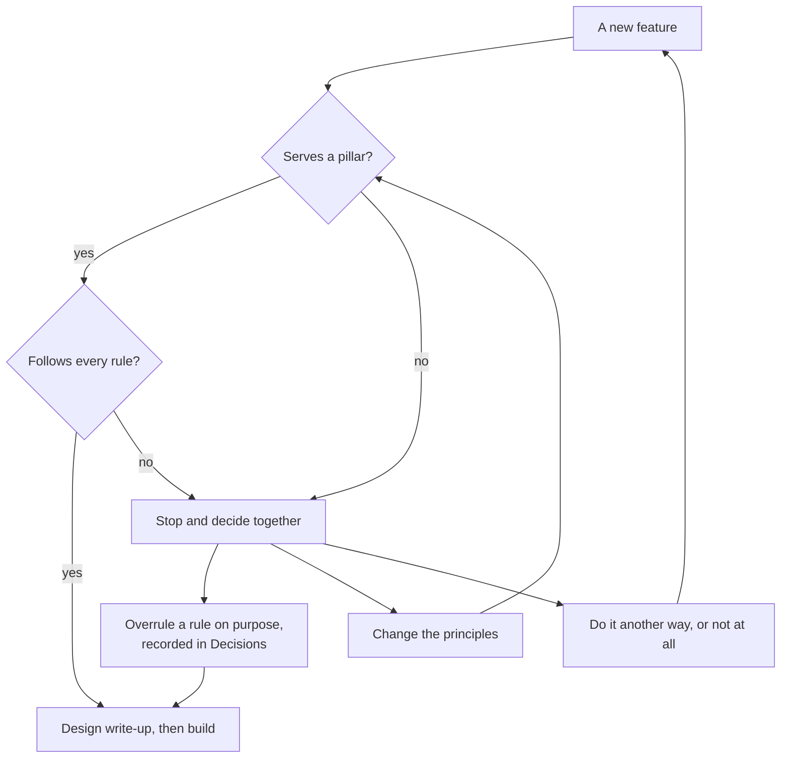

# Principles

Voltrieve grows one feature at a time. These principles keep it pointed at what it is for. Every new feature is checked against them before it is designed, and a feature that does not fit either changes, changes the rules on purpose, or is not built.

## What Voltrieve is

Voltrieve is a made-up Swedish carmaker. It exists to show how an ordinary manufacturing company could build a secure, AI-powered solution on Microsoft's platform, and what it meets along the way. It happens to make electric cars, but the problems are the ones any manufacturer has: product documents, spare parts, dealers, partners, field devices and customers who all need different answers.

## The pillars

Every feature serves at least one of these. If it serves none, it does not belong here.

| Pillar | What it shows | Where it lives today |
| --- | --- | --- |
| **Identity, authorization and security** | Data reaches only the people and systems that should have it, across every part of the solution. | Entra ID tokens, app roles, managed identities, signed source links |
| **RAG and agentic RAG** | How a normal company makes its documents and catalogs answerable, and how the agent decides where to look. | Azure AI Search knowledge bases, [the journey of a prompt](prompt-journey.md) |
| **Tool calls through the agent** | Tools on the server and tools on the client, in the same conversation. | Dealer tools, `set_theme`, `set_seat_heating`, pause and resume |
| **Clients and partner services** | Web, command line, devices close to hardware, and outside services. | The SPA, the CLI, the dealer service |
| **Multimodal** | Images, photos, voice and other media in and out of the conversation. | Car and part images in the sales folders |
| **Monitoring and operations** | Usage, response times, cost, errors and logs, live and after the fact. | Application Insights, the operations dashboard and workbook |
| **Evaluation and quality** | Proof that the AI does the right thing, and a gate that catches when it stops. | Routing tests, grounding check, [evidence](evidence/README.md) |
| **Ready for AI agents** | The solution can be used by AI agents and harnesses, not only use AI itself. | `AGENTS.md`, and MCP access for outside harnesses ([#16](https://github.com/mklab-se/voltrieve/issues/16)) |

## The rules

### 1. Built on Microsoft's platform

The backend runs on Microsoft's platform: Azure, Microsoft Foundry, Azure AI Search, Entra ID and Microsoft 365 where it fits. Clients and partners can be anything (a Rust program in a car, ChatGPT through MCP), but what they connect to is the Microsoft way of doing it. When Microsoft offers more than one way, we pick one and say why in [Decisions](decisions.md).

### 2. Three backends, always

Every feature that touches the agent works on all three backends: the own loop, the prompt agent and the hosted agent. Where one backend cannot do it, that is a finding, and it goes in the comparison with the evidence. A feature that never reaches the agent (a client setting, an ops view) says so in its design.

### 3. A fairly normal company

Build what an ordinary IT team could run and maintain. Prefer managed services over self-hosted ones, plain code over clever code, and boring patterns over new ones. The whole solution deploys with one `azd up`, tears down cleanly, and states what it costs when idle.

### 4. Secure by default

Security is part of the design, not a layer added later. In practice:

- No keys or secrets: Entra ID and managed identities everywhere.
- Roles and permissions as code, in Bicep, with least privilege.
- Checks fail closed.
- Documents, client input and tool results are untrusted data.
- No prompts, answers, photos or signed links in telemetry or logs.

### 5. With the receipts

Claims are backed by live runs, and the runs are kept in [evidence](evidence/README.md). Every feature is measured against the 10 s time-to-first-token limit with the routing suite. What was not verified is listed as not verified.

### 6. Easy to follow

Someone new should understand what was built, how and why. Every feature ships with:

- the "why" in the documentation, in plain language,
- an entry in [Decisions](decisions.md) for each choice that could have gone another way,
- at least one picture: a diagram, a screenshot or something interactive,
- code that is short enough to read, with links to it from the docs,
- an updated verified and not verified status in the README.

### 7. Made up, and safe to share

All data is generated. Real client situations only appear as neutral stand-ins, so nothing in the repository can be traced back to a real company or person.

### 8. Cost is part of the design

A feature that adds standing cost states the new idle cost. Bulk generation (images, 3D, large reruns) has its total calculated and approved before it runs, within the monthly budget.

## The fit check

Every feature starts with a short design write-up, and no code is written until it is approved. The write-up opens with a fit check:

1. **Pillars:** which pillar or pillars it serves.
2. **New or enhancement:** whether it improves something that exists or adds something new.
3. **Rules:** which rules it bends, if any, and why.

When a rule is overruled, the reason goes in [Decisions](decisions.md), so the next reader sees that it was deliberate. When the principles themselves change, this page changes in the same commit.
