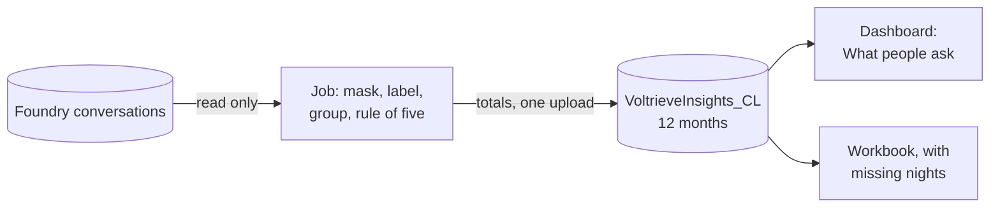

# Demo runbook

This walks through design section 13 for each backend, with the trace you should see beside each step. Results are from the live run of 2026-11-04, recorded in `docs/evidence/`. Deployment is in [deploy.md](deploy.md).

## Before you start

Sign in as the deployer. That account holds `Chat.User` and `TestDrive.Book`.

```sh
az login
azd env select voltrieve-dev
```

The CLI reads `API_URL`, `TENANT_ID`, `CLI_CLIENT_ID` and `API_CLIENT_ID` from the azd environment (`azd env get-values`), so nothing has to be exported. A `VOLTRIEVE_API_URL`, `VOLTRIEVE_TENANT_ID`, `VOLTRIEVE_CLI_CLIENT_ID` or `VOLTRIEVE_API_CLIENT_ID` variable overrides the azd value, for pointing the CLI at another API.

```sh
export FOUNDRY_PROJECT_ENDPOINT="$(azd env get-value FOUNDRY_PROJECT_ENDPOINT)"
alias voltrieve='uv run --project clients/cli voltrieve'
```

The CLI asks for the `access_as_user` scope. `voltrieve login` always shows the Microsoft account picker and does not reuse a cached sign-in, so you can choose which account to use. `voltrieve logout` forgets the cached accounts. Each `ask` and each turn of `chat` generates a correlation id and sends it as `X-Correlation-Id` on every request of the turn; `ask` prints it on stderr, and `chat` shows it in the trace panel.

Run everything from the repository root. `voltrieve ask` prints the answer on stdout and the trace on stderr. Add `--json` to get every event as a JSON line. `voltrieve chat` shows the chat and a live trace panel.

The first call to a backend can be slow, because the API and dealer scale to zero and a hosted session starts cold.

## Run it all at once

```sh
uv run scripts/runbook.py                       # steps 1 to 12, all backends
uv run scripts/runbook.py --backends loop --steps 2,8
uv run tests/grounding/check.py                 # 10 questions per backend
uv run tests/grounding/check.py --backends prompt --only atlas-stock
uv run tests/routing/check.py                   # 14 questions, 3 repeats, all backends
uv run tests/routing/check.py --only brakes-fjord --repeats 1 --no-save
```

`scripts/runbook.py` prints a table and writes `docs/evidence/<backend>.json` and `runbook-table.txt`, overwriting what is there. Saved files keep model output verbatim except for em-dashes and absolute paths ([docs/evidence/README.md](evidence/README.md)). It sends `runbook-<backend>-<step>` as the correlation id. Keep the committed evidence with `git checkout docs/evidence` after a partial run.

Both scripts compare answers with `data/voltrieve.yaml` and exit 1 on a miss. Recorded results:

- Runbook: every step passes on every backend on the final build. Step 11 is `prompt` only. Step 12 is checked by `scripts/runbook.py`, which waits for telemetry and writes `docs/evidence/application-insights.txt`. Its recorded result is from before Foundry's tracing was disconnected, see [Follow a correlation id](#follow-a-correlation-id).
- Grounding: 30 of 30 passed (`docs/evidence/grounding.txt`).
- Routing: 45 of 45 runs used exactly the right sources on every backend, with no knowledge base call in vain. Overlapping calls on two source questions: 12 of 12 on `loop` and `hosted`, 0 of 12 on `prompt`. Article numbers: 117 of 117 on `prompt`, 115 of 117 on `loop` and `hosted`, none invented. The script exits 1 on a missing article, so the recorded run exits 1. Run it with `--workers 1`: more turns at once measure the rate limit, not the routing.

`uv run scripts/new_client_tool_demo.py` shows a client bringing a tool the server has never seen, as a car with a seat heater would (`set_seat_heating`, level 0 to 3). It was run live on 2026-11-24: relayed on loop and hosted, refused on prompt (`docs/evidence/new-client-tool.txt`).

Step 7 and `cheapest-awd-se` are the same question. At the default reasoning effort it varied between runs on every backend. At medium effort it passed 18 of 18 (`docs/evidence/cross-document-repeat.txt`).

The recorded evidence comes from these scripts, which speak the same contract as the CLI. There is no transcript of `voltrieve` itself in `docs/evidence/`. `voltrieve login` and `logout` are tested against a fake MSAL application; a real browser sign-in was not exercised.

`uv run scripts/smoke.py` is the quick check after a deployment: `/healthz` of the API and the dealer, the indexer's last run, one question on each backend, one with the car's tools on the prompt agent, and one about a drawn photo on each backend. `scripts/deploy-agents.sh` runs it last with `--basic`, without the car's tools and the photos, because the API may still be older than the agents.

## Backend A: prompt

Each knowledge base is an MCP tool inside Foundry, so a retrieval shows as one `mcp_tool_called` event per base, with no sub-queries or references. Foundry writes citations as `【5:0†voltrieve-fjord-specifications.pdf】`. The API rewrites them to ` (voltrieve-fjord-specifications.pdf)` and drops a marker that names no file (`【4:0†source】`), so a client cannot tell this backend by its text. The recorded runs predate that filter and show the raw markers.

| Step | Command | Expected trace | Recorded result |
| --- | --- | --- | --- |
| 1 | `voltrieve ask "Hello" --backend prompt --az-token` | `token_validated`, `backend_selected`, `conversation_created`, `model_called`, deltas, `model_returned`, `done`. `token_validated` shows the roles. | PASS (roles: Chat.User, TestDrive.Book) |
| 2 | `voltrieve ask "What is the towing capacity of the Fjord?" --backend prompt --az-token` | `token_validated`, `backend_selected`, `conversation_created`, `model_called`, `mcp_tool_called`, deltas, `model_returned`, `done` | PASS |
| 3 | `voltrieve ask "Which of the 84 kWh models tows more?" --backend prompt --az-token` | `token_validated`, `backend_selected`, `conversation_created`, `model_called`, `mcp_tool_called`, deltas, `model_returned`, `done` | PASS |
| 4 | `voltrieve ask "Which Voltrieve charges fastest?" --backend prompt --az-token` | `token_validated`, `backend_selected`, `conversation_created`, `model_called`, `mcp_tool_called`, deltas, `model_returned`, `done` | PASS |
| 5 | `voltrieve ask "Can the Spark tow a trailer?" --backend prompt --az-token` | `token_validated`, `backend_selected`, `conversation_created`, `model_called`, `mcp_tool_called`, deltas, `model_returned`, `done` | PASS |
| 6 | `voltrieve ask "What is the Lumen's Euro NCAP rating?" --backend prompt --az-token` | `token_validated`, `backend_selected`, `conversation_created`, `model_called`, `mcp_tool_called`, deltas, `model_returned`, `done` | PASS |
| 7 | `voltrieve ask "What is the cheapest AWD Voltrieve in Sweden?" --backend prompt --az-token` | `token_validated`, `backend_selected`, `conversation_created`, `model_called`, `mcp_tool_called`, deltas, `model_returned`, `done`. | PASS (Voltrieve Lumen AWD, 419,000 SEK) |
| 8 | `voltrieve ask "Is the Atlas in stock in Göteborg?" --backend prompt --az-token` | `token_validated`, `backend_selected`, `conversation_created`, `model_called`, `model_returned`, `server_tool_called`, `server_tool_returned`, `model_called`, deltas, `model_returned`, `done`. The tool is `check_stock`. | PASS |
| 9a | `voltrieve ask "Book me a test drive of the Atlas in Göteborg on Saturday (YYYY-MM-DD)." --backend prompt --az-token`, using the coming Saturday | `token_validated`, `backend_selected`, `conversation_created`, `model_called`, `model_returned`, `server_tool_called`, `server_tool_returned`, `model_called`, deltas, `model_returned`, `done`. The tool is `book_test_drive`. | PASS |
| 9b | `uv run scripts/denied_demo.py --backend prompt` | `server_tool_called`, `authorization_denied`, `server_tool_returned`, `model_called`, polite refusal, then `PASS: authorization_denied emitted` | Not recorded for this backend |
| 10 | In `voltrieve chat --backend prompt --az-token`, ask: `What is the towing capacity of the Voltrieve Fjord? When you have the answer, beep three times.` | `token_validated`, `backend_selected`, `model_called`, `model_returned`, `client_tool_requested`, `client_tool_calls`. The CLI rings the bell and posts the result. Then `token_validated`, `backend_selected`, `model_called`, deltas, `model_returned`, `done`. There is no `conversation_created`: the conversation already exists. | PASS (`make_noise`, times=3) |
| 11 | `uv run scripts/runbook.py --backends prompt --steps 11` for the API's refusal, and `uv run --project agents/prompt agents/prompt/demo_rejection.py` for Foundry's 400 | Runbook script: `token_validated`, `backend_selected`, `conversation_created`, `unsupported_client_tool`, `error`. Demo script prints `400 invalid_payload: Error code: 400 - Not allowed when agent is specified.` | PASS, `docs/evidence/prompt-agent-rejection.txt` |
| 12 | See [Follow a correlation id](#follow-a-correlation-id), with `runbook-prompt-2` or `runbook-prompt-8` | One `chat.turn` span and the calls around it | PASS, `docs/evidence/application-insights.txt`, before the tracing was disconnected |

Step 1 alternative for an interactive sign-in: `voltrieve login`, then leave out `--az-token`.

## Backend B: loop

The API runs the loop, so every hop is an event. `knowledge_base_retrieved` carries the sub-queries and references. With query planning on, one question can give several sub-queries.

| Step | Command | Expected trace | Recorded result |
| --- | --- | --- | --- |
| 1 | `voltrieve ask "Hello" --backend loop --az-token` | `token_validated`, `backend_selected`, `conversation_created`, `model_called`, deltas, `model_returned`, `done`. `token_validated` shows the roles. | PASS (roles: Chat.User, TestDrive.Book) |
| 2 | `voltrieve ask "What is the towing capacity of the Fjord?" --backend loop --az-token` | `token_validated`, `backend_selected`, `conversation_created`, `model_called`, `model_returned`, `server_tool_called`, `knowledge_base_retrieved`, `server_tool_returned`, `model_called`, deltas, `model_returned`, `done` | PASS |
| 3 | `voltrieve ask "Which of the 84 kWh models tows more?" --backend loop --az-token` | `token_validated`, `backend_selected`, `conversation_created`, `model_called`, `model_returned`, `server_tool_called`, `knowledge_base_retrieved`, `server_tool_returned`, `model_called`, deltas, `model_returned`, `done` | PASS |
| 4 | `voltrieve ask "Which Voltrieve charges fastest?" --backend loop --az-token` | `token_validated`, `backend_selected`, `conversation_created`, `model_called`, `model_returned`, `server_tool_called`, `knowledge_base_retrieved`, `server_tool_returned`, `model_called`, deltas, `model_returned`, `done` | PASS |
| 5 | `voltrieve ask "Can the Spark tow a trailer?" --backend loop --az-token` | `token_validated`, `backend_selected`, `conversation_created`, `model_called`, `model_returned`, `server_tool_called`, `knowledge_base_retrieved`, `server_tool_returned`, `model_called`, deltas, `model_returned`, `done` | PASS |
| 6 | `voltrieve ask "What is the Lumen's Euro NCAP rating?" --backend loop --az-token` | `token_validated`, `backend_selected`, `conversation_created`, `model_called`, `model_returned`, `server_tool_called`, `knowledge_base_retrieved`, `server_tool_returned`, `model_called`, deltas, `model_returned`, `done` | PASS |
| 7 | `voltrieve ask "What is the cheapest AWD Voltrieve in Sweden?" --backend loop --az-token` | `token_validated`, `backend_selected`, `conversation_created`, `model_called`, `model_returned`, `server_tool_called`, `knowledge_base_retrieved`, `server_tool_returned`, `server_tool_called`, `server_tool_returned`, `model_called`, deltas, `model_returned`, `done`. The recorded run called two tools. | PASS |
| 8 | `voltrieve ask "Is the Atlas in stock in Göteborg?" --backend loop --az-token` | `token_validated`, `backend_selected`, `conversation_created`, `model_called`, `model_returned`, `server_tool_called`, `server_tool_returned`, `model_called`, deltas, `model_returned`, `done`. The tool is `check_stock`. | PASS |
| 9a | `voltrieve ask "Book me a test drive of the Atlas in Göteborg on Saturday (YYYY-MM-DD)." --backend loop --az-token`, using the coming Saturday | `token_validated`, `backend_selected`, `conversation_created`, `model_called`, `model_returned`, `server_tool_called`, `server_tool_returned`, `model_called`, deltas, `model_returned`, `done`. The tool is `book_test_drive`. | PASS |
| 9b | `uv run scripts/denied_demo.py --backend loop` | `server_tool_called`, `authorization_denied`, `server_tool_returned`, `model_called`, polite refusal, then `PASS: authorization_denied emitted` | PASS, `docs/evidence/authorization-denied.txt` |
| 10 | In `voltrieve chat --backend loop --az-token`, ask: `What is the towing capacity of the Voltrieve Fjord? When you have the answer, beep three times.` | `token_validated`, `backend_selected`, `model_called`, `model_returned`, `client_tool_requested`, `client_tool_calls`. The CLI rings the bell and posts the result. Then `token_validated`, `backend_selected`, `model_called`, deltas, `model_returned`, `done`. There is no `conversation_created`: the conversation already exists. | PASS (`make_noise`, times=3) |
| 11 | Skip | Backend A only. | SKIP |
| 12 | See [Follow a correlation id](#follow-a-correlation-id), with `runbook-loop-2` or `runbook-loop-8` | One `chat.turn` span and the calls around it | PASS, `docs/evidence/application-insights.txt` |

## Backend C: hosted

The same core runs in the Foundry container. The trace sequence matches backend B. The API only relays it.

| Step | Command | Expected trace | Recorded result |
| --- | --- | --- | --- |
| 1 | `voltrieve ask "Hello" --backend hosted --az-token` | `token_validated`, `backend_selected`, `conversation_created`, `model_called`, deltas, `model_returned`, `done`. `token_validated` shows the roles. | PASS (roles: Chat.User, TestDrive.Book) |
| 2 | `voltrieve ask "What is the towing capacity of the Fjord?" --backend hosted --az-token` | `token_validated`, `backend_selected`, `conversation_created`, `model_called`, `model_returned`, `server_tool_called`, `knowledge_base_retrieved`, `server_tool_returned`, `model_called`, deltas, `model_returned`, `done` | PASS |
| 3 | `voltrieve ask "Which of the 84 kWh models tows more?" --backend hosted --az-token` | `token_validated`, `backend_selected`, `conversation_created`, `model_called`, `model_returned`, `server_tool_called`, `knowledge_base_retrieved`, `server_tool_returned`, `model_called`, deltas, `model_returned`, `done` | PASS |
| 4 | `voltrieve ask "Which Voltrieve charges fastest?" --backend hosted --az-token` | `token_validated`, `backend_selected`, `conversation_created`, `model_called`, `model_returned`, `server_tool_called`, `knowledge_base_retrieved`, `server_tool_returned`, `model_called`, deltas, `model_returned`, `done` | PASS |
| 5 | `voltrieve ask "Can the Spark tow a trailer?" --backend hosted --az-token` | `token_validated`, `backend_selected`, `conversation_created`, `model_called`, `model_returned`, `server_tool_called`, `knowledge_base_retrieved`, `server_tool_returned`, `model_called`, deltas, `model_returned`, `done` | PASS |
| 6 | `voltrieve ask "What is the Lumen's Euro NCAP rating?" --backend hosted --az-token` | `token_validated`, `backend_selected`, `conversation_created`, `model_called`, `model_returned`, `server_tool_called`, `knowledge_base_retrieved`, `server_tool_returned`, `model_called`, deltas, `model_returned`, `done` | PASS |
| 7 | `voltrieve ask "What is the cheapest AWD Voltrieve in Sweden?" --backend hosted --az-token` | `token_validated`, `backend_selected`, `conversation_created`, `model_called`, `model_returned`, `server_tool_called`, `knowledge_base_retrieved`, `server_tool_returned`, `server_tool_called`, `server_tool_returned`, `model_called`, deltas, `model_returned`, `done`. The recorded run called two tools. | PASS |
| 8 | `voltrieve ask "Is the Atlas in stock in Göteborg?" --backend hosted --az-token` | `token_validated`, `backend_selected`, `conversation_created`, `model_called`, `model_returned`, `server_tool_called`, `server_tool_returned`, `model_called`, deltas, `model_returned`, `done`. The tool is `check_stock`. | PASS |
| 9a | `voltrieve ask "Book me a test drive of the Atlas in Göteborg on Saturday (YYYY-MM-DD)." --backend hosted --az-token`, using the coming Saturday | `token_validated`, `backend_selected`, `conversation_created`, `model_called`, `model_returned`, `server_tool_called`, `server_tool_returned`, `model_called`, deltas, `model_returned`, `done`. The tool is `book_test_drive`. | PASS |
| 9b | No in-process demo for this backend. Sign in as the tester in the website or with `voltrieve login`, choose hosted, and ask the same question. | Should match backend B: `server_tool_called`, `authorization_denied`, `server_tool_returned`, polite refusal. Role gating here is covered by offline tests. | Not tested live |
| 10 | In `voltrieve chat --backend hosted --az-token`, ask: `What is the towing capacity of the Voltrieve Fjord? When you have the answer, beep three times.` | `token_validated`, `backend_selected`, `model_called`, `model_returned`, `client_tool_requested`, `client_tool_calls`. The CLI rings the bell and posts the result. Then `token_validated`, `backend_selected`, `model_called`, deltas, `model_returned`, `done`. There is no `conversation_created`: the conversation already exists. | PASS (`make_noise`, times=3) |
| 11 | Skip | Backend A only. | SKIP |
| 12 | See [Follow a correlation id](#follow-a-correlation-id), with `runbook-hosted-2` or `runbook-hosted-8` | One `chat.turn` span and the calls around it | PASS, `docs/evidence/application-insights.txt`, before the tracing was disconnected |

## Step 9 as the tester, for real

`scripts/denied_demo.py` runs the real API in process with a fake token validator that returns only `Chat.User`, against the real Foundry backend. It does not sign in as the tester, and it never reaches the dealer service. To use the real account, sign in to the website as below, or run `voltrieve login` as the tester, and ask for the booking. This real-account path was not tested.

## Step 10 in the website

The website declares `set_theme`. The CLI declares `make_noise`, `honk`, `get_local_time` and `show_banner`, and, when asked, `set_gauge`. The gauge exists only in the CLI: turn it on with `--gauge` or with `/gauge`. `set_gauge` is deliberately missing from the prompt agents, so while it is on, every request to `prompt` is refused with `unsupported_client_tool`, which shows that limit. On the other two backends, "Switch to the dark theme." changes the theme in the website. The website has no beep tool, so the same question should get an explanation that it cannot beep, with no `client_tool_calls` event. On `prompt` the API picks the web agent, which has only `set_theme`. This was not tested in the browser.

## The car demo

This walkthrough follows the code of the car. It says what you should see, and it has not been run in the car against the deployed API. [The clients](clients.md#the-car) says more about each part.

```sh
just open-car                 # or: azd env get-value CAR_URL. Sign in with an account that holds Chat.User
```

| Step | Type, or press | Expect |
| --- | --- | --- |
| 1 | `Turn the wipers on` | `client_tool_calls` for `set_wipers`, the wipers move, rain starts, and Runa confirms |
| 2 | `Honk twice` | `honk(times=2)`, and the horn is heard twice. If the browser blocks the sound, Runa says to click in the car first |
| 3 | `Drive 50` | `set_speed(kmh=50)`. The speed shown and the street follow the same value. The up and down keys drive too |
| 4 | Press **Park here?** after a sign has passed (it is off until then) | The photo goes with the question. Runa answers yes or no first, then until when, then the fee, then what to check |
| 5 | `Can I park here until 12?`, with no photo attached | The model calls `get_sign_photo`, the car uploads the last photo, and the answer comes after the second turn |
| 6 | Ask about a sign, drive into the next block, then `Park the car` | Before parking, the answer on screen says it is for the previous block. `park()` waits until the car stands, returns that it parked in another block, and Runa says that another sign applies |
| 7 | Pass a sign above 70 km/h and press **Park here?** | The photo is rejected as `too_blurry`. The question goes without it, Runa asks for the photo with `get_sign_photo`, gets the reason and asks the driver to slow down |
| 8 | Open the menu in the corner and switch **Under the hood** on | The event timeline and the backend picker appear. With the switch off, nothing on the screen mentions backends |

Run steps 1 to 8 on each backend. After "honk" or "wipers on" that follows a sign question, the turn is stored as usual, which the conversation shows. On the prompt agent, the API picks `voltrieve-prompt-car` because the car declares its five tools.

Without Azure, the car has a mock server with scripted answers:

```sh
cd clients/car
npm ci
npm run mock          # scripted API on port 8789
npm run dev:mock      # in a second terminal, the car on http://localhost:5175 with fake auth
```

The photos of the signs can be checked without Azure too, against the server's photo handler: `npm run sign-photos` in `clients/car`, then `uv run --project api python scripts/spikes/check_sign_photos.py clients/car/out` from the root. On 2026-11-24 it gave 8 ready and 8 `too_blurry` (not recorded in `docs/evidence/`).

## Under the hood and private turns

**Under the hood** is a switch in the car and on the website, off by default. On, it shows the event timeline of the turn, the backend picker and the correlation id, the same things the CLI shows with `--trace`. Off, a visitor sees a customer's page or a car, not a test rig.

**A private turn** is a turn that carries an attachment or something the client told about itself. What such a turn says stays out of our own logs and spans, and out of the live feed. Foundry's own tracing, which recorded the text of prompt and hosted turns, is [disconnected](decisions.md#closed-foundrys-tracing-is-disconnected). So when one fails:

- Our code logs the failure as a **trace** (the `traces` table in Application Insights), with the type of each error, the HTTP status and the stack as frames. It is not logged as an **exception** with a message and source lines, because an error text may quote the attachment or the client's line.
- A query for `exceptions` finds nothing for these turns. Query `traces` with the `operation_Id` of the request, as in [Follow a correlation id](#follow-a-correlation-id), and look for the message that names what failed.
- The model's tool results of a private turn are not in our debug log either.

The client sees the failure as an `error` event as usual.

## Sign in to the website

The URL is `azd env get-value WEB_URL`. Sign-in is an Entra redirect with PKCE. Interactive sign-in was not verified: the website was tested with a mock server and fake auth, and the deployed site has not had a recorded browser sign-in.

| Account | User | Holds |
| --- | --- | --- |
| Deployer | Your own | `Chat.User`, `TestDrive.Book` |
| Tester | `azd env get-value TEST_USER_UPN` (`voltrieve-tester@<your domain>`) | `Chat.User` only |

The tester's password is generated by `azd up` and printed once by the preprovision hook, when the account is created. It is not stored anywhere. If it is lost, reset it in the Entra admin center. A tenant's MFA or sign-in policies may also apply to this account.

The backend selector, which sets `X-Agent-Backend`, is in **Under the hood**, with the same trace events as the CLI.

To try the website without Azure:

```sh
cd clients/web
npm ci
npm run mock          # scripted API on port 8787
npm run dev:mock      # in a second terminal, website with fake auth
```

## Follow a correlation id

The API takes `X-Correlation-Id` from the request, or generates one. It sets it as `correlation_id` on the request span and the `chat.turn` span, and passes it to the dealer, which sets it on its own span. The hosted agent logs it on every turn, with the same pseudonym for the user as the API. The value is therefore in `customDimensions` of `requests` and `dependencies`. It is not on log records in Application Insights: there, join on `operation_Id`. The JSON logs on stdout do carry it.

Every hop of a turn is also a log line (`trace`, with `step`, `component`, `detail` and `elapsed_ms`) and an event on the `chat.turn` span, so the logs show the same sequence the client sees. Tool arguments and result previews are in our own logs only at `LOG_LEVEL=DEBUG`, truncated.

In the Azure portal, open the Application Insights resource and choose Logs:

```kusto
let cid = "runbook-loop-8";
let ops = union requests, dependencies
    | where timestamp > ago(1d)
    | where tostring(customDimensions.correlation_id) == cid
    | distinct operation_Id;
union requests, dependencies, traces, exceptions
| where timestamp > ago(1d)
| where operation_Id in (ops)
| project timestamp, itemType, cloud_RoleName, name, message,
          duration, resultCode, target,
          turn_id = tostring(customDimensions.turn_id),
          backend = tostring(customDimensions.backend)
| order by timestamp asc
```

This is what is left of the end to end trace since Foundry's tracing was [disconnected](decisions.md#closed-foundrys-tracing-is-disconnected):

| Backend | `cloud_RoleName` | Rows from the code |
| --- | --- | --- |
| `loop` | `voltrieve-api`, and `voltrieve-dealer` for the dealer call | `POST /chat`, the `chat.turn` span, calls to the Foundry project and Search, the call to the dealer |
| `prompt` | The same | The same, with no Search call, because Foundry makes it |
| `hosted` | The same, and `voltrieve-hosted` | The call to `.../protocols/invocations`. The model and dealer calls are made in the agent, with the role `voltrieve-hosted` |

Foundry's own rows (`responsesapi` for prompt and hosted, `agentsv2` for hosted) and the traces in the Foundry portal are gone from new turns by design. One trace id joins the API, the hosted agent and the dealer (`docs/evidence/tracing-disconnected.txt`).

A client tool turn is two HTTP requests, so it spans two `operation_Id` values under one correlation id. The query handles that when the client sends the same id on both, as `scripts/runbook.py` and the CLI do.

`voltrieve` and the website generate one id per turn, send it on every request of the turn and show it (the CLI on stderr, with `--trace` and with `/trace` in the chat, in the trace panel, the website in the event timeline). Copy it into `cid` above. Without an id, take `turn_id` from `voltrieve ask --json` and filter on it instead:

```kusto
dependencies
| where name == "chat.turn" and tostring(customDimensions.turn_id) == "<turn id>"
| project timestamp, operation_Id, duration, customDimensions
```

Step 12 is checked by `scripts/runbook.py`, and it passed on all three backends on 2026-11-04, while the tracing was connected: one trace id spanned the API, Foundry, the hosted agent (`voltrieve-hosted`) and the dealer (`docs/evidence/application-insights.txt`). The script still asks for Foundry's own rows, so step 12 is expected to fail on prompt and hosted until it is changed. It has not been run since. The queries on this page were written from the code and have not been run as they stand, so adjust them if the rows differ.

## Run locally against Azure

The services can run locally with your Azure CLI identity. This path has no recorded run, apart from `scripts/denied_demo.py`, which runs the API in process.

```sh
set -a; eval "$(azd env get-values)"; set +a
export CORS_ORIGINS=http://localhost:5173 VOLTRIEVE_API_URL=http://localhost:8000
(cd api && uv run uvicorn --factory app.main:build_app --port 8000)
```

Foundry and Search work through your roles. Dealer tools fail against the deployed dealer, because it requires the `Dealer.Access` application role, which a user token does not have.

For the website against that API or the deployed one:

```sh
cd clients/web
cp .env.production .env.local     # written by azd; edit VITE_API_URL if needed
npm ci && npm run dev             # http://localhost:5173, a registered redirect URI
```

## Rebuild the documents

The documents in `data/generated/` are built from `data/voltrieve.yaml` by the generator in
`data/generator`. The sales folders are printed to PDF by headless Chromium, which Playwright
installs once per machine:

```bash
uv run --project data/generator playwright install chromium
```

Car images live in `data/design/images/` and are made with ailloy from `data/design/cars.yaml`.
Existing images are never generated again, so a rerun costs nothing unless you delete a file:

```bash
uv run --project data/generator voltrieve-data images --shots all
```

`--shots all` makes every shot a car is missing, its color and wheel variants included; name
shots to make only those (masters first, since every other shot is edited from them). The model
returns PNG, which is stored as a 1536 x 1024 JPEG at quality 90 and committed; the PDFs embed
those JPEGs as they are.

## The operations dashboard

Four views, from now to history. The first three are built on Application Insights, and the last on the table of the nightly job.

| View | Where | Shows |
|---|---|---|
| Live dashboard | The dashboard app (`just open-dashboard`, or `just dashboard` to run it locally), for the `Dashboard.View` role, given to the deployer | Users active in the last 5 minutes, messages today, first text per backend, each turn as it happens with its tools, knowledge bases, timings and estimated cost, and the prompt when **Show prompts** is on |
| Live Metrics | Application Insights, or the dashboard's **Live Metrics** link | Requests, response times and failures this second |
| Workbook | Azure portal, **Voltrieve operations** in the resource group, or the dashboard's **History** link | Users per day, a map of where they connect from, first text median and p95 per backend, share over 10 s, tools, knowledge bases, outcomes, estimated cost per day and month against the 2000 SEK budget, errors, cold starts, two privacy checks, what people ask, and missing nights |
| What people ask | The dashboard app, the second page (`#ask`), for the `Dashboard.View` role | What people ask about and how it went, from the [usage insights](#usage-insights) |

**What our own code stores.** Each turn adds attributes to its `chat.turn` span: OpenTelemetry GenAI names
(`gen_ai.request.model`, `gen_ai.usage.input_tokens`, `gen_ai.usage.output_tokens`) and
`voltrieve.*` names for the rest (backend, a pseudonym for the user, outcome, timings, tools,
knowledge bases, tokens, estimated cost, cold start). No prompt, answer, user name or object id.

**What Foundry's tracing stores.** Nothing new: it is [disconnected](decisions.md#closed-foundrys-tracing-is-disconnected). What is left
in Application Insights are the logs and spans of our own code: the API, the dealer and the hosted agent, which
gets our own connection string. The traces in the Foundry portal are lost.

**Rows from before.** Until 2026-11-24 14:25 UTC Foundry wrote the question, the line from the client and the
answer of prompt and hosted turns to `dependencies` and `genAIContent` (`AppDependencies` and `AppGenAIContent` in
the workspace), with the cloud role `responsesapi`. These rows are not deleted. They stay until retention removes
them after 30 days, which is the workspace's setting. All text in them is made up.

**Check that no chat text reaches telemetry.** It needs `az` and `AZURE_RESOURCE_GROUP`.

```sh
uv run scripts/tracing_check.py --mark                  # one marked turn per backend, prints three markers
uv run scripts/tracing_check.py --search MARKER MARKER MARKER --hours 4
```

Wait 15 minutes before the search, and search again 30 minutes later. The search looks for the markers in every
table of the workspace, and only counts leave the query. Expect `no rows` for every marker.

| Exit code of the search | Means |
|---|---|
| 0 | No rows |
| 1 | A marker was found: chat text reaches telemetry |
| 2 | A bad marker, or bad hours |
| 3 | The search did not run, which proves nothing |

No rows also means nothing if a backend sends no telemetry at all. That happened to the hosted agent on 2026-11-24,
so look for its `voltrieve-hosted` rows too. The recorded run is in `docs/evidence/tracing-disconnected.txt`. The
markers are in the question and in the client's line, and the answer carries no marker of its own.

The workbook has two privacy checks. One lists every attribute name on our `chat.turn` spans and its
longest value. The other counts Foundry's `responsesapi` rows and how many hold the client's line or a
photo, without showing any text. It should be empty, apart from the rows from before. It was added on 2026-11-24
and is not yet run against the deployment.

**The live feed stores nothing.** The API keeps the last 50 turns in memory. Prompts are masked (email
addresses, phone numbers and personal identity numbers) and sent only to a dashboard with
**Show prompts** switched on. A restart forgets them. The chat itself is stored in Foundry's
conversation. Leave the switch off when the screen is shown to an audience unless the people asking know.

**Add it to your own solution.**
1. Put the same attributes on one span per turn (any OpenTelemetry exporter to Application
   Insights). The GenAI names are the standard ones; rename the `voltrieve.*` ones in
   `infra/workbooks/build_operations.py` to yours.
2. Deploy `infra/modules/dashboard-workbook.bicep` with your Application Insights resource id.
3. Switch on Live Metrics (`enable_live_metrics=True` in `configure_azure_monitor`).
4. The live prompt feed is the one custom part: `api/app/insights.py` (`LiveFeed`),
   `GET /admin/live` in `api/app/routes.py` and `clients/dashboard/src/components/Dashboard.tsx`.
   Leave it out if you do not want prompts on screen.

**When a number looks wrong.**
- *No data in the workbook:* telemetry needs `APPLICATIONINSIGHTS_CONNECTION_STRING` on the API,
  and Application Insights takes a few minutes to show new spans.
- *Cost looks low:* it is an estimate from token counts and the price table in
  `api/app/insights.py`. The prompt agent does not report Search reasoning tokens. Fixed costs
  are in Cost Management.
- *The live dashboard is empty after a while:* the API scales to zero when idle, and the feed lives
  in its memory. The first question wakes it (a cold start, counted in the workbook).
- *Every user on the map is in the Azure region (Gävle for Sweden Central):* Application Insights
  places a request by the client address on its request span. Behind the Container Apps ingress
  that is the first `X-Forwarded-For` address, which `api/app/main.py` puts on the span; the
  address itself is masked on ingestion. Requests from inside Azure land in the region.
- *A live dashboard left open keeps the API awake:* its stream counts as traffic, so the API
  does not scale to zero while it is open. Close it after a demo.

## Usage insights

A job reads the stored conversations of the last seven settled UTC days, labels and groups them in memory, and saves totals that at least five people share. The design is [here](https://github.com/mklab-se/voltrieve/blob/main/docs/superpowers/specs/2026-11-24-usage-insights-design.md), and [the decisions](decisions.md#usage-insights) say why.



**Off until the product owner says yes.** The schedule (`INSIGHTS_SCHEDULE`) is `off`, so the job starts by hand only. The notice date (`INSIGHTS_NOTICE_DATE`) is empty, so a run selects made up conversations and no real one. `on` means every night at 02:30 UTC. The date is the first full UTC day after the notice went live in the car and on the website. How to set them is in [Deployment](deploy.md#4-scriptsdeploy-insightssh).

**Run it by hand.** The job needs its image first (`scripts/deploy-insights.sh`).

```sh
job="$(azd env get-value INSIGHTS_JOB_NAME)"; group="$(azd env get-value AZURE_RESOURCE_GROUP)"
az containerapp job start -n "$job" -g "$group"
az containerapp job execution list -n "$job" -g "$group" -o table
```

The lines of a run are in its console log, and reach the workspace as `ContainerAppConsoleLogs_CL`. There is one line a step:

| Step | Says |
|---|---|
| `list` | Conversations listed |
| `select`, `sample` | How many real and seeded were chosen, and how many are left after the caps of 1,000 and 500 |
| `read` | Conversations with user text |
| `label` | Labeled, and refused by the service. More than 10 % refused in one source fails the run |
| `previous names` | Group names of the newest week up to this one, that a group may keep |
| `group` | Conversations in a group, and calls refused |
| `totals` | Rows |
| `save` | Rows, and tokens in and out |

A count of 1 to 4 shows as `under 5`. No line holds text, an id or a person. The last run on 2026-11-24 chose 514, labeled 508, had 6 refused, saved 117 rows, and took 4 minutes.

**A failed night.** The run prints `failed: <step>: <error type>`, ends with exit code 1 and saves nothing. The platform does not try again. One exception: a failure at `save` may have been saved, whole, when only the answer was lost. The dashboard keeps showing the run before. The workbook's table **Missing nights** lists the days without a run for the chosen source, after its first one. A night with nobody to show is not missing: every run saves a `run` row without counts for each source. The newest night is listed from 04:00 UTC. The query ran live on 2026-11-24 for made up data and listed 18 of the last 30 days, and the failed run of that day had saved no `run` row. Not verified: the query since the newest night waits for 04:00, and a night of the schedule that failed. Two failures were seen live, and saved nothing: a query that the query engine refused, at `previous names`, and a wrong model name, at `label`.

**Watch the time.** The run ends itself after 25 minutes. 514 conversations took 4. At that speed both sources at their caps, 1,500 in all, take about 12.

**Do not label more at once.** `gpt-6-luna` has a capacity of 150 thousand tokens a minute, shared with Search query planning when `PLANNING_MODEL_NAME=gpt-6-luna`. The measured run used about 146 thousand a minute, 132 of them input. If a 429 remains after the retries, the run fails closed.

**Older weeks, for demos.** A trend needs more than one week. `--window-end` runs a week that ends on a day, for made up conversations only: it reads no real chat and writes no real row. It refuses a day after the last settled one (`failed: settings: NotSettled`). Seed four weeks, then run the three older ones, oldest first, then the newest without the argument. On 2026-11-24 the weeks ended on 1, 8, 15 and 22 November. The commands for a start with an argument are in [Deployment](deploy.md#4-scriptsdeploy-insightssh).

```sh
uv run scripts/seed_conversations.py                              # says how many, writes nothing
uv run scripts/seed_conversations.py --yes --weeks 4 --copies 5   # writes them, marked seeded
```

`--copies` (at most 10) writes each conversation several times, by other made up people, so that enough share a need to make a named group. Running it twice writes everything twice. A week with more than 500 of them is a sample, and the page says so. A seeded conversation is never counted with real ones. No script removes the made up conversations. Foundry keeps them 60 days by its documentation.

**The checks.** They need `az`, and the roles and settings that each script names at its top.

| Check | Does | Reads or writes |
|---|---|---|
| `uv run scripts/tracing_check.py --mark`, then `--search` | Looks for chat text in [telemetry](#the-operations-dashboard) | One marked turn per backend, and counts from the workspace |
| `uv run scripts/labels_check.py` | Labels 100 made up conversations with known answers, and looks for 108 planted details in the intents. The gate is 90 of 100, read it in the output: the exit code does not say it | Nothing from Foundry's conversations |
| `uv run scripts/insights_check.py` | Grouping with the real model and the real detection: one need in one group, names kept, steering, planted names. Exit code 1 on a FAIL | Nothing is read or saved |
| `uv run scripts/seed_conversations.py` | Writes made up conversations for a run of the job | Writes to Foundry's conversations with `--yes` |

`--out FILE` on `labels_check.py` and `insights_check.py` saves what is printed. The recorded runs are `insights-labels.txt`, `insights-acceptance.txt` and `tracing-disconnected.txt` in `docs/evidence/`. Labels: 91 of 100. Planted details: 0 of 108 in the intents and in the saved group names.

**When the page is empty.** *Not enough people yet* under Real is right while no real chat is read. Once it is, it can also mean that no conversation is marked `car` or `web`: [check the marks](deploy.md#4-scriptsdeploy-insightssh). *This account has no access* means a 403. *The last run was N days ago*, under Real, means that nights may be missing. *What people ask could not be loaded* means that the request failed, for example because the API could not read the table. A new role condition can take 15 minutes to work, and an answer is kept for 5 minutes.

## Source links

Under each answer the website and the car show the documents it used (**Sources**) and, for an answer
about cars, the brochure and specifications of every model it names (**Read more**). A document
title cited in the text is a link too. The CLI numbers the same documents under the answer, and
`/open 2` in `voltrieve chat` opens the second one in the browser.

**How it works.**
1. The model cites each document by its file name, as its instructions ask, such as
   `(voltrieve-fjord-brochure.pdf)`. It never writes a URL.
2. After the answer, the API looks the cited titles up in both indexes and sends a `sources`
   event before `done`: id, title, kind (`source` or `read_more`), and a `link` such as
   `/sources/voltrieve-fjord-brochure.pdf` only when the document is linkable. A title the index
   does not know is dropped. The lookup happens after the text, so the first text is never later.
3. A click calls `GET /sources/{id}` with the user's token. The API checks the index again and
   answers with a user delegation SAS for that one blob: read only, valid for 5 minutes, signed
   with its managed identity. Each click gets a fresh link, so old answers keep working. The
   link is never logged, traced or given to the model.

**What may be linked.** `documents.linkable` in `data/voltrieve.yaml` lists the document types
users may open. `voltrieve-search upload` writes `linkable` into each blob's metadata, and the
indexers copy it into the `linkable` field of both indexes. The parts catalogs are internal: they
show as a source without a link, the API refuses to sign them, and the API may only sign blobs in
the documents container (`SOURCE_CONTAINERS`) anyway. The API identity has Storage Blob Delegator
on the account and Storage Blob Data Reader on that container only.

**When a link does not work.**
- *No chips under an answer:* the answer cited no document title the index knows, or the lookup
  failed (a `Source lookup failed` warning in the API log). The answer is never held back for it.
- *"This document cannot be opened":* the document is not linkable, or it is no longer in the
  index.
- *The new tab shows `AuthorizationPermissionMismatch`:* the role assignments are new and have
  not reached storage yet. Wait a few minutes.
- *A chip has no link after a change to `documents.linkable`:* upload and index again
  (`azd provision` does both).
