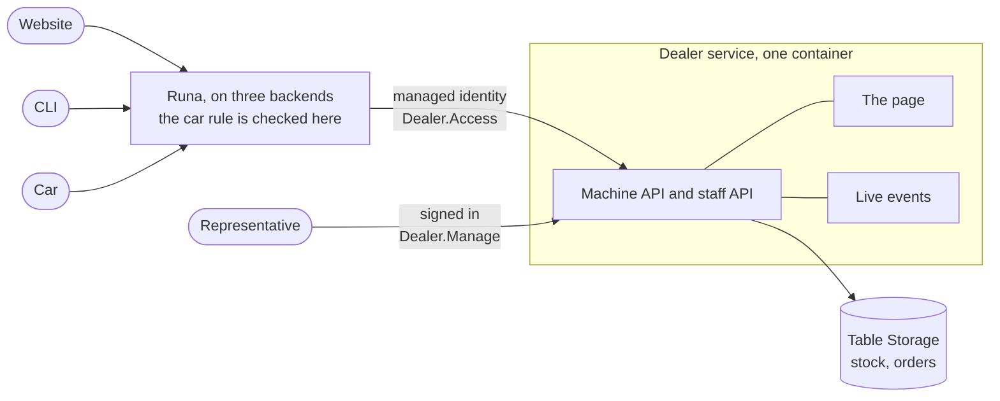
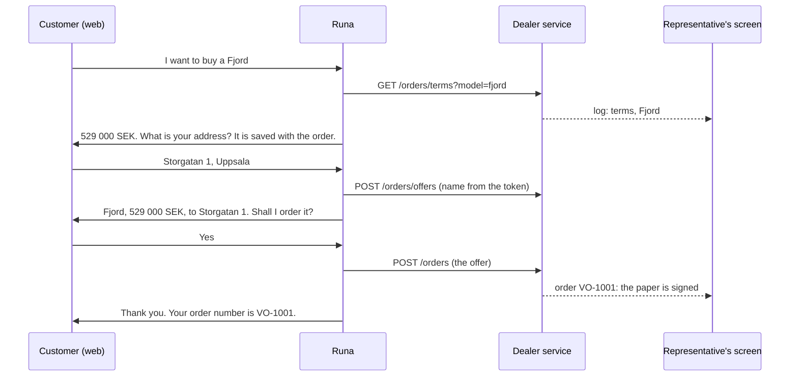

# Dealer orders and inventory: design

Status: approved by the product owner on 2026-11-24. Nothing is built yet.

## 1. Why

The dealer service answers questions about stock and prices, but nobody can see that it was called. In a demo it looks as if Runa knows the numbers. The product owner wants a system beside Runa that people can look at: a representative sees cars and purchase orders, and when a customer orders a car through Runa, it happens on that screen at the same moment.

It also shows a second thing: **what Runa may do depends on where it is used.** A car can be ordered on the website and in the CLI, never from inside a car.

## 2. Fit check

1. **Pillars:** tool calls through the agent, identity and authorization, clients and partner services.
2. **New or enhancement:** it enhances the dealer service, which gets a store and a UI, and adds one audience: the Voltrieve representative.
3. **Rules:**
   - *Three backends:* the order tools are in `agent_core`, so all three get them. The car rule is checked in code on all three.
   - *Private by default:* for the first time we store a name and an address ourselves. Section 9 says what limits that. Nothing of it goes to telemetry or logs.
   - *Secure by default:* two new roles, no keys, checks that fail closed.
   - *Cost:* section 12.

## 3. Goals, non-goals and what would make it a failure

**Goals**

- A representative signs in, sees the stock of cars per city, and adds or removes a car with one click.
- Purchase orders in a list. An order can be delivered when a car of that model is in stock, which takes one car from the stock, or deleted, which leaves the stock alone.
- An order has an order number, the name of the signed-in customer, and an address that Runa asks for. The customer gets a confirmation with the number.
- A live log of every call to the service.
- A purchase order is signed on the screen, with a fake signature, the moment it arrives. Then the screen goes back to normal.
- In the car, Runa says kindly that a car cannot be ordered there, and that the customer is welcome to talk with Runa about it on the website.
- The screen works next to the car or the website in a demo.

**Non-goals:** payment, trim and color, several cars in one order, delivery dates, e-mail, a customer's list of own orders, changing an order, stock of spare parts (unchanged), storing test drives (they are shown in the log and stored nowhere, as today).

**A failure even if it works:** an order made from a car, an order the customer did not say yes to, an address in a log or a trace, a screen that misses an order during a demo, or stock below zero.

## 4. Approaches

| Approach | For | Against |
| --- | --- | --- |
| **A. The dealer service grows, and serves its own UI (chosen by the product owner)** | One service, one address, one deployment. No cross-site setup. Runa calls the system you look at. | The page shares the cold start of the service. The image also builds the page. |
| A2. The same, with the UI as a separate static site | Like the other clients. | One more site, and cross-site setup. |
| B. The UI goes through the Web API | One front door. | Orders go through the assistant's API, so it does not look like a system of its own. |
| C. A page in the operations dashboard | The cheapest. | Mixes sales with the people who run the service. |

The product owner also chose how an order matches a car: **by model, in any city.** The representative picks the city that delivers. An order that no city can deliver waits.

## 5. How it fits together





## 6. Runa's side

Two new server tools in `agent_core`, in the same place as the other dealer tools:

| Tool | Does |
| --- | --- |
| `prepare_car_order(model, address?)` | Without an address: price, stock per city, and that Runa must ask for the address and say that it is saved with the order. With an address: saves an offer and returns its id, for Runa to read back. Runa calls it as soon as someone wants to buy a car, before asking for anything. |
| `place_car_order(offer)` | Places the order of that offer and returns the confirmation. |

- The address comes from the customer: 5 to 200 characters in one line. The name never comes from the model. It is the `name` claim of the signed-in user's token, or the username when there is none, and travels like `oid` does today, also to the hosted agent.
- **Nothing is ordered without a message from the customer after the read-back.** The offer holds customer, model, price, address and the turn it was made in. It can only be placed by the same customer, in a later turn, within 30 minutes. In the same turn the service refuses and Runa must ask. So text in a document, or an eager model, cannot order in one step. That the later message really says yes is left to the model, and measured (section 11). A changed car or address needs a new offer.
- An offer becomes one order. Placing it again returns the same order. So when the reply is lost, Runa is told that the order may have been received and to place the same offer again, not to start over. Offers are in the store, survive a restart, and go with a reset. Expired ones are deleted when the next offer is made and when the service starts.
- Both tools are private: their arguments and results are in no log, debug payload or error text, and a validation error does not repeat the value. Neither runs beside another tool.
- A new role, `Order.Place`, is required for both tools, so nobody types an address only to be refused. The deployer gets it. The test user does not.
- The customer's answer has: order number, model, price, name, address, and that Voltrieve will be in touch about delivery.

### The car rule

- A server tool may name the clients it is for. Both order tools name `web` and `cli`. The client is read from the `azp` claim of the token, never from a header, the model or the conversation, so a car that calls itself something else is still a car.
- An unknown client is refused too. A new hosted agent that gets no client from an older API refuses.
- The check is in `ToolSet.execute`, next to the role check, so it is the same code on all three backends, and comes before the role check. The refusal is a fixed text that tells Runa what to say. The trace event is `client_not_allowed`, seen in "Under the hood".
- The tools are listed for the car too. The refusal is then ours and not something the model makes up, and the attempt can be seen.
- A refused order never reaches the dealer service, so it is not in its log.
- What the car gets: "It is not possible to order a car from within the car. You are welcome to talk with Runa about buying a car on the Voltrieve website." Runa may say it in the customer's language. A question about prices or stock in the car is answered as before.

**Our own scripts** sign in through the Azure CLI, which is neither. The Azure CLI counts as `cli` for this rule only (not for the usage insights, where it stays `other`): a person who holds `Order.Place` could use the Voltrieve CLI in the same terminal. To test the car's refusal on the deployed service, a script sends `X-Voltrieve-Client: car`. That header can only turn a client into the car, which takes away and never gives. `X-Voltrieve-Test` does not change who may order: it only keeps the chat out of the counting, so an order in a test turn is a real row that staff see, and the script deletes it.

## 7. The dealer service

**Two kinds of callers, two doors.** The machine routes need `Dealer.Access` (applications only), as today. The staff routes need a signed-in user with the scope `manage_as_user` and the new role `Dealer.Manage`. Neither opens the other: Runa can read and place orders, and cannot deliver, delete or change stock. The registration `voltrieve-dealer` gets the scope and the role. The deployer gets the role. The Azure CLI is pre-authorized for the scope, as it is for the API, so that our scripts can read the stock and delete their orders. The page gets a registration of its own, `voltrieve-dealer-site`. The registration already requires an assignment, so an account without a role cannot sign in at all.

| Route | Who | Does |
| --- | --- | --- |
| `GET /stock`, `/parts/stock`, `/prices`, `POST /test-drives` | Runa | As today. `/stock` now reads the store |
| `GET /orders/terms` | Runa | Model, price, stock per city |
| `POST /orders/offers` | Runa | Saves an offer, returns its id |
| `POST /orders` | Runa | Places the order of an offer, returns the confirmation |
| `GET /staff/state` | Staff | Stock and orders |
| `POST /staff/stock` | Staff | One car more or less, for a model in a city. Never below 0 |
| `POST /staff/orders/{number}/deliver` | Staff | With the city. 409 when that city has none, or it is delivered already |
| `DELETE /staff/orders/{number}` | Staff | Removes an order, open or delivered. Stock is not changed |
| `POST /staff/reset` | Staff | Stock as in `data.json`, no orders or offers, empty log |
| `GET /staff/events` | Staff | Live events (server-sent events), with the latest first 200 |
| `GET /`, `/assets/*`, `/config.json` | Anyone | The page, and its tenant and client ids. Nothing else |

**Store.** Azure Table Storage in the existing account, one table, one partition. One partition makes it possible to deliver in one transaction: the order changes and the stock goes down, or neither. ETags stop two clicks from both winning. The service seeds the stock from `data.json` when there is none. The dealer's identity may read and write that table and nothing else in the account. Without a working store the calls answer 503, and `/healthz` still answers. A memory store is used only when asked for, for tests and local work.

**Order numbers** are `VO-1001` and up, and are not used again after a reset.

**One copy.** The service runs as at most one replica, so every open screen gets every event. It can still scale to zero. An open page reads the state once a minute, which is meant to keep the service awake and also repairs a missed event. That is measured first, before the page is built on it. During a deployment two copies may run for a moment: the store is safe then, but a screen can miss an event until its next read. The log lives in memory: the latest 200 entries, lost at a restart. Orders and stock are not.

**Log entries** have time, what happened, who (Runa, or the representative's name), the client (website or CLI) when known, the result, and the correlation id. They name the model, city and order number. They never hold an address. Entries are calls that do or ask for something: stock, parts stock, prices, terms, offers, orders, test drives, and what staff change. Page reads, the event stream and `/healthz` are not. A signed-in caller without the right role (403) is an entry. A call without a valid token (401) is not, since anyone on the internet could flood the log.

**Stale orders.** Orders older than 30 days are deleted at the first start or state read after that. A service that nobody uses deletes nothing, so this is no firm limit.

## 8. The page

In `services/dealer/site`: React and Vite as in the other clients, with their sign-in and stream code, built into the same image. It looks like the Voltrieve family, light and dark, and works from 720 pixels, so that it fits beside the car or the website.

```text
+--------------------------------------------------------------------------+
| VOLTRIEVE  Orders and inventory          (o) Live     Anna Rep   Sign out |
+----------------------------------------------------+---------------------+
| PURCHASE ORDERS                          2 open    | LIVE LOG            |
|  VO-1002  Fjord  529 000 SEK   Kim Berg    web     | 14:02:11 Order      |
|           Storgatan 1, Uppsala                     |  VO-1002 Fjord      |
|           Deliver from [Göteborg (4) v] [Deliver]  |  Runa, website      |
|                                         [Delete]   | 14:01:40 Offer      |
|  VO-1001  Spark  ...     Delivered, Malmö 13:58    |  Fjord  Runa        |
+----------------------------------------------------+ 14:01:02 Stock      |
| INVENTORY     Stockholm  Göteborg  Malmö  Uppsala  |  Atlas, Göteborg: 3 |
|  Spark         - 4 +      - 2 +    - 5 +   - 0 +   | 13:58:20 Delivered  |
|  Lumen         - 3 +      - 1 +    - 2 +   - 4 +   |  VO-1001 from Malmö |
|  ...                                               |  Anna Rep           |
+----------------------------------------------------+---------------------+
|                                                       [Reset the demo]   |
+--------------------------------------------------------------------------+
```

- **Adding a car** is one click on **+** in the cell of that model and city. The number moves at once, and flashes when Runa or a delivery changes it.
- **Deliver** lists the cities that have the model, with the count, and starts on the one with the most. With none, the button is off and says "None in stock", and comes on by itself when a car is added.
- **Delete** and **Reset** ask first.
- **The signing.** When an order arrives, the page dims and a sheet of paper slides in: Voltrieve, "Purchase order", number, date, car, price, name and address. A made up signature is drawn by a pen over two seconds, a stamp with the order number lands, and the paper flies into the list. About six seconds in all. A click or Escape skips it. Orders that arrive at the same time queue. With reduced motion the finished paper is shown for three seconds. The signature is a scribble drawn by code from the name, and the paper says "Demo order, not a real purchase".
- The signing plays only for an order that arrives while the page is open, never for the ones that were there when it loaded, and once after a lost connection that came back.
- A lost connection is shown in the header, and the page connects again by itself with a fresh token and reads the state again.
- Two representatives can have it open. Both see the same.

## 9. Personal data

- The name is the signed-in account's real name, and the address is what the customer types. In a demo, use a made up address. The docs say so.
- They are stored in the table, shown to staff with `Dealer.Manage`, and deleted with the order, by a reset, or at the first use after 30 days. An offer that was not placed is gone at the first use after 30 minutes.
- They are never in a log entry of ours, a span or a metric. Validation errors do not repeat the input. A customer's message is treated as every prompt is today.
- The chat where the address was typed is stored in Foundry as every chat is. The masking used by the live dashboard and the nightly job gets street addresses and postal codes, as a best effort: a pattern cannot find every address.
- Runa says that the address is saved with the order when asking for it, which covers the CLI too. The notice on the website gets the same in one sentence.

## 10. What it changes elsewhere

- **The fixed stock test** (Atlas in Göteborg) compares with `data.json`. It will read the expected number from `GET /staff/state`, as the signed-in deployer.
- **Agent instructions** change, so the routing suite must be run once on all three backends. It costs 15 to 20 SEK, and the product owner is asked first.
- **Docs:** clients (a fifth), decisions, deploy, runbook, prompt journey, README status, a picture of the page and of the signing, and the demo in the runbook: warm up, reset, page beside the website, order, deliver, then try in the car.
- **The website** gets one more suggested question, about buying a car.
- CI builds and tests the page.

## 11. Order of work and acceptance

1. Store, orders and staff routes in the dealer service, with the registrations and roles.
2. The page, with log, inventory, orders and signing.
3. The tools, the car rule and the instructions. Deploy order: dealer service, hosted agent and prompt agents, then the API.
4. Docs, evidence and the runbook.

**Accepted when, on the deployed service:**

- an order is placed on each of the three backends and gets a number, and it shows on an open page,
- the car is refused on each of the three backends, before Runa asks for an address, and nothing reaches the dealer service,
- Runa does not order when everything is in one message ("Order a Fjord to Storgatan 1"), after a "no", or with the old address when it was changed after the read-back: each on all three backends, all right,
- a representative's token gets 403 on the machine routes,
- the page is still live after 10 quiet minutes,
- delivering takes one car from the chosen city, twice in a row gives 409, and at zero it is refused,
- deleting leaves the stock alone,
- a marker in an address is found in no table of Application Insights,
- a restart keeps stock and orders,
- the routing suite is inside the limits it has today.

Two things are checked offline, with signed test tokens: that Runa's token gets 403 on the staff routes (a person cannot get such a token), and that a user without `Order.Place` is refused (`denied_demo.py`, which gets a client).

The signing and the layout are checked in a browser with a mock server, in both themes and with reduced motion, and the page is looked at beside the website.

## 12. Cost

- Table Storage: well under 1 SEK a month. No new resource, site or plan.
- The dealer service stays awake while a page is open: about 0.05 USD (0.5 SEK) an hour at list price, before the free grant. Closed, it scales to zero as today.
- The tests on the deployed service: about 60 short turns (about 5 to 10 SEK, an estimate), and the routing suite (15 to 20 SEK, asked first). The 2000 SEK limit for November stands.

## 13. Calls made by the designer

To be checked by the product owner:

1. `Order.Place` is needed to order, so an account without it is refused.
2. The Azure CLI counts as a CLI for ordering, and may be used by a representative for the staff routes, so that our scripts can test and clean up.
3. An order can be placed when no city has the car. It waits.
4. Runa's stock and price lookups are in the log too, not only orders.
5. The log is lost at a restart, orders and stock are not.
6. A reset button for demos, and orders are deleted at the first use after 30 days.
7. The price on the order is the dealer's Swedish base price.
8. An order needs a message from the customer after the read-back, and our code checks that (section 6).
9. Calls without a valid token are not in the log.

**Left to the builder:** file layout, component structure, exact look and motion, libraries for the store, how the scribble is drawn.

## 14. Not verified before building

- That the access token has the `name` claim for all clients. If not, the username is used, or the claim is added.
- That Runa calls `prepare_car_order` before it asks for an address, every time. The car rule does not depend on it, only how nice the refusal feels.
- How long the page takes to open after a cold start.
