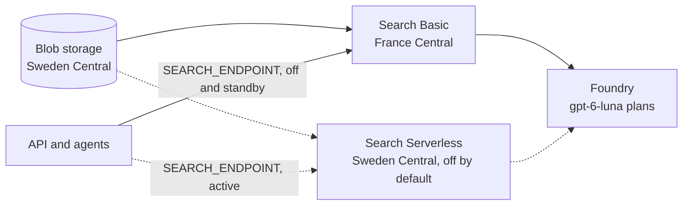

# Newer search APIs (Foundry IQ): design

Status: asked for by the product owner on 2026-11-24 ("please just implement the newer Azure Search APIs and deploy"), so approval before code is waived. Azure AI Search is now called Foundry IQ (Azure AI Search). Resource types, endpoints and meters keep their names.

## 1. Fit check

1. **Pillars:** RAG and agentic RAG, and evaluation and quality. Serverless also touches monitoring and operations, through cost.
2. **New or enhancement:** an enhancement. The second search service is new, and off.
3. **Rules:**
   - *Three backends:* the own loop and the hosted agent use the REST client, the prompt agent uses the MCP endpoint. Both move.
   - *Secure by default:* no keys. The new service has its own identity with only the roles it needs. No new text in logs or telemetry: one model name is added to a trace step.
   - *Receipts:* section 9 says what is measured, section 10 what is not verified.
   - *Cost:* no new idle cost until somebody turns Serverless on. Planning gets cheaper per token.
   - *Latest versions:* this is the recorded rule in [Decisions](../../decisions.md).

No rule is bent.

## 2. Approaches

| Approach | For | Against |
| --- | --- | --- |
| **A. `2026-11-01-preview` (chosen)** | Newest. GPT-6 planning. Nothing we use breaks. `maxOutputSize` stays. | Preview: no SLA, and a later preview can break it. |
| B. `2026-10-01`, stable | Support terms. Has planning. | No GPT-6. The request must use `maxOutputSizeInTokens` instead of `maxOutputSize`. Low effort picks up to 3 sources by default. |
| C. Microsoft Retriever 1 for planning | No model deployment at all. | Only `minimal` effort, and exactly one semantic intent instead of messages. No published price. A change of retrieval method, so it needs its own measurement. Not now. |

B is the way back to a supported contract, and it is one changed value plus one renamed field. It only works with a GPT-5 planner.

## 3. Versions

| Surface | From | To |
| --- | --- | --- |
| Data plane (REST) and MCP endpoint | `2026-08-01-preview` | `2026-11-01-preview` |
| Management (Bicep) | `2026-09-01-preview` | `2026-11-01`, stable |

`2026-11-01` was not live in France Central on 2026-11-04. A read of our service with it succeeded on 2026-11-24, and the provider lists it. `2026-09-01-preview` adds auto generated DNS labels, which we do not use.

The version is one constant, `DEFAULT_API_VERSION` in the search client. `create_agents.py` imports it. Bicep and `scripts/smoke.py` cannot import it, so a contract test compares them.

## 4. What breaks

Every field was checked against the `2026-11-01-preview` reference. The stored objects and the indexer status were also read from the deployed service in both versions: the only differences were added fields that are null or empty.

**Definitions**

| Object | Fields we send | Result |
| --- | --- | --- |
| Data source | `type`, `credentials` with `ResourceId`, `container` | Unchanged |
| Index | fields, `vectorSearch` (hnsw, `azureOpenAI` vectorizer), `semantic` | Unchanged. New optional: `topicGraphProfile(s)`, `organizationAccessExpiration`, `oneLakeSecuritySource` |
| Skillset | `SplitSkill`, `AzureOpenAIEmbeddingSkill`, `indexProjections` | Unchanged |
| Indexer | `parameters.configuration` | Unchanged |
| Knowledge source | `searchIndexParameters`: index, semantic configuration, `sourceDataFields`, `searchFields` | Unchanged. The removed query hints are for other source kinds, and we use none |
| Knowledge base | `knowledgeSources` (name only), `models`, `retrievalReasoningEffort`, `outputMode`, `retrievalInstructions` | Unchanged. `modelName` accepts four GPT-6 models. New `tools`: leaving it out clears stored tools, and we have none |

**Retrieve request:** `messages`, `knowledgeSourceParams` (`kind`, `knowledgeSourceName`, `includeReferences`, `includeReferenceSourceData`), `maxOutputSize`, `includeActivity`. All are still in the contract. It lists `maxOutputSizeInTokens` too. Live testing found earlier that the service wanted `maxOutputSize`, so it stays.

**Response**

| We read | Result |
| --- | --- |
| `response[0].content[0].text`, a JSON list with `ref_id`, `title`, `content` | Unchanged |
| `references[]`: `id`, `docKey`, `rerankerScore`, `sourceData` | Unchanged. `citationUrl` and `activitySource` are ignored |
| `activity[]`: `type`, `inputTokens`, `outputTokens`, `reasoningTokens`, `searchIndexArguments.search`, `error` | Unchanged. All are optional, and a token count can be null, which our sum could not handle. Fixed |
| `activity[].model` | The nested `model` object (`modelName`, `deploymentId`) came in `2026-08-01-preview`. We read no model name until now. It is now read, to prove which model planned and to price its tokens |
| `activity[].warning` | Optional text. Not read by the agents. `voltrieve-search retrieve` prints it with the activity |
| Status 206 | Partial, as before |
| Status 502 | Every source failed, or a `failOnError` source did. It becomes a tool error, like today |

**Paging of list calls:** lists are paged with `@odata.nextLink`. Our code makes no list calls. It reads objects by name. `docs/search` with `top: 1000` is a query, not a list.

**Removed parameters:** `$top`, `$skip`, `$count` on lists, `attributions`, the scalar `modelName` and `inclusionMode`. We use none.

**MCP endpoint:** the same URL and the same `knowledge_base_retrieve` tool. The documentation says the endpoint returns synthesized answers when the base has a model and a matching effort. Our bases store `outputMode: extractiveData`, so it should stay extractive. The prompt agent cites file names from chunks, so this is checked first after deployment.

**Management:** `publicNetworkAccess` is written `Enabled`. Nothing else changes. `disabledDataExfiltrationOptions` and `serviceLevelEncryptionKey` are gone from the answer, and we set neither.

**The one real trap is order.** GPT-6 models need `2026-11-01-preview`. A client still on `2026-08-01-preview` is not documented to work against a base that plans with GPT-6. See section 7.

## 5. Planning model

The documentation lists `gpt-6-astra`, `gpt-6-sol`, `gpt-6-luna` and `gpt-6.1-sol` for `2026-11-01-preview`. **`gpt-6.1-terra`, our chat model, is not listed.** `gpt-6-luna` is, it is the cheapest, and it was already deployed for the model comparison. It is chosen, version `2026-09-22`.

- **API profile:** GPT-6 profiles use the Responses API. Search sends the deployment id as `model` to `/openai/v1/responses` on `resourceUri`, with `store: false`. There is no documented fallback to chat completions. Our `models` entry is already right: `kind: azureOpenAI`, the native endpoint, the deployment, and the exact model name.
- **Role:** Cognitive Services OpenAI User on the Foundry account, for the search identity. The role contains `OpenAI/responses/*` (read from the role definition). The Basic service has it already, together with Cognitive Services User. One section of the same page asks for Cognitive Services User instead. Basic keeps both. The Serverless service gets only the first.
- **Parameter:** `planningModelName`, default `gpt-6-luna`, from `PLANNING_MODEL_NAME` in the azd environment. The only other value is `gpt-5.4-mini`. The versions sit next to each other in Bicep, so going back is one value. Both deployments stay in Bicep until the change is measured.

`low` effort stays.

## 6. Serverless

| Question | Answer |
| --- | --- |
| Sweden Central | Yes, with agentic retrieval and semantic ranker. France Central has no Serverless. The live offerings call says the same. Sweden Central takes no new Dedicated services, so Basic cannot move there, but Serverless can. |
| Knowledge bases with planning | Yes. 10,000 bases and sources per service, 10 sources per base. Source selection is stated for all tiers "including Serverless". |
| Semantic ranking | Yes. 4 concurrent and 8 queued per service. Basic has 2 and 4. |
| Indexers | Yes, generally available. Blob indexers with skillsets run in the shared environment. 2 hours per run, 48 hours a day in all. |
| Managed identity | Yes by the tier table ("not available on the Free tier"). The identity page says "Basic tier or higher" and does not name Serverless. |
| Keyless | Yes: role based access works "on any tier". |
| MCP endpoint | Not named for Serverless. The endpoint belongs to the knowledge base, and Serverless has the same APIs. To be tested. |
| Limits | 10 GB per index, 3 GB vectors per index, 50 queries a second per index. We have 2.4 MB and 2.7 MB in two indexes. |
| Moving a service | Not possible between Dedicated and Serverless. A new service must be created and filled. |

**It fits,** so it is built, off by default. One value, `serverlessSearch`:

| Value | Basic | Serverless | What the API and agents use |
| --- | --- | --- | --- |
| `off` (default) | deployed | not in the deployment | Basic |
| `standby` | deployed | deployed, filled by hand | Basic |
| `active` | deployed | deployed, filled by `azd up` | Serverless |

The Basic service is in the template in all three cases, and azd deploys incrementally, so neither service is ever deleted by a changed value. Setting `off` after `standby` leaves the Serverless service running. Deleting it is a manual decision.

Roles of the Serverless identity: Storage Blob Data Reader on storage, Cognitive Services OpenAI User on Foundry. Readers of it: the API, the hosted agent and the project identity (Search Index Data Reader), and the deployer (Search Service Contributor, Search Index Data Contributor).

## 7. Order of deployment

1. **The version, with the old planner.** Set `PLANNING_MODEL_NAME` to `gpt-5.4-mini`. Provision (which also writes the definitions with the new version), deploy the API, then run `scripts/deploy-agents.sh`. Check the prompt agent first. Measure.
2. **The planner.** Set `PLANNING_MODEL_NAME` to `gpt-6-luna`, provision. The definitions are written again, and the next retrieve plans with it. No new images. Measure.
3. **Serverless.** Set `standby`, provision, fill it, run the search smoke questions against it. Then `active`, provision, `deploy-agents.sh`. Measure, also after more than 10 idle minutes.

Never do steps 1 and 2 in one provision: between the new definitions and the new images, old clients would meet a GPT-6 base.

## 8. Rollback

- **Serverless:** set `standby`, provision, `deploy-agents.sh`. If the documents changed while Serverless was active, the provision indexes Basic again.
- **Planner:** set `gpt-5.4-mini`, provision. Minutes, no new images. Writing the two bases again with the old planner takes seconds.
- **Version:** the planner first, then the code of the commit before, with a provision, a deployment of the API and `deploy-agents.sh`. The index and its content are the same in both versions, so nothing is rebuilt.

## 9. How it is measured

- `voltrieve-search smoke`, which now prints the planning model.
- The routing suite, 3 repeats on three backends, against the 10 s limit to the first token, once per step.
- The grounding suite, once per step.
- `voltrieve-search retrieve` once per base, for `docs/evidence/search-activity.txt`.
- Planning: tokens and milliseconds per retrieve, from the activity. GPT-6 may spend more output tokens, because it reasons.
- Serverless: the same, plus the `AggregateComputeUnits` metric over a routing run and over an idle hour, and the first turn after 10 idle minutes.

Stay on `gpt-6-luna` if routing and articles are not worse and no more turns pass 10 s. Otherwise go back.

## 10. Cost

| Item | Today | After |
| --- | --- | --- |
| Search Basic | USD 0.101 an hour, about 74 a month | The same |
| Planning, per million tokens in and out | `gpt-5.4-mini`: USD 0.75 and 4.50 | `gpt-6-luna`: USD 0.10 and 0.50 (prices read 2026-11-05) |
| Planning, one retrieve of 946 in and 49 out | USD 0.00093 | USD 0.00012, if the token counts stay |
| Retrieval tokens | USD 0.022 per million after 50 million free a month | The same |
| Two planning deployments | 0 | 0, pay per token |
| Serverless, off | | 0 |
| Serverless, storage | | USD 0.259 per GB and month. 2.4 MB is under USD 0.01 |
| Serverless, compute | | USD 0.255 per CU hour, no minimum, zero after 10 idle minutes |

Prices for search are from the Azure retail prices API for Sweden Central, read 2026-11-24. The documentation does not say how many CU a small active index uses, so a monthly figure cannot be calculated. The break-even with Basic is 289 CU hours a month. At 8 hours of use on 22 days, that is an average of 1.6 CU. Running both during the measurement costs the Serverless compute on top of Basic. Indexing costs one round of embeddings for 159 chunks.

## 11. Not now

- **Image serving:** it only runs with answer synthesis and on blob, OneLake or SharePoint sources, and we use `extractiveData` on search index sources.
- **Citation URLs:** they point at the index document and need a token with index access, and our source links are signed blob links for linkable documents only.
- **Freshness:** it is a setting on sources that ingest for themselves, ours read an index, and all our documents are generated together.
- **Named knowledge base tools:** they could give the two MCP tools distinct names, but that changes routing, so it needs its own measurement.

## 12. Not verified

- Any write or retrieve with `2026-11-01-preview`. Only reads were done, all 200.
- That a base planned by GPT-6 refuses or accepts an older client.
- That the MCP endpoint stays extractive on the new version.
- That the Responses call works with the roles given, on either service.
- `maxOutputSize` on the new version.
- Serverless: creation, MCP, managed identity, cold start, CU use.
- `2026-11-01` for a write of the Basic service in France Central. A what-if of the whole template with it succeeded, with Serverless off and in standby, and showed no deletion.
- The price of `gpt-6-luna`: taken from the table in the repository, not read again.
