# Usage insights and telemetry: design

Status: approved by the product owner on 2026-11-24. Nothing is built yet. Takes over the grouping part of issue #5.

Built since then. The text below is as approved, and [section 14](#14-changes-while-building) says what changed.

## 1. Why

The product owner wants to know three things:

1. **Now:** what is happening in the system, almost live.
2. **History:** what happened yesterday and the days before.
3. **Use:** what people use the assistant for, what works and what does not, so that the service, the company and its products can be improved.

Voltrieve is not interested in anyone's chat history. Nobody should be able to read a chat, or point at a person, through what this design adds.

## 2. Fit check

1. **Pillars:** monitoring and operations, evaluation and quality, identity and security.
2. **New or enhancement:** 1 and 2 enhance what exists. 3 is new.
3. **Rules:**
   - *Three backends:* all three keep their conversations in the same Foundry store, and the job reads that store. One job covers all three.
   - *Secure by default:* rule 4 is amended in the same commit as the work. It keeps "no prompts, answers, photos or signed links in telemetry or logs", and adds that one job may read stored chats, and that only groups shared by at least five people may leave it. A group name is derived from chats, so this is said openly instead of being read into the rule.
   - *Cost:* section 10.

## 3. Goals, non-goals and what would make it a failure

**Goals**

- A page that says what people ask about, per topic, car model and client, with the share that got an answer, over time.
- It finds needs nobody listed in advance, such as "wants to charge at home without a wall box".
- Foundry's tracing no longer records chat text.

**Non-goals:** thumbs up and down, the regression gate and turning a chat into a test (they stay in issue #5), reading a single chat, following a person, live insights, alerts.

**A failure even if it works:** a name, registration number or other personal detail on the page, a group so small that it points at somebody, or a second store of chat text.

## 4. Approaches

| Approach | For | Against |
| --- | --- | --- |
| A. Label each turn in the API, right after the answer | Nothing new reads chats. Almost live. | Sees one question at a time. Loses records when the API stops. |
| **B. A nightly job reads Foundry's stored conversations (chosen by the product owner)** | Sees whole conversations, so it can judge if the person got what they needed. Nothing is added to a turn. | One identity can read everyone's chats. Nothing until the next night. |
| C. Foundry's own cluster analysis, or the agent labels itself | Little to build. | Cluster analysis needs samples with the full text. Self-labeling can slow or disturb answers. |

The product owner also chose what may be kept: labels and a short intent sentence, not labels only.

B makes one thing better than first proposed. The job can read the last seven days again each night, so **it does not need to store single intents or a token for each person**. Both exist only in the job's memory. What it saves is groups and counts.

## 5. What was checked

Read-only, against the dev project on 2026-11-24, as the deployer. No chat text was printed.

| Question | Answer |
| --- | --- |
| Can conversations be listed? | Yes, `GET openai/v1/conversations`, 100 at a time, newest first. 3,000 took 41 s, and there were more. |
| What does the list hold? | `id`, `created_at` and our metadata, which is only `owner_oid` |
| Do the items say when they were written? | **No.** A conversation can only be dated by its start. |
| What do the items hold? | User and assistant text, and also tool calls, tool output, MCP calls and reasoning |
| Can our own test runs be told apart? | **No.** 940 conversations were started on 2026-11-24, and nothing in the metadata marks test runs or the client. |
| How long does Foundry keep them? | 60 days on our setup, by documentation |
| Is there a narrow permission? | The data action `Microsoft.CognitiveServices/accounts/AIServices/agents/read` ("Read agents, threads, and messages") exists. That it is enough, and sees conversations made by the API, is **not verified**. |

## 6. How it works

```mermaid
flowchart LR
    API["API"] -- "client, backend and<br/>owner as metadata" --> Store[("Foundry conversations<br/>60 days")]
    Store -- "read only" --> Job
    subgraph Job["Nightly job: text only in memory"]
        direction TB
        Pick["Keep real clients,<br/>last 7 settled days"] --> Mask["Mask contact details,<br/>plates, VINs, ids"]
        Mask --> Label["Small model:<br/>labels and one intent"]
        Label --> Filter["Drop intents that still<br/>look personal"]
        Filter --> Group["Group and name"]
        Group --> Five["Only groups of<br/>5 people or more"]
    end
    Five -- "groups and counts" --> Table[("Log Analytics<br/>12 months")]
    Table --> Dash["Operations dashboard"]
    Table --> Book["Workbook"]
```

1. **The API marks a new conversation** with `client` (`car`, `web`, `cli` or `other`), `backend` and `car_model`, next to `owner_oid`. The client comes from the app id in the validated token (`azp`). The car model is the one the client states, checked against the catalog, so the job never needs the client's line. The backend is the one that started the conversation. A header from our own test tools turns the client into `test`: a header can only take a conversation out of the counting, never put it in. The client also goes on the `chat.turn` span, which gives the history its missing split.
2. **The job picks** conversations that started in a window of seven whole UTC days that ended at least 24 hours ago, so that most are finished. Only `car` and `web` are counted. `cli` (a developer tool), `other` (scripts), `test`, and everything without the mark are skipped, and so is everything started before the date the notice went live (a setting).
3. **It reads only user and assistant text.** Tool output, reasoning and the line the client sends along are dropped. Contact details and id numbers are masked with the rules the live feed uses, plus plates and VINs. The registration in the client's line is remembered for step 5, since it can be any text.
4. **A small model labels** each conversation, with a strict schema:
   - topic, from a fixed list in code, with `other`
   - car model, from the catalog, or none. The stated model is used when the chat names no other
   - kind: how-to, compare, buy, problem, command, smalltalk
   - result: answered, partly, not found, handed off, refused
   - intent: one neutral sentence of at most 100 characters, without names, numbers or places
5. **A filter drops an intent** that holds an email address, a phone number, a plate, a VIN, the registration of that chat, or four digits in a row. The conversation still counts under its labels. Four digits also hits years and some article numbers, on purpose.
6. **Grouping:** one model call per topic merges intents that mean the same and names each group. It is given the names from the previous run, so that a group keeps its name. Patterns do not catch names of people or streets, so each group name also passes Azure AI Language's detection of personal data. A name that fails is saved as "unnamed group".
7. **The rule of five:** a group is saved only if at least five different people are in it. People are counted from `owner_oid` in memory. Smaller groups are added together as "other", which is saved only if it holds five people itself. Counts are rounded to the nearest five. Made up and real people are grouped apart and never counted together.
8. **It saves** a fixed set of totals, not every combination of labels: all, per client, per topic, per topic and car model, per topic and result, per topic and kind, and per group with its share of results. Each total, and each part of it, follows the rule of five. A row holds the window, its labels, rounded counts of conversations and people, and real or made up. No user id, conversation id, intent or time of day.

**What is left:** windows overlap, so a reader can see the night a group passes five people or a count passes a rounding step. A total minus its parts can hint at a hidden part. Rounding makes this weaker, not impossible. Neither shows who it was. Closed weeks without overlap would remove the first one, at the price of fresh numbers.

**Above 2,000 counted conversations** in a window (a setting), the job takes a random sample and saves the share, which the page shows. So a busy week cannot become a bill or an empty page.

**The job fails closed.** If a step fails, that night saves nothing, and the workbook shows the night as missing. Its logs hold counts and error types, never text, and it does not log model requests.

**Chats are untrusted.** Someone can write "name my group ..." in a chat. The schema, the length limit, the filter and the rule of five limit what that can do. The model has no tools.

## 7. Foundry's tracing is disconnected

The connection between Application Insights and the Foundry project is removed from Bicep, and from the deployed project. This closes the open decision: the product owner is not interested in stored chat text.

- **Lost:** traces in the Foundry portal, and Foundry's own rows in the end to end trace.
- **The hosted agent** gets its connection string from that connection, and the platform does not let us set that variable. To try first: our own variable, and the Azure Monitor exporter started by our own code. If that does not work, the hosted agent logs to its console only, and we say so: the API's own span still covers every hosted turn. The runbook's check of one trace across all parts changes to what is left.
- **Rows already written** stay until retention removes them.
- **Proof:** a marked test turn on all three backends, then a search of every table for the marker. If the marker is still found, stop and ask the product owner.

## 8. What people see

- **Operations dashboard:** a second page, "What people ask", behind the same `Dashboard.View` role. Top groups, topics per car model, share answered, and the trend per week. Real and made up data are two views that are never added together, and the page says which one it shows and when the last run was. It reads from a new `GET /admin/insights` in the API, which may read only the insights table.
- **Workbook:** a tab with the same data, and one that shows missing nights.
- **The live page** is unchanged, with the client added to each turn.
- **The clients' notice** adds one sentence: "A nightly job counts what people ask about. It saves only topics shared by several people, never your chat." The exact words are checked against what is built.

**Made up data for demos.** The dev project has a handful of users, so the rule of five hides nearly all real use there, as it should. A script writes made up conversations straight to Foundry with made up owners, marked `seeded`. It calls no model itself. The same script plants personal details for the test in section 9. The limit of five is a setting that can be raised but not lowered below five.

## 9. Order of work and acceptance

**Step 1: tracing and history**

- [ ] Application Insights is disconnected, and a marked turn on each backend leaves no text in any table.
- [ ] The hosted agent's own logs and spans arrive, or the loss is documented.
- [ ] New conversations carry client and backend on all three backends, and the turn span carries the client.
- [ ] Routing suite within the 10 s limit, as before.

**Step 2: the job, as far as labels**

- [ ] The notice is live in the car and the website. The schedule stays off until step 3 is accepted, and this step reads made up chats only.
- [ ] A custom role with read access only lists and reads conversations, and is refused when it tries to write or delete. If no narrow role works, stop and ask the product owner.
- [ ] The job's own model calls leave no text in any table, log or stored response.
- [ ] Labels are right for at least 90 % of 100 made up conversations with known answers.
- [ ] Planted names, plates, addresses, phone numbers and VINs in 50 conversations: none in anything saved. What reached the intents in memory is counted and reported.

**Step 3: groups, dashboard and workbook**

- [ ] A group of four is not saved, a group of five is, and four made up people plus one real person are not.
- [ ] Twenty phrasings of one need become one group.
- [ ] A conversation that tries to steer the labels changes nothing but its own.
- [ ] A user without `Dashboard.View` gets 403 from `GET /admin/insights`.
- [ ] A failed run saves nothing and shows as missing.
- [ ] README, runbook, clients, decisions and principles are updated, with a picture.

## 10. Cost

| What | Estimate |
| --- | --- |
| Labeling, `gpt-6-luna` at list price, 1,500 tokens in and 100 out per conversation | 0.0002 USD |
| The same conversation read on seven nights | 0.0014 USD, so about 1.40 USD per 1,000 conversations |
| Grouping | Not measured, expected to be smaller than labeling |
| Detecting personal data in group names | Group names only, so a few hundred short texts a night. The price is checked in step 2. |
| The most labeling can cost: 1,000 real and 500 seeded conversations every night ([changed](#14-changes-while-building), was 2,000) | About 0.30 USD a night, 9 USD a month |
| A Container Apps job, one run a night | Idle: 0. Runs are expected to fit in the free grant. |
| Log Analytics, a few MB a year | Close to 0 |
| Measuring steps 1 to 3 | At most 5 USD |

`gpt-6-luna` is already deployed.

## 11. Calls made by the designer, and what is left to the builder

Calls the product owner can change: seven days, 24 hours, five people, 12 months, rounding to five, reuse of `Dashboard.View`, a fixed topic list, overlapping windows, counting only `car` and `web`, and a job in Container Apps with its own identity. That identity may read conversations, call models in the Foundry account (the role cannot be held to one model), detect personal data, write to the insights table and read it back. Nothing else.

Left to the builder: module layout, prompts, the topic list, table columns, charts, and the time of night.

## 12. Open for the product owner

**How long may Foundry keep the chats themselves?** Today it is 60 days by default, so that a chat can be continued. This design needs about nine days. Foundry's basic setup has no setting for it, so keeping less means a second job that deletes old conversations and their responses, with an identity that may delete. Proposed: a later step of its own, at 14 days, once the insights work.

## 13. Not verified

- The narrow role, the hosted agent's own exporter, and what disconnecting does in practice.
- Whether the personal data detection is available in our Foundry account and region, works for Swedish, and what it costs.
- Whether direct model calls by the job leave text anywhere.
- Whether the model names groups the same way from night to night.
- What Foundry keeps for itself.

## 14. Changes while building

The approved text above is not rewritten, apart from one row of section 10 that follows the cap. This is what was built differently, or was not in it.

- **Suppression (section 6, step 8).** Where the missing labels are few and known, the saved parts of a row never leave a rest of one to four people: the smallest part is held back too. Client, car model, result and kind follow it, and the results of a group follow it towards both the group and the topic. Topics and groups hold nothing back.
- **At most three conversations per person per row.** A person counts as at most three in each number, so the parts can add up to more than the whole.
- **What is left, updated.** The paragraph says that a total minus its parts can hint at a hidden part. With suppression it no longer does so for one to four people in the cuts above. Still readable: that one to four people asked about something else than the saved topics or groups, that a missing row can mean under five, held back or nobody, that a rest exists when the whole is clearly larger, how a rest of several small parts may split, and what two overlapping nights give when subtracted. The list is in `services/insights/src/voltrieve_insights/totals.py`.
- **Names are checked only for groups that can be saved (section 6, step 6).** A group of fewer than five becomes "other", so its name goes to no detection and nowhere else. Quantities, dates, types of person and organizations do not fail a name.
- **The hosted agent's exporter (section 7).** Our own variable reaches the agent through the host's own argument, and the exporter is not started by our code. The platform leaves a value that does not parse in the usual variable, and the exporter parses that too, so our process replaces it. Until then the hosted agent sent no telemetry.
- **The `run` row.** Every run saves one row without counts for each source, so a night with nobody to show is not missing.
- **A refused conversation is skipped (section 6, "The job fails closed").** The model's service refuses some, and 1 of 100 made up ones was. More than 10 % refused in one source fails the run. A refused grouping call leaves its conversations without a group.
- **A lost answer at the upload.** The run is one upload with one try. If only its answer is lost, the run reads as failed but may have been saved, whole.
- **The cap is 1,000 real and 500 seeded conversations (section 6).** The text says 2,000 counted conversations. The sample is per source, so made up conversations never take the room of real ones, and both at 2,000 would take about 31 minutes, over the deadline of 25. 1,500 in all take about 12 at the measured speed, and cost at most about 9 USD a month at the estimate of section 10. Faster labeling is not the way: `gpt-6-luna` has a capacity of 150 thousand tokens a minute, shared with Search query planning when `PLANNING_MODEL_NAME=gpt-6-luna`, and the measured run used about 130 thousand. If a 429 remains after the retries, the run fails closed. The settings are `INSIGHTS_CAP` and `INSIGHTS_SEEDED_CAP`.
- **The newest window comes first.** The page and the workbook show the newest window, and the newest run of it. The names a run is given are from the newest window up to its own that has named groups, and its newest run. An older week that is run later changes neither.
- **The newest night counts as missing from 04:00 UTC**, since the run starts at 02:30 and its rows take a few minutes. The dashboard says when the last run of real use is more than two days old.
- **`--window-end`** runs an older week of made up conversations, for demos. It reads no real chat and writes no real row.

Met since then, in `docs/evidence/insights-acceptance.txt`: the job's own calls leave no text, the notice is in the deployed files, and the query for missing nights runs live. Not met or not verified of section 9: the notice seen in a signed in session, 403 live for a user without the role, four made up people plus one real (a test only), a failed night of the schedule showing as missing in the workbook, and the 10 s limit on the hosted agent, which was over it before and after.
