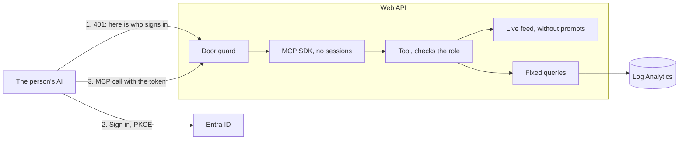
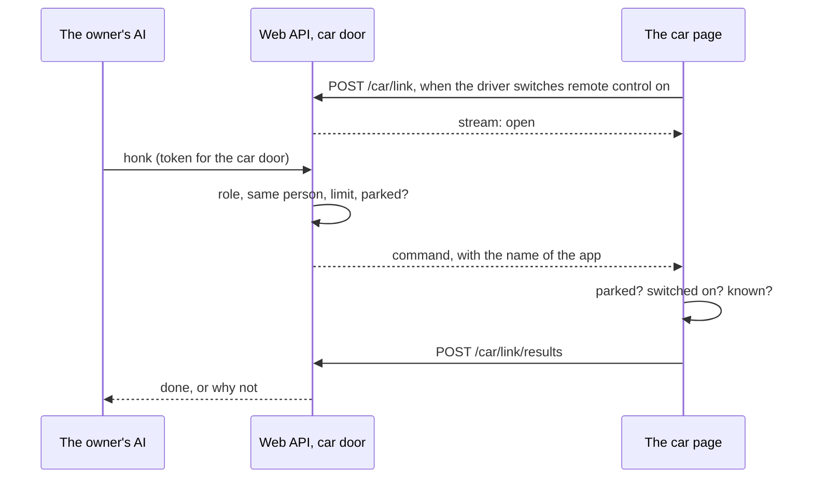

# Bring your own AI: four MCP doors

Status: the product owner ordered the build and the release of #16, #20, #21, #22 and #23 on 2026-11-25, without pausing for questions. The owner approved the issues, but has not read this text. Choices that the issues left open were made by the builder and are marked **(builder's choice)**, so that they can be changed.

Sections 1 to 14 hold what is common and the operations door. Sections 15 to 17 hold the car, the dealer and the customer.

## 1. Why

People around Voltrieve have an AI of their own. This shows how Voltrieve opens its services to it, and proves one point: **the same person gets different rights through different doors, whichever AI they bring.**

What every door needs comes first: the address, the sign-in, the checks, the telemetry rules and the tests. The operations door is the first real use of it, since it only reads.

## 2. Fit check

1. **Pillars:** ready for AI agents, identity and authorization, monitoring and operations.
2. **New or enhancement:** a new way in to services that exist.
3. **Rules:**
   - *Microsoft's platform:* Entra ID, Container Apps and a managed certificate. The protocol is open, and so is its SDK.
   - *Three backends:* the doors do not reach the agent, except `ask_runa` (section 17), which works on all three.
   - *A normal company:* the official SDK, inside the API that runs today. No new service.
   - *Secure by default:* section 6. No secret anywhere.
   - *Private by default:* section 7. No chat text through a door.
   - *Receipts:* section 10.
   - *Cost:* section 11.

No rule is bent.

## 3. Goals, non-goals, and what would make it a failure

**Goals**

- A harness that follows the MCP standard can sign in with Entra ID and call a tool, with no secret.
- We know, harness by harness, what works and what does not, and the guide says it.
- Someone with `Dashboard.View` can ask their own AI how Voltrieve behaves and what went wrong.

**Non-goals:** agents of our own, MCP Apps, prompts and resources in MCP, people outside our tenant, ordering a car.

**A failure even if it works:** chat text or a caller's words in telemetry or in an answer, a tool that answers without the role, a door that slows down Runa, or a guide that claims what nobody tried.

## 4. What was found before this design

A throwaway spike on 2026-11-25, with `mcp` 2.3.0 on one machine and no Entra ID. It is not in the repository.

| Question | Found |
| --- | --- |
| Two doors in one FastAPI app? | Yes, each with its own metadata at its own path |
| Newest and older clients? | Both 2026-07-28 and 2025-11-25 worked against the same stateless door |
| A token for one door at another? | 401 |
| Is a tool that is not listed safe? | **No.** It can be called anyway, so the call must check |
| Asking the person in the middle of a call? | Works for new clients. Older clients without sessions, and clients that cannot ask, get an error, so nothing is done |
| Does the SDK keep quiet? | **No.** The text of a failed tool went to the log with its traceback. The caller's tool name, method and request id went into span names and attributes. A caller can also choose the trace id |

And from the documentation: the id of the resource must be the server's address, on a domain that is verified in the tenant. `mklab.se` is verified in ours. Addresses of Azure Container Apps are not.

## 5. Approaches

### Where a door lives

| | Good | Bad |
| --- | --- | --- |
| **A. In the service that owns the data (picked, issue #16)** | No extra hop, no token exchange. The user and the calling app are in the token | Shares the one replica with Runa |
| B. A container for all doors, with an on-behalf-of exchange | Kept apart from Runa, one address | Every call needs a second token. The API then sees the gateway as the client, so the app has to be passed on in some other, trusted way |
| C. Azure API Management in front | Rate limits and monitoring ready made | A standing cost, and one more thing to run for a small company |

A is simplest, and its weakness is handled in section 8. B and C are described in the documentation as what to do when outside traffic grows.

### How a client gets an identity

| | Good | Bad |
| --- | --- | --- |
| **A. Clients registered by hand, public, with PKCE (picked)** | Supported, no secret, and we decide which harness may come | One registration per harness |
| B. Client ID metadata documents | Nothing to register | A preview without a service level, and any client may ask |

A is built and documented. B is tried in the sign-in test and reported.

### The address

A name of our own on the API: `api.voltrieve.mklab.se` in our environment, a setting in Bicep. Without one, the door has the address of the container app and the id `api://<client id>`. Then a script with a token from the Azure CLI can use it, and a harness most likely cannot sign in. With no door registrations in the settings there are no doors at all, so nothing changes for a deployment that does not want them. DNS is changed by the owner of the domain, never by a script. A routing rule in the Container Apps environment could put all doors under one name. Two names, one for the API and later one for the dealer service, are simpler.

## 6. The design

- **The door:** `https://<host>/mcp/operations`, with metadata at `/.well-known/oauth-protected-resource/mcp/operations`. Stateless, JSON answers, protocol 2026-07-28, with older clients served by the same code. Only tools.
- **Its own registration,** `voltrieve-mcp-operations`: the address as its id, one scope `operations.read`, v2 tokens. The role `Dashboard.View` is defined on it too, and given to the same people by the same script. A role lives in the registration that the token is for, so the API's own role cannot be reused.
- **The token check** is the API's, made configurable (audience, scope, role), in the shared package. Tokens for the API itself do not open a door, and tokens for a door do not open the API.
- **Harness registrations,** one each, public, only with the redirect addresses of that harness and only this scope: `voltrieve-harness-claude`, `-chatgpt`, `-vscode`. Microsoft 365 Copilot is tried with Entra sign-in, without a secret. If it cannot be done without one, that is the result.
- **Who may call:** a valid v2 token for this door from our tenant, the scope, the role, and a calling app (`azp`) on the list in the settings. An unknown app is refused, so a new harness is a decision and not a surprise. The Azure CLI is on the list when `MCP_ALLOW_CLI` is true, which the entra script also needs for the pre-authorization. It is off by default and on in our dev environment.

### The door guard

A small piece of code in front of the SDK, shared by all doors. It answers before the SDK sees anything:

1. The host must be the configured one. A browser origin must be on a list, which is empty from the start.
2. The token is checked by the same code as the API's other routes, with this door's audience. 401 points to the metadata.
3. The body is at most 64 KiB and one JSON-RPC message. The method must be one the door supports, and the name in `tools/call` one the door has. Otherwise a fixed error, which repeats nothing.
4. The SDK's own spans and logs are off, so the caller's request id and names reach neither. A trace id that a caller sends is used as on every other route.
5. Limits: 30 calls a minute per person and app, and at most 4 calls at the same time in all doors of a service. Over that: 429. Kept in memory, so they start again with the process, and would have to move if there were more than one replica.

The guard is plain ASGI middleware that takes the paths of the doors and leaves the rest alone. It lives in a package of its own, `doors/`, which the API and the dealer service both use. CORS of the API does not apply to a door.

### Tools

Every tool checks the role again when it is called. All are read only. Answers are capped in size, and arguments are checked against a schema and fixed choices.

| Tool | Arguments | Answer |
| --- | --- | --- |
| `service_health` | `period`: 1 h, 24 h or 7 d | Per backend: turns, errors, median and worst time to first text, turns over 10 s, cost |
| `recent_turns` | `count`, at most 20 | The latest turns from the live feed: time, backend, client, outcome, tools, times, cost. After a restart it says since when it knows |
| `problem_turns` | `period`, `kind`: slow or failed | At most 20, with correlation ids |
| `explain_turn` | `correlation_id` | Each step of one turn: kind, time, result |
| `what_people_ask` | none | The totals from the nightly job, `real` only, as on the dashboard |

Queries are fixed text in code. A period is one of three constants, and a correlation id must match the pattern that the API uses. `recent_turns` reads the live feed. The other answers about turns come from the `chat.turn` spans and the spans beside them, through the same Log Analytics reader as the insights (no new package).

## 7. Privacy

- No prompt, answer, user name or pseudonym leaves through the door. `recent_turns` builds its answer from a list of named fields, so a new field in the feed does not leak by default.
- `explain_turn` gives the kind of each step (model, search, dealer, Foundry), never an address or a query.
- The SDK's own spans and logs are turned off for what they may quote. Our span for a call has the door, the tool from our list, the calling app from our list, the result and the time.
- A failed tool gives the caller a fixed text, and the log the type of the error.
- What the AI then does with an answer is for the one who brought it. The guide says so.

## 8. Keeping Runa fast

The API has at most one replica, and scales to zero. A first call after a quiet time takes about 30 s, and a harness may give up. `just warm-up` helps, and the guide says so. A replica that always runs would be a standing cost, so it is not chosen **(builder's choice)**. To protect Runa: at most 4 calls at once in the doors, queries with a timeout of 10 s, answers cached for 30 s, and no model call. It is measured: routing questions on the own loop with and without a scripted client that keeps the door busy.

## 9. Changes

- **API:** `app/doors/` with the guard, the token check for a door, and the operations door. `mcp==2.3.0` is the new dependency (released 2026-10-02). What it brings along is checked against the 168 hours.
- **Entra setup:** the door, the harnesses and the assignments, idempotent, with tests.
- **Bicep:** the host name and its managed certificate, the settings, and reading of `AppDependencies` and `AppRequests` for the API's identity, with the condition on the table that the insights table has today.
- **By the product owner, in DNS:** one CNAME and one TXT record. The free certificate also needs that a CAA record on `mklab.se`, if there is one, allows DigiCert.
- **Dashboard:** calls per door, tool and app, as a workbook section.
- **Docs:** "Bring your own AI" with a guide per harness, decisions, a diagram, the README.

## 10. How it is verified

1. **Offline tests:** each refusal (no token, wrong door, wrong tenant, no scope, no role, unknown app, unknown tool, unknown method, two messages, too big, wrong host, over the limit), for new and older clients. A marker placed in every caller-controlled field is in no span and no log.
2. **A scripted client against the deployed door,** with a token from the Azure CLI, kept as evidence. The CLI is on the list of apps in dev only.
3. **The sign-in test,** by hand with the product owner: each harness connects and calls `service_health`. What worked, what did not and the error go in `docs/evidence/`. First with registrations by hand, then once with the preview.
4. **A real question:** "which turns were slow today, and why?", asked from one harness.
5. **The same question to Azure MCP Server,** run locally with the product owner's Azure rights, side by side. If it answers as well, the door shrinks to what it cannot do.
6. **Routing suite** on the own loop for the time to first text, with the cost estimated and approved first.
7. A marker from a chat question is in no answer from the door.

## 11. Cost

No new idle cost: the certificate is free, and the subdomain is on a domain we have. Queries are small. The role condition and the registrations cost nothing. In use: an open connection to a car keeps the API awake, about 0.5 SEK an hour, and exists only while remote control is on. `ask_runa` costs as much as a turn on the website. Document and parts search plan with a small model, as today.

## 12. Order of work

1. Token check, guard and one tool (`service_health`), tested offline.
2. Registrations, the address and the first deploy. Then the sign-in test.
3. The other tools, the workbook section, the docs.

The sign-in test needs the DNS records and the product owner's hands. The release does not wait for it: the guides say "not tried" until it is done.

## 13. Left to the builder

Names of files and settings, the exact fields of each answer, and the wording of tool descriptions and errors.

## 14. Not known

- Whether each harness accepts two doors on one host, and a resource with a path.
- Whether the harnesses send `resource` in a way that Entra ID accepts.
- Which plan is needed in ChatGPT and in Microsoft 365 Copilot for a custom server.
- Whether a certificate can be created and bound in one Bicep deployment, or needs a second step in a hook.

## 15. The car door (#21)

**Why, in one line:** flash the lights from your own AI, and never drive from it.

- **The tools, and no others:** `car_status` (connected, parked, odometer, wipers), `honk` (1 to 3), `flash_lights` (1 to 5), `set_wipers` (off, slow, fast). Speed, parking and the camera do not exist here.
- **The link.** A car page with remote control on holds one stream to the API, authenticated like every other call to it. It tells the API when parked or odometer changes. Only the car client may open a link, and the Azure CLI when `MCP_ALLOW_CLI` is true, so that a script can play the car. No link, no cost.
- **Whose car:** the person whose token opened the link, by `oid`. The caller's `oid` must be the same. Nothing in the arguments names a car. With two tabs, the one opened last answers.
- **The car decides last.** It does nothing when it is moving, when remote control is off, or when it does not know the command. The answer says why. The API checks the same first, from what the car last told it.
- **The driver sees it:** "Claude honked the horn" on the center screen, and what was refused. Remote control is off at every start of the page **(builder's choice)**.
- **Limits:** 6 commands a minute per person, 5 s to answer, then "The car did not answer". Nothing is queued for later.
- **Flashing** lights the street and the arrows in the driver display. Reduced motion shows a steady light instead. One flash takes 0.6 s, so it stays under three flashes a second.
- **Runa** does not get the new function. Its tools for the car are unchanged.
- **Why a stream and not Web PubSub:** one replica, few cars, no new resource. With more replicas, Web PubSub.

## 16. The dealer door (#22)

- **Address:** `https://<dealer host>/mcp/dealer`, in the dealer service, with its own registration `voltrieve-mcp-dealer`, scope `dealer.use`, and two roles: `Dealer.Staff` for people and `Dealer.Agent` for applications.
- **Which dealer:** a setting in the dealer service, `DEALER_DOOR_CITIES`, a list from person or application (`oid`) to city. Not in the list: refused, even with the role. The city never comes from an argument.

| Tool | Person | Application |
| --- | --- | --- |
| `my_stock` | Yes | Yes |
| `change_stock(model, change)`, one car up or down, never below 0 | Yes | Yes |
| `open_orders(after?)`: number, model, price, time, and if the own city has the model | Yes | Yes |
| `deliver_order(number)` from the own stock | Yes, when the person has said yes in the middle of the call | **No (builder's choice)** |

- **Delete does not exist** through this door.
- **No name and no address.** An order belongs to whoever delivers it, and the address is on the staff page **(builder's choice)**.
- **New orders** are asked for with `after`, the last number seen.
- **The yes** is asked for by the server with MCP's elicitation, with number, model and city in the question. A harness that cannot ask gets a clear refusal, and nothing is delivered. A "no" delivers nothing.
- **The live log** shows the calls: who, from which app, what. The dealer page gets it through the same hub as today.
- **An application without a secret** is verified in tests. A live run needs a managed identity with the role, which is not set up here, so it is listed as not verified.

## 17. The customer door (#23)

- **Two ways, in one door, by scope:** `customer.tools` gives the tools, `runa.ask` gives `ask_runa`. A harness that asks for one scope sees only that one. Role `Customer`, and `TestDrive.Book` for the test drive.
- **Tools:** `search_documents`, `search_parts`, `check_car_stock`, `check_part_stock`, `car_prices`, `book_test_drive`, `my_car`, `approved_answer(topic)`. They call the same code as Runa's tools. Titles of the sources come with the result. A signed link is not given, since it would live on in someone else's chat: the answer gives the title, and the website opens it **(builder's choice)**.
- **`ask_runa(question)`:** one turn, a new conversation each time, on the backend that the API uses, or the one in `X-Agent-Backend`, so that all three can be measured. The answer comes with the titles of its sources. No client tools, no photo, and no ordering: the client of such a turn is `mcp`, which the order rule does not allow, and Runa points to the website. 5 a minute per person.
- **My car** is the one made up car that the website and the car show, from one file in the API. Everyone has the same one, as today. A test compares it with the website's. A store of customers was considered, and one made up car per person proves nothing more here **(builder's choice)**.
- **Approved answers:** the result says that the text must be shown as it is. Whether the caller's AI does so is measured.
- **The comparison:** a plain model with only these tools against Runa, on a small set of routing questions. A full run is bulk and waits for the product owner's approval of the cost.
- **Usage counts:** a turn from the door is counted as client `mcp` on the dashboard and in the insights.

## 18. Order and account of the work

The shared package first. Then the four doors, the registrations and the infrastructure beside each other. Then docs, review, deploy and the live checks in section 10, as far as they can be done without the owner's sign-in.
